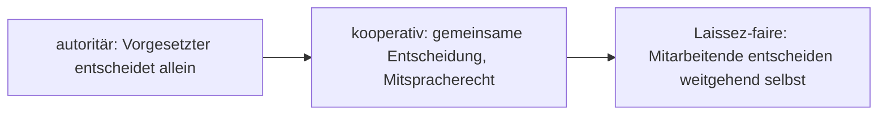

# Führungsstile im Überblick

> [!summary] Kurz & knapp
> Ein **Führungsstil** beschreibt, wie Vorgesetzte mit Mitarbeitenden umgehen – vor allem, **wie stark Mitarbeitende an Entscheidungen beteiligt werden**. Im Unterricht behandelt: **autoritär, kooperativ, Laissez-faire** sowie das Führungskonzept **Management by Objectives**.

## Einordnung nach Entscheidungsspielraum

## Vergleich

| | [[Autoritärer Führungsstil\|Autoritär]] | [[Kooperativer Führungsstil\|Kooperativ]] | [[Laissez-faire-Führungsstil\|Laissez-faire]] | [[Management by Objectives\|MbO]] |
|---|---|---|---|---|
| Entscheidung | Führungskraft allein | gemeinsam, Mitbestimmung | Mitarbeitende selbst | Ziele gemeinsam vereinbart, Weg frei |
| Kommunikation | von oben nach unten, Befehl und Kontrolle | offen, Feedback in beide Richtungen | kaum Vorgaben, Führung berät nur | Zielvereinbarungs- und Kontrollgespräche |
| Motivation | eher gering | hoch (Wertschätzung) | hoch bei Selbstständigen, Überforderung bei Unerfahrenen | hoch durch Identifikation mit eigenen Zielen |
| Vorteil | schnelle Entscheidungen, klare Regeln | Teamwork, Produktivität, weniger Fehlentscheidungen | Kreativität, Eigenverantwortung | Ergebnisorientierung, Eigenverantwortung |
| Nachteil | Demotivation, keine Eigeninitiative, Distanz | langsamer, unklarere Ansagen | fehlende Struktur und Orientierung | Leistungsdruck, nur Zielerreichung zählt |
| Geeignet für | Krisen, Routine, unerfahrene Teams | qualifizierte Teams, moderne Unternehmen | Experten, kreative Teams | messbare Aufgaben (Vertrieb, Projekte) |

> [!tip] Merke
> - Je weiter nach rechts (autoritär → Laissez-faire), desto **mehr Entscheidungsspielraum** für Mitarbeitende.
> - Es gibt **nicht den einen besten Stil** – er hängt von Situation, Aufgabe und Reife der Mitarbeitenden ab (situative Führung).
> - MbO ist ein **Führungskonzept** (Management-by-Technik), das gut mit dem kooperativen Stil zusammenpasst.

## Lernfragen
> [!question]- Was unterscheidet die Führungsstile grundsätzlich?
> Der Grad der Beteiligung der Mitarbeitenden an Entscheidungen bzw. die Verteilung der Entscheidungsbefugnis zwischen Führung und Mitarbeitenden.

> [!question]- Welcher Führungsstil ist in einer Notfallsituation sinnvoll und warum?
> Der autoritäre Stil, weil schnelle, eindeutige Entscheidungen nötig sind.

> [!question]- Ordne die Stile nach zunehmendem Entscheidungsspielraum der Mitarbeitenden.
> Autoritär → kooperativ → Laissez-faire.

> [!question]- Gibt es einen „besten“ Führungsstil?
> Nein; welcher Stil passt, hängt von der Situation, der Aufgabe und der Erfahrung/Motivation der Mitarbeitenden ab.

## Siehe auch
- [[Autoritärer Führungsstil]]
- [[Kooperativer Führungsstil]]
- [[Laissez-faire-Führungsstil]]
- [[Management by Objectives]]
- [[Übung Führungsstile Gruppenarbeit]]
