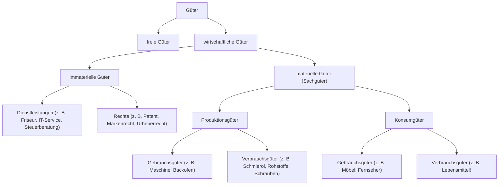

# Güterarten

> [!summary] Kurz & knapp
> Güter sind Mittel, die Bedürfnisse befriedigen und dadurch Nutzen stiften. Man unterscheidet **freie** und **wirtschaftliche** Güter; wirtschaftliche Güter teilt man weiter in materielle (Sachgüter) und immaterielle Güter (Dienstleistungen, Rechte) ein.

## Freie und wirtschaftliche Güter

| | Freie Güter | Wirtschaftliche Güter |
|---|---|---|
| Verfügbarkeit | in unbegrenztem Maße vorhanden | **knapp** – nicht zu jeder Zeit und an jedem Ort ausreichend vorhanden |
| Kosten / Preis | keine Herstellungskosten, kein Preis | Herstellung verursacht Kosten → haben einen **Preis** |
| Marktgeschehen | kein Gegenstand des Wirtschaftens | werden am **Markt gehandelt** |
| Beispiele | Luft, Wasser im Meer, Sonnenlicht | Holz, Fernseher, Haarschnitt, Patent |

Hinweis: Auch bei „freien“ Gütern kann man streiten, ob z. B. *saubere* Luft wegen Umweltverschmutzung wirklich unbegrenzt vorhanden ist.

## Gliederung der wirtschaftlichen Güter

- **Produktionsgüter**: werden von Unternehmen zur Herstellung weiterer Produktions- oder Konsumgüter eingesetzt.
- **Konsumgüter**: werden von privaten Haushalten (Endverbrauchern) zur Bedürfnisbefriedigung genutzt.
- **Gebrauchsgüter**: können mehrfach/längere Zeit genutzt werden (Backofen in der Bäckerei).
- **Verbrauchsgüter**: werden bei der Nutzung aufgebraucht (Schmieröl für eine Maschine).

> [!info] Je nach Verwendung
> Ob ein Gut Produktions- oder Konsumgut ist, hängt vom **Verwender** ab: Ein Notebook im Büro ist ein Produktionsgut, dasselbe Notebook zu Hause ein Konsumgut.

> [!tip] Merke
> - Wirtschaftliche Güter = **knapp + kosten etwas + haben einen Preis**.
> - Die Einteilung **Gebrauchs-/Verbrauchsgut** gilt nur für **materielle** Güter – nicht für Dienstleistungen oder Rechte.
> - Produktions- vs. Konsumgut entscheidet der **Verwendungszweck**, nicht das Gut selbst.

## Lernfragen
> [!question]- Nenne zwei Merkmale, in denen sich wirtschaftliche von freien Gütern unterscheiden.
> Wirtschaftliche Güter sind knapp (nicht überall/jederzeit verfügbar) und ihre Herstellung verursacht Kosten, daher haben sie einen Preis und werden am Markt gehandelt. Freie Güter sind unbegrenzt vorhanden und kostenlos.

> [!question]- Welche zwei Arten immaterieller Güter gibt es? Nenne je ein Beispiel.
> Dienstleistungen (z. B. IT-Support, Haarschnitt) und Rechte (z. B. Patente, Lizenzen, Markenrechte).

> [!question]- Worin unterscheiden sich Produktions- und Konsumgüter?
> Produktionsgüter setzen Unternehmen zur Herstellung weiterer Güter ein; Konsumgüter dienen privaten Haushalten zur direkten Bedürfnisbefriedigung.

> [!question]- Ordne „Server im Rechenzentrum eines IT-Dienstleisters“ ein.
> Wirtschaftliches, materielles Gut (Sachgut), Produktionsgut, Gebrauchsgut.

> [!question]- Ist eine Rechtsberatung ein Gebrauchsgut?
> Nein. Sie ist ein immaterielles Gut (Dienstleistung); die Einteilung in Gebrauchs- und Verbrauchsgüter gilt nur für materielle Güter.

## Siehe auch
- [[Übung Güterarten zuordnen]]
- [[Betriebsarten]]
