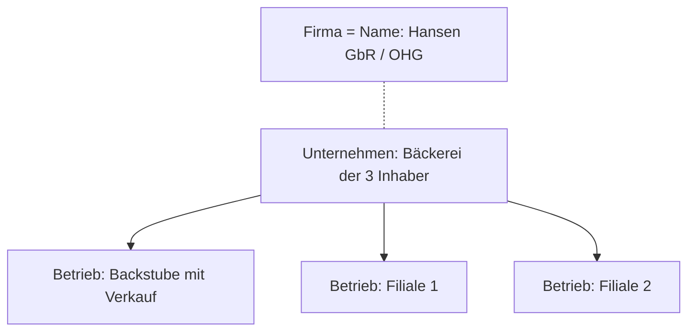

# Unternehmen, Betrieb und Firma

> [!summary] Kurz & knapp
> Das **Unternehmen** ist die rechtliche (und wirtschaftliche) Einheit, der **Betrieb** die örtliche, technisch-organisatorische Einheit, in der Güter oder Dienstleistungen erstellt werden, und die **Firma** ist der im Handelsregister eingetragene **Name** eines Kaufmanns.

## Gegenüberstellung

| Unternehmen | Betrieb |
|---|---|
| rechtliche Einheit, der ein oder mehrere Betriebe zugeordnet sind | selbstständige organisatorische Einheit |
| kann aus einer oder mehreren Personen (Eigentümern) bestehen | örtlich gebunden |
| verfolgt das Ziel der Gewinnmaximierung, trägt Verlustrisiko | stellt Güter her oder Dienstleistungen bereit, verfolgt einen wirtschaftlichen Zweck |
| muss nicht örtlich gebunden sein | ist rechtlich unselbstständig |
| agiert autonom (Staat macht keine Vorschriften, *was* produziert wird) | mehrere Betriebe können einem Unternehmen untergeordnet sein |
| muss Bücher führen und einen Jahresabschluss aufstellen | kann einen **Betriebsrat** haben |

- Mehrere Unternehmen können sich zu einem **Konzern** zusammenschließen.
- Mehrere Unternehmen können gemeinsam einen Betrieb führen → **Gemeinschaftsbetrieb**.

## Firma
Die **Firma** ist der Name, unter dem ein Kaufmann seine Geschäfte betreibt und unterschreibt (§ 17 HGB). Sie wird im **Handelsregister** eingetragen und enthält einen **Rechtsformzusatz** (z. B. e. K., OHG, KG, GmbH, AG).

Beispiel: Herr Gruber führt ein Unternehmen mit einer Betriebsstätte im Industriegebiet, dort werden Holzautos gefertigt. Seine Firma lautet „Kinderspielzeug Gruber“.

## Beispiel Bäckerei Hansen

> [!tip] Merke
> - **Unternehmen** = rechtlich-wirtschaftliche Einheit („Wer?“) · **Betrieb** = Ort der Leistungserstellung („Wo?“) · **Firma** = Name („Wie heißt es?“).
> - Im Alltag werden die Begriffe oft gleich verwendet, im **Arbeitsrecht** (z. B. Betriebsrat) ist die Unterscheidung wichtig.
> - Eine Firma im Rechtssinn haben nur **Kaufleute** (Eintrag im Handelsregister).

## Lernfragen
> [!question]- Grenze Unternehmen und Betrieb voneinander ab.
> Das Unternehmen ist die rechtliche Einheit (Eigentümer, Gewinnerzielung, Haftung, Buchführung). Der Betrieb ist die örtliche, organisatorische Einheit, in der produziert bzw. geleistet wird; er ist rechtlich unselbstständig und kann einem Unternehmen untergeordnet sein.

> [!question]- Was versteht man unter der Firma?
> Den im Handelsregister eingetragenen Namen eines Kaufmanns, unter dem er Geschäfte betreibt, klagt und verklagt werden kann.

> [!question]- Ein Unternehmen hat drei Standorte. Wie viele Unternehmen und wie viele Betriebe liegen vor?
> Ein Unternehmen mit drei Betrieben (Betriebsstätten).

> [!question]- Was ist ein Konzern?
> Ein Zusammenschluss mehrerer rechtlich selbstständiger Unternehmen unter einheitlicher Leitung.

## Siehe auch
- [[Übung Unternehmen, Betrieb und Firma - Bäckerei Hansen]]
- [[Betriebsarten]]
- [[Kriterien der Rechtsformwahl]]
