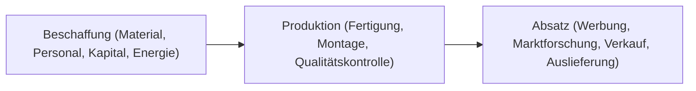

# Ablauforganisation

> [!summary] Kurz & knapp
> Die **Ablauforganisation** regelt die **Arbeitsprozesse**: Sie beantwortet die Frage „**Wer macht was, wann, wo, womit und in welcher Reihenfolge?**“ – vom ersten Arbeitsschritt bis zur Auslieferung an den Kunden.

## Inhalt
- Beginnt mit dem ersten Arbeitsschritt zur Herstellung eines Produkts und endet mit der Auslieferung an den Kunden. Dazwischen: Produktionsschritte, Montage, Qualitätsprüfung, Verpackung, Versand.
- Jeder Arbeitsschritt wird **terminiert**; es ist transparent, in welcher **Reihenfolge** Aufgaben erledigt werden und welche **parallel** laufen.
- Die Schritte leisten Mitarbeitende, deren Stellen und Verantwortlichkeiten in der [[Aufbauorganisation]] festgelegt sind.

## Ziele der Ablauforganisation

| Ziel | Erklärung |
|---|---|
| **Optimale Durchlaufzeit** | reibungsloser Ablauf; Engpässe, Stauungen und Leerläufe vermeiden |
| **Optimale Auslastung** | Betriebsmittel und Arbeitskräfte gut auslasten |
| **Qualitätssicherung** | Güte der Arbeit durch Kontrollen überwachen |
| **Terminsicherung** | Terminpläne aufstellen und ihre Einhaltung überwachen |
| **Optimaler Informationsfluss** | Informationen schnell und präzise an die zuständigen Stellen |

## Betriebliche Grundfunktionen eines Produktionsbetriebs

| Vorgang | Funktion |
|---|---|
| Rohstoffe werden bestellt | Beschaffung |
| Ein Facharbeiter wird eingestellt | Beschaffung (Personal) |
| Aufnahme eines Bankkredits | Beschaffung (Kapital/Finanzierung) |
| Die Stromrechnung wird bezahlt | Beschaffung (Energie) |
| Neuprogrammierung eines Fertigungsautomaten | Produktion |
| Ein Facharbeiter montiert Teile | Produktion |
| Ein Bandmeister prüft die Qualität | Produktion |
| Belieferung eines Kunden mit Waren | Absatz |
| Werbeanzeigen in der Tageszeitung | Absatz |
| Marktforschungsinstitut ermittelt Trends | Absatz |

> [!tip] Merke
> - Ablauforganisation = **Prozesse** (zeitlich, räumlich) · Aufbauorganisation = **Struktur**.
> - W-Fragen: **wer, was, wann, wo, womit, in welcher Reihenfolge**.
> - Fünf Ziele: **Durchlaufzeit, Auslastung, Qualität, Termine, Information**.

## Lernfragen
> [!question]- Welche Frage beantwortet die Ablauforganisation?
> Wer macht was, wann, wo, womit und in welcher Reihenfolge?

> [!question]- Nenne die fünf Ziele der Ablauforganisation.
> Optimale Durchlaufzeit, optimale Auslastung, Qualitätssicherung, Terminsicherung, optimaler Informationsfluss.

> [!question]- Ordne „Aufnahme eines Bankkredits“ einer betrieblichen Grundfunktion zu.
> Beschaffung (Kapitalbeschaffung/Finanzierung).

> [!question]- Wie hängen Aufbau- und Ablauforganisation zusammen?
> Die Ablauforganisation legt die Prozesse fest; ausgeführt werden sie von den Stellen, die die Aufbauorganisation definiert.

## Siehe auch
- [[Aufbauorganisation]]
- [[Wertschöpfungskette]]
- [[Wertschöpfung berechnen]]
- [[Übung Ablauforganisation und Wertschöpfung]]
