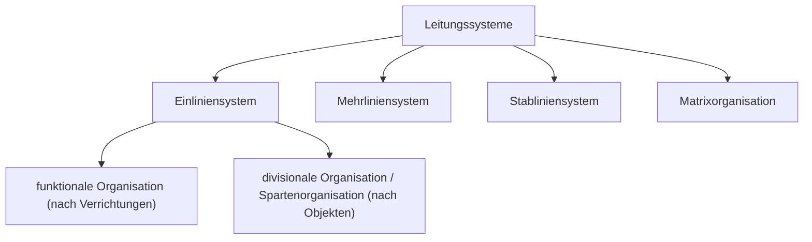

# Aufbauorganisation

> [!summary] Kurz & knapp
> Die **Aufbauorganisation** legt die **Struktur** eines Unternehmens fest: Welche **Stellen** und **Abteilungen** gibt es, wer ist wem **weisungsbefugt** und über welche Wege laufen Anweisungen und Informationen? Dargestellt wird sie im **Organigramm**. Je nach Weisungsweg unterscheidet man verschiedene **Leitungssysteme**.

## Grundbegriffe

| Begriff | Bedeutung |
|---|---|
| **Stelle** | kleinste organisatorische Einheit; Aufgabenbereich einer Person |
| **Instanz** | Stelle mit Leitungs- und Weisungsbefugnis (z. B. Abteilungsleitung) |
| **Abteilung** | Zusammenfassung mehrerer Stellen unter einer Instanz |
| **Stabsstelle** | beratende Stelle ohne Weisungsbefugnis |
| **Organigramm** | grafische Darstellung der Aufbauorganisation (Hierarchie, Weisungswege) |
| **Weisungsbefugnis** | Recht, anderen Stellen Anweisungen zu erteilen |

## Leitungssysteme (Organisationsformen)

| Form | Prinzip | Kernvorteil | Kernnachteil |
|---|---|---|---|
| [[Einliniensystem und funktionale Organisation\|Einliniensystem]] | jeder hat genau **einen** Vorgesetzten | klare Zuständigkeiten | lange Dienstwege, Überlastung der Leitung |
| [[Spartenorganisation\|Divisional/Sparten]] | 2. Ebene nach **Produkten/Regionen** | Kunden-/Produktnähe, schnelle Entscheidungen | Doppelarbeit, hohe Kosten |
| [[Mehrliniensystem]] | **mehrere** Fachvorgesetzte | Fachkompetenz, kurze Wege | Kompetenzkonflikte |
| [[Stabliniensystem]] | Einlinie + beratende **Stäbe** | Entlastung der Leitung durch Experten | Konflikte Linie ↔ Stab, Kosten |
| [[Matrixorganisation]] | **zwei Dimensionen** (Funktion × Produkt) | interdisziplinär, flexibel | Abstimmungsaufwand, Konflikte |

## Abgrenzung zur Ablauforganisation
- **Aufbauorganisation** = Struktur: *Wer* ist zuständig, wer ist wem unterstellt?
- **[[Ablauforganisation]]** = Prozesse: *Was* wird *wann, wo, womit, in welcher Reihenfolge* erledigt?

> [!tip] Merke
> - Klausur: Für jede Aufbauorganisation **Name, Beschreibung, Vor- und Nachteile** kennen!
> - Bei funktional vs. divisional entscheidet die **zweite Hierarchieebene** über den Namen: Funktionen (Einkauf, Verkauf …) → funktional; Produkte/Sparten → divisional.
> - Stab = berät, **ohne** Weisungsbefugnis.

## Lernfragen
> [!question]- Was regelt die Aufbauorganisation?
> Die Gliederung des Unternehmens in Stellen und Abteilungen sowie die Weisungs- und Kommunikationsbeziehungen (Hierarchie).

> [!question]- Was ist der Unterschied zwischen Stelle und Instanz?
> Eine Stelle ist der Aufgabenbereich einer Person; eine Instanz ist eine Stelle mit Leitungs- und Weisungsbefugnis.

> [!question]- Nenne vier Leitungssysteme.
> Einliniensystem (funktional/divisional), Mehrliniensystem, Stabliniensystem, Matrixorganisation.

> [!question]- Wie unterscheiden sich Aufbau- und Ablauforganisation?
> Die Aufbauorganisation regelt die Struktur (Stellen, Hierarchie), die Ablauforganisation die zeitliche und räumliche Abfolge der Arbeitsprozesse.

## Siehe auch
- [[Übung Aufbauorganisation Elektro GmbH]]
- [[Ablauforganisation]]
- [[Führungsstile im Überblick]]
