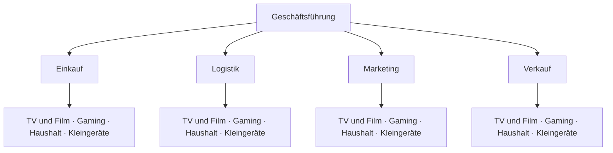

# Einliniensystem und funktionale Organisation

> [!summary] Kurz & knapp
> Im **Einliniensystem** hat jede Stelle **genau einen** direkten Vorgesetzten; Anweisungen und Berichte laufen streng vertikal über den Dienstweg. Bei der **funktionalen Organisation** wird die zweite Hierarchieebene nach **Funktionen** (Einkauf, Logistik, Marketing, Verkauf) gegliedert.

## Einliniensystem
- Grundform der hierarchischen Aufbauorganisation: Untergeordnete Stellen erhalten Weisungen **nur von einer** übergeordneten Instanz.
- Kommunikationswege verlaufen **vertikal**; Informations-, Delegations- und Berichtswege sind klar strukturiert.
- Typisch für stark hierarchische Unternehmen, aber auch für neu gegründete Start-ups, kleine und mittlere Unternehmen, die öffentliche Verwaltung und Organisationen mit Kommandostrukturen (Militär, Polizei, Feuerwehr).
- Formen: **funktionale** und **divisionale** Organisation ([[Spartenorganisation]]).

## Funktionale Organisation – Beispiel Elektro GmbH

Unter der Geschäftsführung liegen die **Funktionsbereiche**; erst darunter wird nach Produktbereichen gegliedert (viermal „TV und Film“, viermal „Gaming“ usw.).

## Vor- und Nachteile

| Vorteile | Nachteile |
|---|---|
| einfache, übersichtliche Struktur | **lange Kommunikations- und Weisungswege** |
| eindeutige Zuständigkeiten, klare Kompetenzabgrenzung, keine Überschneidungen | Zwischeninstanzen werden unnötig belastet |
| klare Kommunikations- und Weisungswege | **Überlastung** der Leitung (viele Kontrollaufgaben, hohe Verantwortung) |
| Spezialisierung in den Funktionsbereichen | starre Hierarchie → **wenig flexibel** |

> [!tip] Merke
> - Einlinie = **ein Chef pro Stelle** („Dienstweg“).
> - Funktional = 2. Ebene nach **Tätigkeiten/Verrichtungen** (Einkauf, Produktion, Verkauf …).
> - Gut für kleine Unternehmen, schlecht bei schnellen Entscheidungen.

## Lernfragen
> [!question]- Beschreibe das Einliniensystem.
> Jede Stelle hat genau einen Vorgesetzten, von dem sie Anweisungen erhält; alle Wege laufen vertikal über die Hierarchie (Dienstweg).

> [!question]- Woran erkennt man eine funktionale Organisation im Organigramm?
> Die zweite Hierarchieebene unter der Geschäftsführung ist nach Funktionen gegliedert (z. B. Einkauf, Logistik, Marketing, Verkauf).

> [!question]- Nenne zwei Vor- und zwei Nachteile des Einliniensystems.
> Vorteile: klare Zuständigkeiten, übersichtliche Struktur. Nachteile: lange Dienstwege, Überlastung der Vorgesetzten/Inflexibilität.

> [!question]- Für welche Organisationen eignet sich das Einliniensystem besonders?
> Für kleine und mittlere Unternehmen, Start-ups, die öffentliche Verwaltung und Organisationen mit Kommandostrukturen (Militär, Polizei, Feuerwehr).

## Siehe auch
- [[Aufbauorganisation]]
- [[Spartenorganisation]]
- [[Stabliniensystem]]
- [[Übung Aufbauorganisation Elektro GmbH]]
