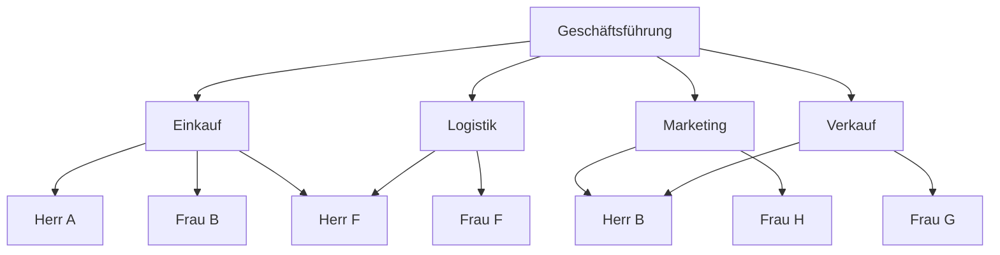

# Mehrliniensystem

> [!summary] Kurz & knapp
> Im **Mehrliniensystem** hat eine Stelle **mehrere Vorgesetzte**, die jeweils für ihr **Fachgebiet** weisungsbefugt sind. Es folgt dem Prinzip der **Mehrfachunterstellung** und der **kürzesten Wege** (Grundidee: Funktionsmeistersystem nach F. W. Taylor).

## Prinzip
- Spezialisierte Vorgesetzte delegieren Aufgaben auch über ihren eigenen Bereich hinaus.
- Eine übergeordnete Instanz ist gegenüber **mehreren** untergeordneten Stellen weisungsbefugt – und eine Stelle erhält Weisungen von **mehreren** Instanzen.
- Anweisungen gehen **direkt** an die ausführende Stelle, ohne lange Hierarchiekette.

**Beispiel Elektro GmbH:** Abteilungen Einkauf, Logistik, Marketing, Verkauf. Erkenntnisse des Marketings fließen direkt in den Verkauf; der Verkaufsleiter kann direkte Anweisungen an Marketing geben (verkaufsfördernde Maßnahmen); der Einkaufsleiter hat Weisungsbefugnis gegenüber der Logistik (Verfügbarkeit der Ware).

(Vereinfachte Darstellung – einzelne Mitarbeitende sind mehreren Abteilungsleitungen unterstellt.) Original-Organigramm: ![[LF1-LF2-Rossian.pdf#page=52]]

## Vor- und Nachteile

| Vorteile | Nachteile |
|---|---|
| **Fachkompetenz**: autoritäre Fachkompetenz verteilt die Aufgaben → höhere Akzeptanz | **Kompetenzüberschneidungen** und erhöhtes **Konfliktpotenzial** |
| **kurze Kommunikationswege**, Zeitersparnis bei Problemen | Mitarbeitende wissen evtl. nicht, wessen Weisung Vorrang hat |
| Entlastung der höheren Führungskräfte | Zuständigkeiten und Verantwortung schwer abgrenzbar |
| Probleme werden besser gelöst, da mehrere Abteilungen beteiligt sind; bessere Kontrollmöglichkeiten | Fehler lassen sich schwer zuordnen und zurückverfolgen |

> [!tip] Merke
> - Mehrlinie = **mehrere Chefs**, jeder für sein Fach.
> - Pro: **Fachwissen + kurze Wege** · Contra: **Kompetenzkonflikte**.

## Lernfragen
> [!question]- Beschreibe das Mehrliniensystem.
> Eine Stelle ist mehreren fachlich spezialisierten Vorgesetzten unterstellt, die ihr jeweils für ihr Fachgebiet Weisungen erteilen dürfen.

> [!question]- Welches Hauptproblem hat das Mehrliniensystem?
> Kompetenzüberschneidungen: Weisungen verschiedener Vorgesetzter können sich widersprechen; Verantwortung ist schwer zuzuordnen.

> [!question]- Nenne zwei Vorteile gegenüber dem Einliniensystem.
> Kürzere Kommunikationswege und Nutzung der Fachkompetenz spezialisierter Vorgesetzter.

## Siehe auch
- [[Einliniensystem und funktionale Organisation]]
- [[Matrixorganisation]]
- [[Aufbauorganisation]]
