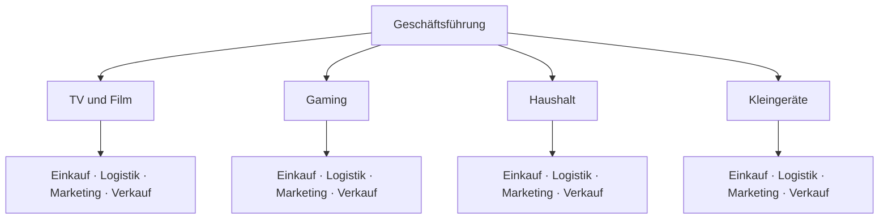

# Spartenorganisation

> [!summary] Kurz & knapp
> Die **Divisional- oder Spartenorganisation** ist eine Form des Einliniensystems, bei der die zweite Hierarchieebene nach **Objekten** – also **Produktbereichen (Sparten)**, Regionen oder Kundengruppen – gegliedert ist. Jede Sparte hat darunter ihre eigenen Funktionsbereiche.

## Beispiel Elektro GmbH

Direkt unter der Geschäftsführung stehen die **Sparten**; erst darunter folgen jeweils (viermal) Einkauf, Logistik, Marketing und Verkauf. Sparten arbeiten oft wie eigenständige Unternehmen (**Profit-Center**).

## Vor- und Nachteile

| Vorteile | Nachteile |
|---|---|
| hohe **Kunden- und Produktorientierung** | **Doppelarbeit** – jede Sparte hat eigene Abteilungen |
| **schnellere Entscheidungen** innerhalb der Sparte | hohe finanzielle Belastung, **hohe Personalkosten** |
| **Entlastung der Geschäftsleitung** | jede Sparte hat ein eigenständiges Gremium → Abstimmungsprobleme, Missverständnisse |
| Unabhängigkeit der Sparten, klare Verantwortlichkeiten (Erfolg je Sparte messbar) | unterschiedliche Arbeitsergebnisse/Standards zwischen den Sparten |
| geringeres Arbeitsvolumen je Bereich, überschaubare Einheiten | wenig Absprachemöglichkeiten, **Konkurrenz zwischen den Sparten**, erschwerte Gesamtkontrolle |

> [!tip] Merke
> - Divisional = 2. Ebene nach **Objekten** (Produkte, Regionen, Kunden).
> - Funktional ↔ divisional: Man vergleicht **nur die zweite Ebene**.
> - Typisch für große Unternehmen mit sehr unterschiedlichen Produktgruppen.

## Lernfragen
> [!question]- Woran erkennt man eine Spartenorganisation im Organigramm?
> Unter der Geschäftsführung stehen Produktbereiche, Regionen oder Kundengruppen; die Funktionen (Einkauf, Verkauf …) folgen erst eine Ebene darunter.

> [!question]- Nenne drei Vorteile der Spartenorganisation.
> Hohe Kunden-/Produktorientierung, schnellere Entscheidungen, Entlastung der Geschäftsleitung (auch: klare Erfolgsverantwortung je Sparte).

> [!question]- Warum verursacht die Spartenorganisation hohe Kosten?
> Weil Funktionen wie Einkauf oder Marketing in jeder Sparte doppelt vorhanden sind (Doppelarbeit, mehr Personal).

> [!question]- Wann ist eine Spartenorganisation sinnvoll?
> Bei großen Unternehmen mit mehreren sehr unterschiedlichen Produktgruppen oder Märkten.

## Siehe auch
- [[Einliniensystem und funktionale Organisation]]
- [[Matrixorganisation]]
- [[Aufbauorganisation]]
- [[Übung Aufbauorganisation Elektro GmbH]]
