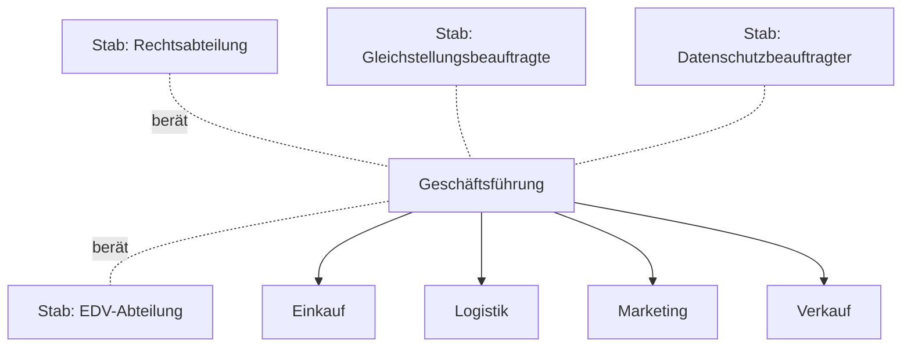

# Stabliniensystem

> [!summary] Kurz & knapp
> Das **Stabliniensystem** ist ein **Einliniensystem, das um Stabsstellen erweitert** ist. Stabsstellen **beraten** und unterstützen die Linieninstanzen (v. a. die Leitung) mit Expertenwissen, haben aber **keine Weisungsbefugnis**.

## Beispiel Elektro GmbH

## Aufgaben der Stabsstellen
- Vorbereitung von Entscheidungen: Beschaffung, Verarbeitung und Weitergabe von Informationen für die Führungsinstanz
- planerische, beratende oder kontrollierende Aufgaben
- Typische Stabsstellen: EDV-Abteilung, Rechtsabteilung, Datenschutzbeauftragter, interne Revision, Gleichstellungsbeauftragte, Fachkraft für Arbeitssicherheit, Betriebsarzt

Laut Konzept haben Stäbe keine Weisungsbefugnis. In der Praxis verfügen hoch spezialisierte Stäbe aber oft über eine **indirekte Entscheidungskompetenz** („**Expertenmacht**“): Die eigentlichen Entscheider übernehmen häufig die Vorschläge der Stäbe. Auch bei Polizei und Militär wird das Stabliniensystem eingesetzt.

## Vor- und Nachteile

| Vorteile | Nachteile |
|---|---|
| **Entlastung** der Linieninstanzen/Führung | **Konflikte** zwischen Linie und Stab |
| Nutzung von **Expertenwissen** → bessere Entscheidungen | Transparenz geht verloren, Gefahr der **Entscheidungsmanipulation** durch Stäbe („Expertenmacht“) |
| Ausgleich zwischen kurzfristigem Denken der Abteilungen und langfristigem Blick der Stäbe | Stäbe sind **teuer** |
| klare Linienstruktur bleibt erhalten | überdimensionierte Stäbe verlangsamen Entscheidungen; Demotivation, wenn Vorschläge nicht umgesetzt werden |

> [!tip] Merke
> - Stab = **Berater ohne Weisungsrecht** (Ausnahme in der Praxis: Expertenmacht).
> - Stablinie = Einlinie **+** Stäbe.
> - Für IT-Azubis wichtig: EDV und Datenschutzbeauftragter sind oft Stabsstellen.

## Lernfragen
> [!question]- Was ist eine Stabsstelle?
> Eine beratende, unterstützende Stelle (meist der Leitung zugeordnet) ohne Weisungsbefugnis gegenüber der Linie.

> [!question]- Nenne vier typische Stabsstellen.
> EDV-Abteilung, Rechtsabteilung, Datenschutzbeauftragter, interne Revision (auch: Gleichstellungsbeauftragte, Betriebsarzt, Fachkraft für Arbeitssicherheit).

> [!question]- Was versteht man unter „Expertenmacht“?
> Stäbe haben formal keine Weisungsbefugnis, beeinflussen durch ihr Spezialwissen aber faktisch die Entscheidungen, weil die Leitung ihre Vorschläge meist übernimmt.

> [!question]- Nenne zwei Nachteile des Stabliniensystems.
> Konflikte zwischen Linie und Stab, hohe Kosten (auch: Intransparenz, langsamere Entscheidungen).

## Siehe auch
- [[Einliniensystem und funktionale Organisation]]
- [[Aufbauorganisation]]
- [[Übung Aufbauorganisation Elektro GmbH]]
