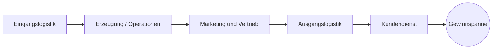

# Wertschöpfungskette

> [!summary] Kurz & knapp
> In der **Wertschöpfungskette** nach **Michael E. Porter (1985)** werden alle Tätigkeiten eines Unternehmens in ihrer Reihenfolge dargestellt und in **Primäraktivitäten** (direkt an der Leistungserstellung beteiligt) und **unterstützende Aktivitäten** (Voraussetzung dafür) eingeteilt. Die **Gewinnspanne** ist der geschaffene Mehrwert.

## Modell nach Porter

| Unterstützende Aktivitäten (über alle Primäraktivitäten) |
|---|
| Unternehmensinfrastruktur |
| Personalwirtschaft |
| Technologieentwicklung |
| Beschaffung |

Original-Grafik: ![[LF1-LF2-Rossian.pdf#page=67]]

## Begriffe
- **Primäraktivitäten**: hängen direkt mit der Erstellung des Produkts/der Dienstleistung zusammen (Eingangslogistik, Erzeugung, Marketing/Vertrieb, Ausgangslogistik, Kundendienst).
- **Unterstützende Aktivitäten**: schaffen die Voraussetzungen für die Primäraktivitäten (Infrastruktur, Personal, Technologie, Beschaffung).
- **Gewinnspanne (Marge)**: der Mehrwert, der während der Produktion entsteht.

## Wozu?
Tätigkeiten werden in Einzelbestandteile zerlegt, um die **Effizienz der Prozesse** und die **Wettbewerbsfähigkeit** zu erhöhen. Ein Diagramm ermöglicht die Gesamtanalyse und den Vergleich einzelner Bereiche: Wo entsteht viel Wert, wo entstehen nur Kosten?

**Besonders wertschöpfungsintensiv** sind Tätigkeiten, die direkt mit der **Leistungserstellung** zu tun haben, möglichst **kundennah** sind und zu den **Kernkompetenzen** des Unternehmens gehören.

> [!tip] Merke
> - Porter: **5 Primär- + 4 unterstützende Aktivitäten → Gewinnspanne**.
> - Eselsbrücke Primär: „**E**in **E**sel **M**acht **A**uch **K**affee“ (Eingangslogistik, Erzeugung, Marketing/Vertrieb, Ausgangslogistik, Kundendienst).
> - Beispiel IT-Dienstleister: Kundendienst (Support) ist eine Primäraktivität; die interne IT-Infrastruktur ist eine unterstützende Aktivität.

## Lernfragen
> [!question]- Wer hat das Modell der Wertschöpfungskette entwickelt?
> Der US-Ökonom Michael E. Porter (1985).

> [!question]- Was unterscheidet Primäraktivitäten von unterstützenden Aktivitäten?
> Primäraktivitäten tragen direkt zur Erstellung und zum Absatz des Produkts bei; unterstützende Aktivitäten schaffen die Voraussetzungen dafür.

> [!question]- Nenne die fünf Primäraktivitäten.
> Eingangslogistik, Erzeugung (Operationen), Marketing und Vertrieb, Ausgangslogistik, Kundendienst.

> [!question]- Welche Tätigkeiten sind besonders wertschöpfungsintensiv?
> Tätigkeiten, die direkt mit der Leistungserstellung zu tun haben, kundennah sind und zu den Kernkompetenzen gehören.

## Siehe auch
- [[Wertschöpfung berechnen]]
- [[Ablauforganisation]]
- [[Übung Ablauforganisation und Wertschöpfung]]
