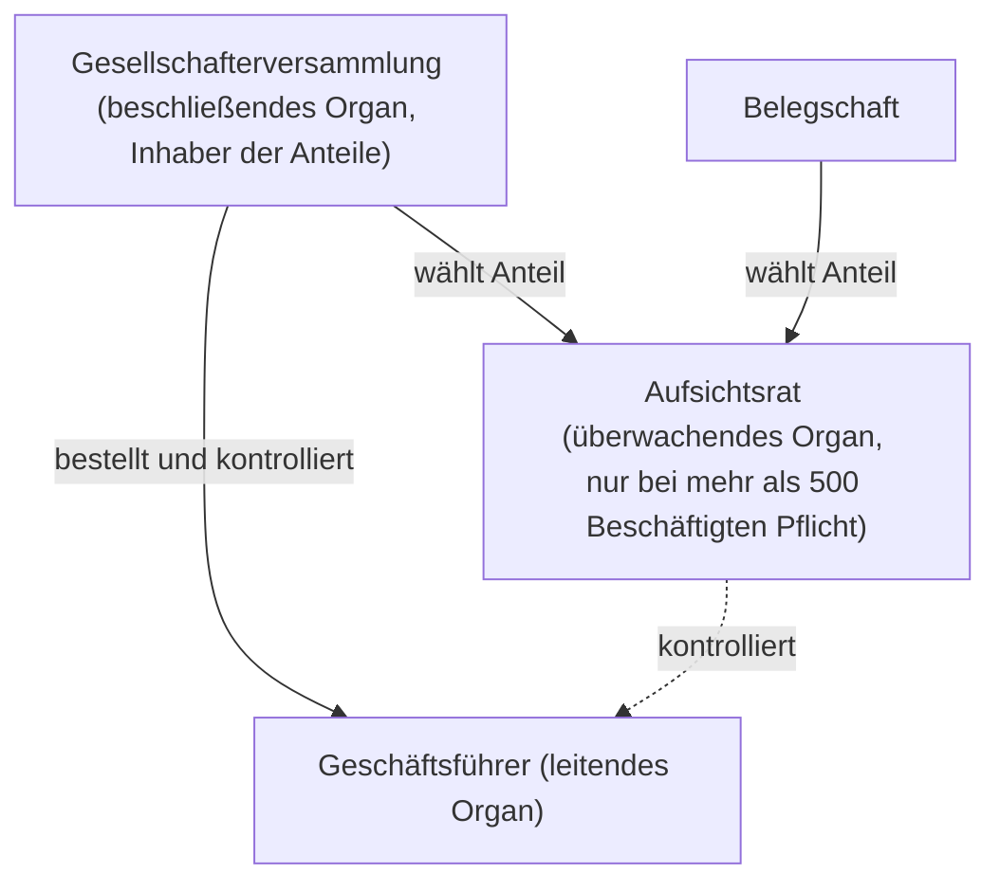

# Rechtsform GmbH

> [!summary] Kurz & knapp
> Die **Gesellschaft mit beschränkter Haftung (GmbH)** ist eine Kapitalgesellschaft und juristische Person. Sie haftet nur mit ihrem **Gesellschaftsvermögen**; die Gesellschafter riskieren nur ihre **Einlage**. Mindest-**Stammkapital: 25.000 €**. Nach der Einzelunternehmung ist sie die zweithäufigste Rechtsform in Deutschland.

## Steckbrief

| Kriterium | GmbH |
|---|---|
| Rechtsgrundlage | **GmbH-Gesetz** (GmbHG) |
| Gründer | mind. **1** Person (Ein-Personen-GmbH möglich) |
| Gründung | Gesellschaftsvertrag (Satzung) mit **notarieller Beurkundung**, **Eintragung ins Handelsregister** (erst dann entsteht die GmbH) |
| Mindestkapital | **Stammkapital 25.000 €**, setzt sich aus den **Stammeinlagen (Geschäftsanteilen)** der Gesellschafter zusammen; bei Gründung mind. die Hälfte (12.500 €) eingezahlt |
| Firma | Zusatz „Gesellschaft mit beschränkter Haftung“ oder **GmbH** |
| Geschäftsführung & Vertretung | **Geschäftsführer** (von der Gesellschafterversammlung bestellt; kann Gesellschafter oder externer Manager sein), an Weisungen der Gesellschafterversammlung gebunden |
| Gewinn / Verlust | Gewinnverteilung nach **Geschäftsanteilen** (laut Gesellschaftsvertrag); Verluste werden durch spätere Gewinne oder Rücklagen gedeckt |
| Haftung | die GmbH mit ihrem **Gesellschaftsvermögen**; Gesellschafter haften **nicht persönlich** (Risiko = Verlust der Einlage) |
| Kapitalbeschaffung | Erhöhung der Einlagen, **Aufnahme neuer Gesellschafter**, Bankkredite (oft gegen private Sicherheiten der Gesellschafter) |
| Besteuerung | **Körperschaftsteuer** (15 % + Solidaritätszuschlag) und **Gewerbesteuer**; ausgeschüttete Gewinne versteuern die Gesellschafter zusätzlich (Kapitalertragsteuer/Abgeltungsteuer) |

## Organe der GmbH

- **Gesellschafterversammlung**: oberstes Organ; beschließt z. B., wer Geschäftsführer wird; jeder Gesellschafter hat ein Recht auf Gewinnanteile.
- **Geschäftsführer**: leitet die Gesellschaft und vertritt sie nach außen.
- **Aufsichtsrat**: erst ab **mehr als 500 Arbeitnehmern** Pflicht (gewählt durch Gesellschafter und Belegschaft).

## Vor- und Nachteile

| Vorteile | Nachteile |
|---|---|
| **beschränkte Haftung** – ideal für mittlere und kleine Betriebe | hohe **Gründungskosten** und Bürokratie (Notar, Handelsregister) |
| Geschäftsführung durch Fremdmanager möglich | **Mindestkapital** 25.000 € |
| Gesellschafter müssen nicht mitarbeiten | geringere Kreditwürdigkeit → Banken verlangen oft **private Sicherheiten** |
| klare Organstruktur | Buchführungs- und Publizitätspflichten (Jahresabschluss offenlegen) |

> [!info] Variante: UG (haftungsbeschränkt)
> Die „Mini-GmbH“ kann schon mit **1 €** Stammkapital gegründet werden, muss aber jährlich 25 % des Gewinns in eine Rücklage einstellen, bis 25.000 € erreicht sind.

> [!tip] Merke
> - **GmbH = 25.000 € Stammkapital, Notar, Handelsregister**.
> - Haftung: **GmbH** mit Gesellschaftsvermögen, **Gesellschafter** nur mit Einlage.
> - Organe: **Gesellschafterversammlung – Geschäftsführer – (Aufsichtsrat ab > 500 AN)**.
> - Eine GmbH ist **immer gewerbesteuerpflichtig** (kraft Rechtsform).

## Lernfragen
> [!question]- Wie heißt das Mindestkapital der GmbH und wie hoch ist es?
> Stammkapital, mindestens 25.000 €.

> [!question]- Wer haftet bei der GmbH?
> Die GmbH selbst mit ihrem Gesellschaftsvermögen; die Gesellschafter haften nicht persönlich, sie können nur ihre Einlage verlieren.

> [!question]- Nenne die Organe der GmbH und ihre Aufgaben.
> Gesellschafterversammlung (beschließt, bestellt Geschäftsführer), Geschäftsführer (leitet und vertritt), Aufsichtsrat (überwacht, Pflicht ab mehr als 500 Beschäftigten).

> [!question]- Warum wandeln viele OHGs in eine GmbH um?
> Wegen der Haftungsbeschränkung (kein Risiko für das Privatvermögen) und weil die Geschäftsführung auch extern besetzt werden kann.

> [!question]- Welche Steuern zahlt eine GmbH auf ihren Gewinn?
> Körperschaftsteuer (15 % + Soli) und Gewerbesteuer; die Gesellschafter zahlen auf Ausschüttungen Kapitalertragsteuer.

## Siehe auch
- [[Rechtsform AG]]
- [[Personengesellschaften und Kapitalgesellschaften]]
- [[Rechtsformen im Vergleich]]
- [[Übung Rechtsformen - Kapitalgesellschaften]]
