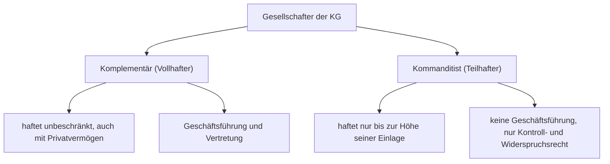

# Rechtsform KG

> [!summary] Kurz & knapp
> Die **Kommanditgesellschaft (KG)** ist eine Personengesellschaft mit zwei Arten von Gesellschaftern: mind. ein **Komplementär (Vollhafter)**, der unbeschränkt haftet und die Geschäfte führt, und mind. ein **Kommanditist (Teilhafter)**, der nur mit seiner Einlage haftet und von der Geschäftsführung ausgeschlossen ist.

## Gesellschafter der KG

## Steckbrief

| Kriterium | KG |
|---|---|
| Rechtsgrundlage | **HGB** (§§ 161 ff.) |
| Gründer | mind. **2** Personen: mind. 1 Komplementär + mind. 1 Kommanditist |
| Gründung | Gesellschaftsvertrag, **Eintragung ins Handelsregister** (inkl. Haftsumme der Kommanditisten) |
| Mindestkapital | keines |
| Firma | Zusatz „Kommanditgesellschaft“ oder **KG** (z. B. „Mutig Gips KG“); der Name des Kommanditisten muss nicht in der Firma stehen |
| Geschäftsführung & Vertretung | **Komplementär(e)**; Kommanditisten sind ausgeschlossen, haben aber ein **Kontrollrecht** (Einsicht in den Jahresabschluss) und ein **Widerspruchsrecht** bei außergewöhnlichen Geschäften |
| Gewinn / Verlust | laut Gesellschaftsvertrag; gesetzliche Regel siehe Korrektur unten |
| Haftung | Komplementär **unbeschränkt, gesamtschuldnerisch**; Kommanditist nur mit seiner **Einlage** |
| Kapitalbeschaffung | Einlagen der Gesellschafter, **Aufnahme weiterer Kommanditisten** (Kapitalgeber ohne Mitspracherecht), Bankkredite |

## Beispiel Mutig Gips KG
- **Daniel Mutig (Komplementär)**: risikobereit, entscheidet gern schnell und allein. Er brauchte für sein wachsendes Einzelunternehmen neues Kapital, wollte aber das alleinige Entscheidungsrecht behalten → haftet weiter mit seinem ganzen Privatvermögen.
- **Bernhard Sicher (Kommanditist)**: sicherheitsliebend, hat 50.000 € eingebracht, wollte nicht mit seinem Privatvermögen haften und braucht nicht mitzuführen; er hat Kontroll- und Widerspruchsrecht.
- Gewinn: je 4 % auf die Kapitaleinlage, der Rest nach Risikoanteilen (vertraglich vereinbart); Verluste in angemessenen Anteilen.

## Gewinnverteilung
**Klassische Regel (HGB bis 2023, so im Material):** 4 % auf die Kapitaleinlagen, der Rest in einem **angemessenen Verhältnis** (Komplementäre erhalten wegen Haftung und Arbeit meist mehr). Kommanditisten tragen Verluste nur bis zur Höhe ihrer Einlage.

> [!warning] Korrektur / Aktualisierung (MoPeG 2024)
> Die gesetzliche 4-%-Vorabverzinsung ist seit dem **01.01.2024** entfallen. Maßgeblich ist der **Gesellschaftsvertrag**; fehlt eine Regelung, wird nach den Beteiligungsverhältnissen bzw. in angemessenem Verhältnis verteilt. Die Tabelle im Unterricht („4 % Verzinsung der Einlagen, Rest im Verhältnis der Kapitaleinlagen“) entspricht der alten Rechtslage bzw. einer typischen Vertragsregelung.

## Wann ist eine KG sinnvoll?
- wenn **einige** Gesellschafter sich **nur mit Kapital** beteiligen wollen (ohne Haftung über die Einlage hinaus, ohne Geschäftsführung) und
- **andere** bereit sind, die **Geschäftsführung zu übernehmen und persönlich zu haften**.

Sonderform: **GmbH & Co. KG** – Komplementär ist eine GmbH, sodass im Ergebnis keine natürliche Person unbeschränkt haftet.

> [!tip] Merke
> - **Kompl**ementär = **kompl**ett haftend (Vollhafter) + Chef.
> - **Kommand**itist = gibt Geld, hat aber nichts zu **kommand**ieren (Teilhafter).
> - Durch neue Kommanditisten bekommt die KG Eigenkapital, **ohne** dass der Komplementär Entscheidungsmacht abgibt.

## Lernfragen
> [!question]- Worin unterscheiden sich Komplementär und Kommanditist?
> Komplementär: haftet unbeschränkt und führt die Geschäfte. Kommanditist: haftet nur mit seiner Einlage, ist von der Geschäftsführung ausgeschlossen, hat Kontroll- und Widerspruchsrecht.

> [!question]- Welche Rechte hat ein Kommanditist?
> Anspruch auf Gewinnanteil, Kontrollrecht (Einsicht in Jahresabschluss/Bücher), Widerspruchsrecht bei außergewöhnlichen Geschäften.

> [!question]- Wie kann eine KG ihre Haftungsmasse erhöhen?
> Vor allem durch Erhöhung der Einlagen der Kommanditisten bzw. Aufnahme neuer Kommanditisten oder Komplementäre (mehr haftendes Vermögen).

> [!question]- Für wen eignet sich eine KG?
> Für Gründer, von denen einige nur Kapital geben und ihr Risiko begrenzen wollen, während andere die Leitung übernehmen und voll haften.

> [!question]- Was ist eine GmbH & Co. KG?
> Eine KG, deren Komplementär eine GmbH ist; dadurch ist die Haftung im Ergebnis beschränkt.

## Siehe auch
- [[Rechtsform OHG]]
- [[Rechtsform GmbH]]
- [[Personengesellschaften und Kapitalgesellschaften]]
- [[Übung Rechtsformen - Personenunternehmen]]
