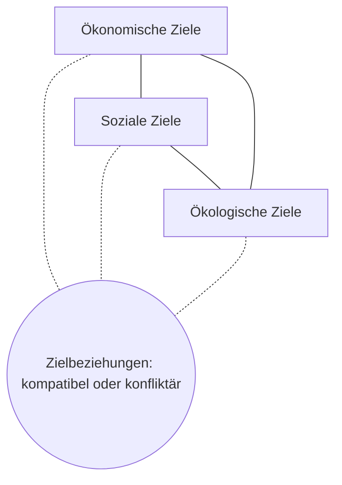

# Zieldreieck - ökonomische, ökologische und soziale Ziele

> [!summary] Kurz & knapp
> Jedes Unternehmen verfolgt Ziele. Man ordnet sie drei **Zieltypen** zu: **ökonomische**, **ökologische** und **soziale** Ziele. Zusammen bilden sie das **Zieldreieck**, mit dem man Unternehmen „verorten“ kann – je nachdem, welche Ziele im Vordergrund stehen.

## Die drei Zieltypen

| Zieltyp | Bedeutung | Beispiele |
|---|---|---|
| **Ökonomische Ziele** | klassische betriebswirtschaftliche Größen | Umsatz- oder Gewinnsteigerung, Vergrößerung des Marktanteils, Ausweitung des Geschäftsfelds (z. B. neue Produkte) |
| **Soziale Ziele** | Wohlergehen von Mitarbeitenden und Gesellschaft | Einhaltung bestehenden Rechts (**Compliance**), Übernahme regionaler Verantwortung (z. B. Unterstützung lokaler Vereine), Erhöhung der Mitarbeitergesundheit |
| **Ökologische Ziele** | Schonung natürlicher Ressourcen, rücksichtsvoller Umgang mit Tieren und Natur | energiesparende Produkte, Senkung von Schadstoffausstößen, Reduzierung von Verpackungsmüll |

## Wer bestimmt die Ziele?
Ziele entstehen durch **Aushandlung** zwischen verschiedenen Interessengruppen (**Stakeholdern**): Eigentümer, Management, Mitarbeitende, politische Akteure (Kommunen, Verbände), Geldgeber, Kunden. Deshalb ist die Zielbildung ein **dynamischer Prozess**.

## Beispiele aus dem Film „Unternehmen wagen – 3 Wege in die Selbstständigkeit“
- **manomama** (Sina Trinkwalder, Textilunternehmen Augsburg): stark **sozial** und **ökologisch** – Arbeit für Menschen, die auf dem Arbeitsmarkt schwer eine Chance haben, regionale und ökologische Produktion.
- **Vaude Sport** (Antje von Dewitz, Bergsportausrüster): Nachhaltigkeit und verantwortungsvolles Unternehmertum, aber auch wirtschaftliches Wachstum (Sortiment).
- **SofaConcerts** (Marie-Lene Armingeon, Start-up Hamburg): Skalierung auf ganz Europa → stärker **ökonomisch** geprägt.

> [!tip] Merke
> - Drei Zieltypen: **ökonomisch – ökologisch – sozial** (Eselsbrücke: „**Geld – Grün – Gemeinschaft**“).
> - Nachhaltiges Wirtschaften versucht, alle drei Ecken auszubalancieren.
> - Ziele werden von **Stakeholdern** ausgehandelt.

## Lernfragen
> [!question]- Nenne die drei Zieltypen und je ein Beispiel.
> Ökonomisch (Gewinnsteigerung), ökologisch (CO₂-Ausstoß senken), sozial (Mitarbeitergesundheit fördern).

> [!question]- Was ist Compliance und zu welchem Zieltyp gehört sie?
> Die Einhaltung von Gesetzen und Regeln; sie wird im Material den sozialen Zielen zugeordnet.

> [!question]- Wozu dient das Zieldreieck?
> Es dient zur Einordnung von Zielen und zur Verortung von Unternehmen danach, welche Zieltypen bei ihnen im Vordergrund stehen.

> [!question]- Warum ist die Zielbildung ein dynamischer Prozess?
> Weil verschiedene Interessengruppen (Eigentümer, Management, Mitarbeitende, Politik, Geldgeber) mitwirken und ihre Interessen immer wieder neu aushandeln.

## Siehe auch
- [[Zielbeziehungen]]
- [[Handlungsziele nach Zielbereichen]]
- [[SMART-Ziele]]
- [[Übung Ziele aus dem Film Unternehmen wagen]]
