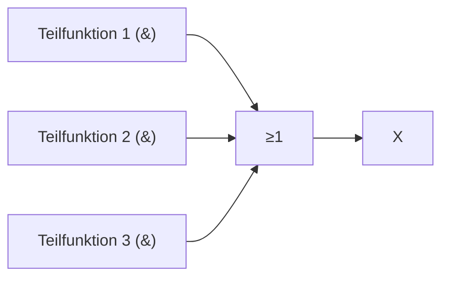

# Schaltfunktionen aus Wertetabelle und Zeitablaufdiagramm

> [!summary] Kurz & knapp
> Aus einer Wertetabelle bekommt man die Funktionsgleichung, indem man für **jede Zeile mit X = 1** eine **UND-Teilfunktion** bildet (Eingang 0 → negiert, Eingang 1 → normal) und alle Teilfunktionen mit **ODER** verknüpft (**disjunktive Normalform, DNF**). Ein Zeitablaufdiagramm ist nur eine andere Darstellung der Wertetabelle über die Zeit.

## Vorgehen: Wertetabelle → Funktionsgleichung
1. Alle Zeilen suchen, in denen **X = 1** ist.
2. Für jede dieser Zeilen eine **Teilfunktion** (Minterm) bilden:
   - Eingang = 1 → Variable normal ($A$)
   - Eingang = 0 → Variable negiert ($\overline{A}$)
   - alle Variablen mit **UND** verknüpfen
3. Alle Teilfunktionen mit **ODER** verknüpfen.
4. Wenn möglich vereinfachen: Zwei Teilfunktionen, die sich nur in **einer** Variable unterscheiden, kann man zusammenfassen, und diese Variable fällt weg ($A \land B \lor A \land \overline{B} = A$).

**Beispiel:**

| C | B | A | X |
| --- | --- | --- | --- |
| 0 | 1 | 1 | 1 |
| 1 | 0 | 1 | 1 |
| 1 | 1 | 1 | 1 |
| sonst | | | 0 |

Teilfunktionen: $\overline{C} \land B \land A$, $C \land \overline{B} \land A$, $C \land B \land A$
DNF: $X = (\overline{C} \land B \land A) \lor (C \land \overline{B} \land A) \lor (C \land B \land A)$
vereinfacht: $X = A \land (B \lor C)$

## Vorgehen: Schaltung → Wertetabelle
1. Zwischenausgänge (z. B. U, V, W) benennen und deren Teilfunktionen aufschreiben.
2. Wertetabelle mit allen $2^n$ Eingangskombinationen anlegen (binär hochzählen: 000, 001, 010, …).
3. Spalte für Spalte die Zwischenausgänge und zuletzt X ausrechnen.

## Vorgehen: Zeitablaufdiagramm → Wertetabelle
1. Das Diagramm an **jeder Signaländerung** in Abschnitte teilen (senkrechte Hilfslinien).
2. Für jeden Abschnitt die Eingangswerte (0/1) und den Ausgang X ablesen.
3. Gleiche Kombinationen nur einmal eintragen. Dann weiter wie bei der Wertetabelle.

## Funktionsplan zeichnen
Jede Teilfunktion wird ein **UND-Gatter** (negierte Eingänge mit Kreis). Alle UND-Ausgänge gehen in ein **ODER-Gatter**, dessen Ausgang X ist.

> [!tip] Merke
> - DNF: **Zeilen mit 1** → UND-Terme → mit ODER verbinden.
> - 0 in der Zeile = Variable **negiert**.
> - Unterscheiden sich zwei Terme nur in einer Variable → zusammenfassen.

## Lernfragen
> [!question]- Wie bildet man aus einer Wertetabelle die Funktionsgleichung?
> Für jede Zeile mit X = 1 eine UND-Teilfunktion bilden (0 → negiert, 1 → normal) und alle Teilfunktionen mit ODER verknüpfen.

> [!question]- Wie lautet die Teilfunktion für die Zeile D = 0, C = 1, B = 0, A = 1?
> $\overline{D} \land C \land \overline{B} \land A$

> [!question]- Vereinfache $(\overline{A} \land B) \lor (A \land B)$.
> $B$, weil A einmal negiert und einmal normal vorkommt und deshalb wegfällt.

> [!question]- Wie liest man aus einem Zeitablaufdiagramm die Wertetabelle ab?
> Das Diagramm an jeder Flanke in Abschnitte teilen und je Abschnitt die Pegel aller Eingänge und des Ausgangs ablesen.

## Siehe auch
- [[Logikgatter]]
- [[Übung - Schaltfunktionen bestimmen]]
- [[Übung - Logikgatter im Alltag und Kfz-Warnsignal]]
