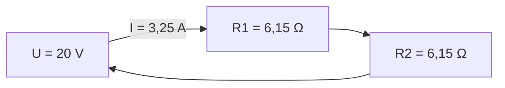
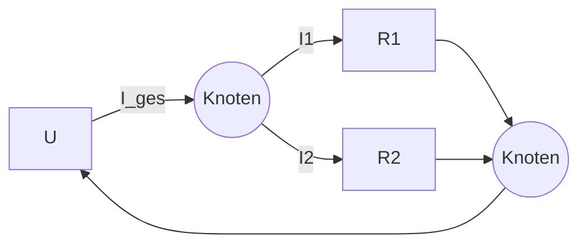

# Reihen- und Parallelschaltung

> [!summary] Kurz & knapp
> In der **Reihenschaltung** fließt überall derselbe Strom und die Spannung teilt sich auf. Die Widerstände werden addiert. In der **Parallelschaltung** liegt überall dieselbe Spannung an und der Strom teilt sich auf. Hier addiert man die Kehrwerte der Widerstände.

## Reihenschaltung

- Strom: $I = I_1 = I_2$ (überall gleich)
- Spannung: $U = U_1 + U_2$ mit $U_1 = R_1 \cdot I$, $U_2 = R_2 \cdot I$
- Gesamtwiderstand: $R_{ges} = R_1 + R_2 = 6{,}15\,\Omega + 6{,}15\,\Omega = 12{,}30\,\Omega$ (Tafelbeispiel)

Die beiden Widerstände kann man durch **einen** Ersatzwiderstand von 12,30 Ω ersetzen.

## Parallelschaltung

- Spannung: $U = U_1 = U_2$ (an jedem Zweig gleich)
- Strom: $I_{ges} = I_1 + I_2$
- Gesamtwiderstand: $\dfrac{1}{R_{ges}} = \dfrac{1}{R_1} + \dfrac{1}{R_2}$, also $R_{ges} = \left(\dfrac{1}{R_1} + \dfrac{1}{R_2}\right)^{-1}$
- Der Gesamtwiderstand ist **immer kleiner** als der kleinste Einzelwiderstand.

## Gemischte Schaltung

Bei gemischten Schaltungen fasst man schrittweise zusammen: erst die Reihen-Teile, dann die parallelen Teile, dann wieder in Reihe. Ein vollständiges Beispiel mit Rechenweg steht in [[Übung - Gemischte Schaltung]].

## Bezug zur IT
- Geräte an einer Steckdosenleiste sind **parallel** geschaltet. Jedes bekommt 230 V, die Ströme addieren sich, und deshalb kann die Sicherung auslösen.
- Der Leitungswiderstand liegt **in Reihe** zum Gerät. Deshalb fällt auf der Leitung Spannung ab, siehe [[Spannungsfall und Leitungsverluste]].

> [!tip] Merke
> | | Reihe | Parallel |
> | --- | --- | --- |
> | gleich bleibt | Strom $I$ | Spannung $U$ |
> | teilt sich auf | Spannung $U$ | Strom $I$ |
> | $R_{ges}$ | Summe | Kehrwert der Summe der Kehrwerte |

## Lernfragen
> [!question]- Welche Größe ist in der Reihenschaltung überall gleich?
> Der Strom $I$.

> [!question]- Zwei Widerstände mit je 300 Ω sind parallel geschaltet. Wie groß ist $R_{ges}$?
> $1/R_{ges} = 1/300\,\Omega + 1/300\,\Omega = 2/300\,\Omega$ → $R_{ges} = 150\,\Omega$

> [!question]- Warum werden Verbraucher im Haushalt parallel geschaltet?
> Damit jedes Gerät die volle Netzspannung (230 V) bekommt und unabhängig von den anderen ein- und ausgeschaltet werden kann.

> [!question]- 100 Ω und 200 Ω liegen in Reihe an 12 V. Wie groß ist der Strom?
> $R_{ges} = 300\,\Omega$, $I = 12\,\text{V} / 300\,\Omega = 0{,}04\,\text{A} = 40\,\text{mA}$

## Siehe auch
- [[Ohmsches Gesetz]]
- [[Formelsammlung Elektrotechnik]]
- [[Übung - Gemischte Schaltung]]
