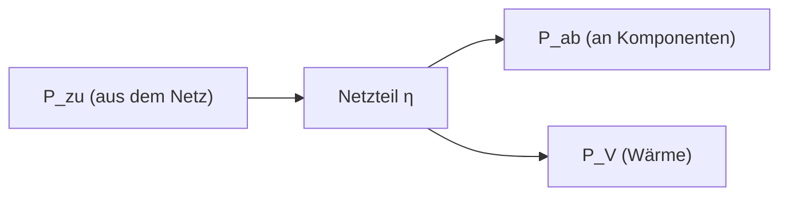

# Wirkungsgrad

> [!summary] Kurz & knapp
> Der Wirkungsgrad $\eta$ gibt an, welcher Anteil der aufgenommenen Leistung als nutzbare Leistung herauskommt: $\eta = P_{ab} / P_{zu}$. Der Rest geht als **Verlustleistung** (meist Wärme) verloren. $\eta$ ist immer kleiner als 1 (100 %).

## Formel

$$\eta = \frac{P_{ab}}{P_{zu}} \qquad [\eta] = \frac{\text{W}}{\text{W}} = 1 \text{ (einheitenlos, oft in \%)}$$

- $P_{zu}$ = **zugeführte** (aufgenommene) Leistung, z. B. aus der Steckdose
- $P_{ab}$ = **abgegebene** (nutzbare) Leistung, z. B. an die PC-Komponenten

**Umstellungen:**

$$P_{ab} = \eta \cdot P_{zu} \qquad P_{zu} = \frac{P_{ab}}{\eta} \qquad P_V = P_{zu} - P_{ab}$$

## Mehrere Stufen hintereinander
Durchläuft die Energie mehrere Wandler (z. B. zwei Transformatoren), werden die Wirkungsgrade **multipliziert**:
$$\eta_{ges} = \eta_1 \cdot \eta_2 = 0{,}98 \cdot 0{,}98 \approx 0{,}96$$

## Beispiel: Laptop-Netzteil (Mitschrift)
Auf dem Typenschild steht: Output 20 V ⎓ 3,25 A, Input 230 V ~ 1,7 A.
- $P_{ab} = 20\,\text{V} \cdot 3{,}25\,\text{A} = 65\,\text{W}$
- In der Mitschrift: $P_{zu} = 230\,\text{V} \cdot 1{,}7\,\text{A} = 391\,\text{W}$ → $\eta = 65 / 391 \approx 0{,}17$

> [!warning] Korrektur
> Ein Wirkungsgrad von 17 % ist für ein Netzteil unrealistisch. Die Input-Angabe auf dem Typenschild (1,7 A) ist der **maximale Eingangsstrom**, meist bei der kleinsten zulässigen Eingangsspannung (oft 100 V) und beim Einschalten. Der tatsächliche Strom bei 230 V und 65 W Last ist viel kleiner. Moderne Laptop-Netzteile erreichen **ca. 85–92 %**. Den echten Wirkungsgrad bekommt man nur, wenn man die tatsächlich aufgenommene Leistung misst, z. B. mit einem Energiemessgerät.

## Bedeutung in der IT
- Netzteile mit hohem Wirkungsgrad (z. B. **80-PLUS**-Zertifikate Bronze/Gold/Platinum) sparen Strom und erzeugen weniger Abwärme, was auch weniger Kühlung bedeutet (→ [[Green IT]]).
- Netzteile sind bei ca. 50 % Last meist am effizientesten.

> [!tip] Merke
> - $P_{zu}$ ist **immer größer** als $P_{ab}$.
> - Gesucht ist die Aufnahme → **dividieren**: $P_{zu} = P_{ab} / \eta$.
> - Gesucht ist die Abgabe → **multiplizieren**: $P_{ab} = \eta \cdot P_{zu}$.
> - Verlust = Aufnahme − Abgabe.

## Lernfragen
> [!question]- Ein Server braucht intern 300 W, das Netzteil hat $\eta = 82\,\%$. Wie viel nimmt es aus dem Netz auf?
> $P_{zu} = 300\,\text{W} / 0{,}82 \approx 365{,}9\,\text{W}$, Verlust $\approx 65{,}9\,\text{W}$

> [!question]- Ein Netzteil nimmt 350 W auf, $\eta = 0{,}8$. Wie viel gibt es ab?
> $P_{ab} = 0{,}8 \cdot 350\,\text{W} = 280\,\text{W}$

> [!question]- Warum hat der Wirkungsgrad keine Einheit?
> Weil Watt durch Watt geteilt wird. Die Einheiten kürzen sich weg.

> [!question]- Wie berechnet man den Gesamtwirkungsgrad von zwei Trafos mit je 98 %?
> $\eta_{ges} = 0{,}98 \cdot 0{,}98 = 0{,}9604 \approx 96\,\%$

> [!question]- Wohin geht die Verlustleistung eines Netzteils?
> Sie wird überwiegend in **Wärme** umgewandelt und muss durch Lüfter oder Klimaanlage abgeführt werden.

## Siehe auch
- [[Formelsammlung Elektrotechnik]]
- [[Elektrische Leistung und Energie]]
- [[USV]]
- [[Übung - Netzteile und Wirkungsgrad]]
- [[Übung - Spannungsebenen Rechenzentrum]]
