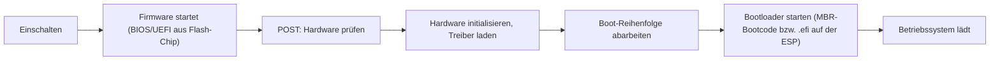

# BIOS und UEFI

> [!summary] Kurz & knapp
> **BIOS** und sein moderner Nachfolger **UEFI** sind die **Firmware** auf dem Mainboard. Sie prüfen beim Einschalten die Hardware (**POST**), initialisieren sie und starten den Bootloader des Betriebssystems. UEFI ist modular, unterstützt große Datenträger (**GPT**), **Secure Boot**, Netzwerk-Boot und eine grafische Oberfläche.

## Ablauf beim Einschalten

## 1. POST (Power-On Self-Test)
Ein automatischer, eingebauter **Selbsttest** der Firmware direkt nach dem Einschalten. Geprüft werden u. a.:
- **CPU** und Register
- **Arbeitsspeicher (RAM)**
- **Grafikkarte (GPU)**
- Chipsatz, Tastatur/Controller, angeschlossene Laufwerke
- Fehler werden über **Piepcodes** (Beep Codes), Debug-LEDs oder Fehlermeldungen angezeigt.

## BIOS vs. UEFI

| Merkmal | BIOS (Basic Input/Output System) | UEFI (Unified Extensible Firmware Interface) |
| --- | --- | --- |
| Alter | seit ca. 1981 | ab ca. 2005, Standard seit Windows 8 |
| Partitionsschema | **MBR** | **GPT** (MBR über CSM-Kompatibilitätsmodus) |
| max. Bootlaufwerk | 2 TiB | praktisch unbegrenzt (9,4 ZB) |
| Bootvorgang | Bootcode im MBR (erste 512 Byte) | `.efi`-Bootloader auf der **EFI-Systempartition (ESP)** |
| Oberfläche | textbasiert, nur Tastatur | grafisch, Maus möglich |
| Sicherheit | kaum | **Secure Boot**, signierte Updates, TPM-Anbindung |
| Erweiterbarkeit | starr | **modular** (Treiber, Anwendungen, Netzwerk-Stack) |
| Prozessormodus | 16-Bit Real Mode | 32/64-Bit |

## Antworten zum Aufgabenblatt (Kurzfassung)

**2. Übergang BIOS → UEFI:** UEFI ist der moderne Nachfolger des BIOS. BIOS bootet von **MBR**-Datenträgern, UEFI nutzt **GPT**. Herausforderungen beim Umstieg: Ein vorhandenes MBR-System muss nach GPT konvertiert werden (z. B. mit `mbr2gpt`). Der CSM-/Legacy-Modus muss passend eingestellt sein. Alte Betriebssysteme oder Treiber unterstützen UEFI/Secure Boot evtl. nicht.

**3. Vorteile von GPT:** siehe [[MBR und GPT]]. UEFI nutzt diese Vorteile, indem es von großen Datenträgern bootet und die Bootloader als Dateien auf der ESP findet. So lassen sich auch mehrere Betriebssysteme starten.

**4. Secure Boot:** Secure Boot bestimmt, **welche Software der Computer starten darf**. Die Firmware prüft die **digitale Signatur** von Bootloader, Kernel, Treibern und Options-ROMs. Nicht oder falsch signierte Software wird **blockiert**. Das schützt vor Bootkits/Rootkits, kann aber die Installation mancher Linux-Distributionen, älterer Betriebssysteme oder eigener Kernel verhindern. Dann muss man Secure Boot deaktivieren oder eigene Schlüssel hinterlegen.

**5. Treiber im BIOS/UEFI:** Die Firmware braucht eigene Treiber, um Hardware **vor dem Start des Betriebssystems** anzusprechen (Tastatur, Grafik, Laufwerke, Netzwerk). Sie prüfen Hardwarefehler und bestimmen, welche Geräte beim Start funktionieren. Das UEFI kann eigene Treiber modular nachladen. Fehlt ein Treiber, kann z. B. von einem Laufwerk nicht gebootet werden.

**6. Sicherheitsfunktionen von UEFI:**
- **Secure Boot** (Signaturprüfung beim Booten)
- **signierte Firmware-Updates** (nur Herstellerupdates werden akzeptiert)
- Setup-/Benutzer-**Passwörter** (Setup Mode / User Mode)
- Anbindung an das **TPM** (Trusted Platform Module, z. B. für BitLocker, Measured Boot)

**7. PXE-Boot (Booten über das Netzwerk):** UEFI enthält Netzwerkprotokolle (DHCP, TFTP), die schon **vor dem Betriebssystem** (Pre-Boot) laufen.
1. Im Bootmenü wird **PXE** als Boot-Option ausgewählt.
2. UEFI initialisiert die Netzwerkkarte und sendet ein **DHCP-Discover**-Paket.
3. Der DHCP-Server antwortet mit IP-Adresse, Netzmaske und den **TFTP-Serverdetails** (Bootdatei).
4. UEFI lädt das **NBP** (Network Bootstrap Program) per **TFTP** herunter.
5. Das NBP wird ausgeführt und lädt z. B. ein Installations- oder Live-System.

**8. Fehler beim BIOS/UEFI-Update:** Die Firmware kann beschädigt werden, sodass der PC nicht mehr startet („Brick“). Maßnahmen: CMOS-Reset, **Dual-BIOS** bzw. Recovery-BIOS nutzen, **BIOS-Flashback** per USB-Stick (ohne CPU/RAM möglich), Chip neu programmieren lassen, im schlimmsten Fall das Mainboard tauschen. Vorbeugend: Update nur mit stabiler Stromversorgung (USV/Netzteil am Laptop) und nie unterbrechen.

**9. Boot-Reihenfolge:** wird im BIOS/UEFI-Setup festgelegt und bestimmt, von welchem Medium zuerst gestartet wird (SSD, USB, Netzwerk). Sie beeinflusst **nicht die Leistung** des laufenden Systems, aber die **Bootzeit**. Steht z. B. das Netzwerk vorn, wartet der PC erst auf einen PXE-Timeout.

**10. Modulare Architektur:** UEFI besteht aus austauschbaren Modulen und Treibern. Hersteller können Funktionen (Netzwerk, Grafik, Sicherheit, Shell) flexibel ergänzen. Das BIOS ist dagegen ein monolithischer Block.

**11. UEFI in Embedded Systems:** Vorteile: Sicherheit (Secure Boot), Netzwerkfunktionen, Standardisierung. Nachteile: komplex, braucht mehr Speicher und Bootzeit, für einfache Embedded-Geräte oft überdimensioniert. Dort nutzt man häufig schlanke Bootloader wie U-Boot oder Coreboot.

**12. Zugriff auf BIOS/UEFI:** direkt nach dem Einschalten eine Taste drücken, typisch **Entf (Del)** oder **F2**, je nach Hersteller auch F10, F12 (Bootmenü) oder Esc. Bei Schnellstart über das Betriebssystem: Windows → Erweiterter Start → „UEFI-Firmwareeinstellungen“.

**13. Custom Firmware (z. B. Coreboot):** Open-Source-Ersatz für die Herstellerfirmware. Mehr Kontrolle, Transparenz und Sicherheit, schneller Start. Nachteile: Nur bestimmte Hardware wird unterstützt, die Installation ist aufwendig und riskant, und Garantie und Support entfallen.

**14. EFI-Systempartition (ESP):** kleine FAT32-Partition (ca. 100–500 MB), auf der die **Bootloader-Dateien (`.efi`)** liegen. UEFI liest sie direkt und startet daraus das Betriebssystem. Mehrere Betriebssysteme können ihre Bootloader nebeneinander ablegen (Multiboot).

**15. Boot- und Systempartitionen BIOS vs. UEFI:** Beim BIOS liegt der Bootcode im **MBR** und in einer aktiven Partition. Beim UEFI gibt es eine **separate ESP** auf einem GPT-Datenträger. UEFI ist dadurch flexibler, sicherer und unterstützt große Datenträger.

> [!tip] Merke
> - Firmware-Aufgaben: **POST → Initialisierung → Bootloader starten**.
> - BIOS = alt, MBR, 16 Bit. UEFI = modern, GPT, Secure Boot, grafisch, modular.
> - Secure Boot prüft **digitale Signaturen** beim Start.
> - PXE: DHCP (IP + Bootserver) → TFTP (Bootprogramm laden).
> - Setup-Zugang meist mit **Entf** oder **F2**.

## Lernfragen
> [!question]- Was passiert beim POST?
> Die Firmware testet nach dem Einschalten automatisch die wichtigsten Komponenten (CPU, RAM, GPU, Laufwerke). Fehler meldet sie über Piepcodes oder Meldungen.

> [!question]- Nenne drei Vorteile von UEFI gegenüber BIOS.
> GPT-Unterstützung (Bootlaufwerke > 2 TiB), Secure Boot, modulare Erweiterbarkeit/Netzwerk-Boot, grafische Oberfläche, schnellerer Start.

> [!question]- Wie funktioniert Secure Boot?
> Die Firmware prüft vor dem Start die digitalen Signaturen von Bootloader, Treibern und Kernel gegen hinterlegte Schlüssel. Unsignierte oder manipulierte Software wird nicht gestartet.

> [!question]- Welche Protokolle nutzt der PXE-Boot und wofür?
> DHCP liefert IP-Adresse und Infos zum Bootserver. TFTP lädt das Network Bootstrap Program herunter.

> [!question]- Was ist die EFI-Systempartition?
> Eine kleine FAT32-Partition auf GPT-Datenträgern, die die `.efi`-Bootloader enthält, aus denen UEFI das Betriebssystem startet.

> [!question]- Was kann man tun, wenn ein BIOS-Update fehlgeschlagen ist?
> CMOS-Reset, Dual-/Recovery-BIOS bzw. BIOS-Flashback nutzen, Chip neu flashen lassen oder das Mainboard tauschen.

## Siehe auch
- [[MBR und GPT]]
- [[Datenträgerorganisation]]
- [[Speicherarten]]
- [[Mainboard-Bestandteile]]
