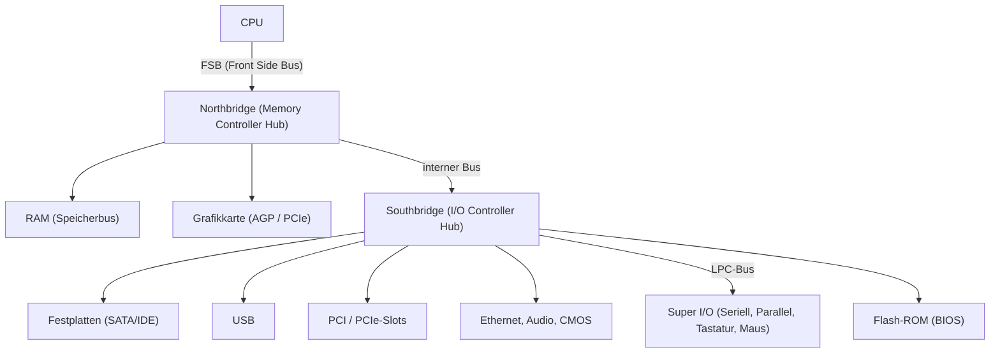
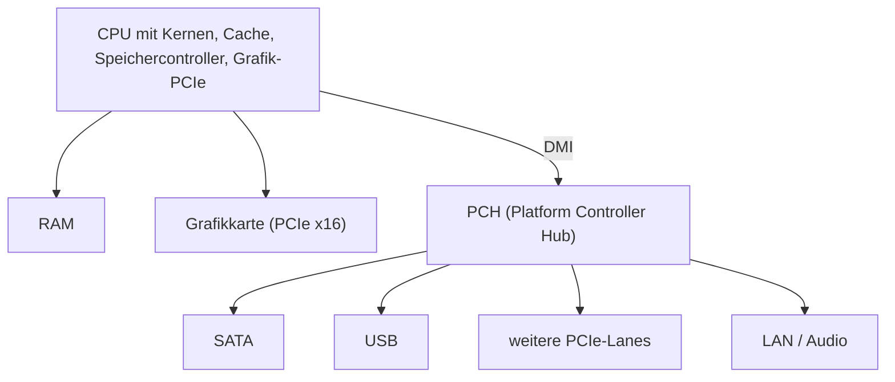

# Bridge- und Hub-Architektur

> [!summary] Kurz & knapp
> Der **Chipsatz** verbindet die CPU mit RAM, Grafikkarte und Peripherie. Bei der älteren **Bridge-Architektur** übernehmen das **Northbridge** (schnelle Komponenten) und **Southbridge** (langsame Peripherie). Bei der **Hub-Architektur** heißen sie Memory Controller Hub und I/O Controller Hub. Heute ist der Speichercontroller in der CPU, und es gibt nur noch einen **PCH** (Platform Controller Hub).

> [!info] Klausurhinweis
> Laut Mitschrift: **„kommt nicht in Arbeit dran“**. Das Thema ist Hintergrundwissen und hilft beim Verständnis von [[Bussysteme]] und [[PCIe]].

## Bridge-Architektur (Northbridge / Southbridge)

| Baustein | angebundene Komponenten | Eigenschaft |
| --- | --- | --- |
| **Northbridge** | CPU (über FSB), RAM, Grafikkarte | schnelle Verbindungen, nah an der CPU |
| **Southbridge** | Festplatten, USB, PCI(e)-Slots, Netzwerk, Audio, BIOS, Super I/O | langsamere Peripherie |

Originalgrafik mit Lösungen:

![[LF2.pdf#page=5]]

## Hub-Architektur
Intel nannte die Bausteine ab ca. 1999 **Hubs**:
- **MCH** (Memory Controller Hub) = Northbridge
- **ICH** (I/O Controller Hub) = Southbridge

Später wanderten **Speichercontroller und PCIe-Grafikanbindung in die CPU**. Übrig blieb ein einzelner Chip, der **PCH** (Platform Controller Hub), über den **DMI**-Bus an die CPU angebunden (→ [[Bussysteme]]).

## Was legt der Chipsatz fest? (Aufgabe 3)

| Eigenschaft | Beispiel |
| --- | --- |
| **Prozessorunterstützung / Sockel** | welche CPU-Generationen passen (z. B. Intel LGA1700, AMD AM5) |
| **Speicher (Memory Controller)** | RAM-Typ (DDR4/DDR5), max. Größe und Takt (heute meist in der CPU) |
| **Peripherieschnittstellen** | Anzahl der USB- und SATA-Ports, PCIe-Lanes, M.2-Steckplätze |
| **Grafikanbindung** | PCIe-Version und -Lanes für die Grafikkarte, Übertaktung, Multi-GPU |

> [!info] Serielle und parallele Übertragung
> - **SATA** = Serial ATA → **serielle** Übertragung
> - **PATA** (IDE) = Parallel ATA → **parallele** Übertragung (veraltet)

> [!tip] Merke
> - Northbridge = schnell (CPU, RAM, GPU), Southbridge = langsam (I/O).
> - Hub-Architektur: MCH + ICH. Heute: CPU + **PCH**, verbunden über **DMI**.
> - Der Chipsatz bestimmt, welche CPUs, wie viel RAM und welche Anschlüsse ein Mainboard bietet.

## Lernfragen
> [!question]- Welche Komponenten waren an die Northbridge angebunden?
> CPU (über den FSB), Arbeitsspeicher und Grafikkarte (AGP/PCIe).

> [!question]- Welche Aufgaben hatte die Southbridge?
> Anbindung der langsameren Peripherie: Festplatten (SATA/IDE), USB, PCI-Slots, Netzwerk, Audio, BIOS-Chip, Super I/O.

> [!question]- Was ist der PCH?
> Der Platform Controller Hub, ein einzelner Chipsatz-Baustein, der die Southbridge-Aufgaben übernimmt. Die Northbridge-Funktionen sind in die CPU gewandert. Angebunden ist er über DMI.

> [!question]- Nenne vier Eigenschaften eines Mainboards, die der Chipsatz festlegt.
> Unterstützte CPUs (Sockel/Generation), Arbeitsspeicher (Typ/Größe), Anzahl der Peripherieschnittstellen (USB, SATA, PCIe-Lanes) und die Grafikanbindung.

## Siehe auch
- [[Bussysteme]]
- [[PCIe]]
- [[Mainboard-Bestandteile]]
- [[Von-Neumann-Architektur]]
