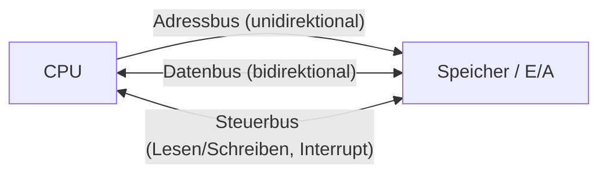

# Bussysteme

> [!summary] Kurz & knapp
> Ein **Bus** ist ein gemeinsamer Übertragungsweg, über den Komponenten wie CPU, RAM und Chipsatz Daten austauschen. Man unterscheidet **Daten-, Adress- und Steuerbus** sowie **parallele** und **serielle** Busse. Moderne Busse (PCIe, SATA, USB, DMI) sind fast alle **seriell**.

## Was ist ein Bus? (Aufgabe 1)
Ein Bus ist ein Bündel von Leitungen bzw. ein Übertragungssystem auf dem Mainboard, das mehrere Komponenten (CPU, RAM, Chipsatz, Erweiterungskarten) verbindet und den **Datenaustausch** nach festen Regeln (Protokoll) ermöglicht.

## Daten-, Adress- und Steuerbus (Aufgabe 2)

| Bus | Aufgabe | Richtung |
| --- | --- | --- |
| **Datenbus** | überträgt die eigentlichen Daten (Befehle, Operanden, Ergebnisse, z. B. bei LOAD/STORE) | **bidirektional** |
| **Adressbus** | überträgt die Speicheradresse, die gelesen/beschrieben werden soll | **unidirektional** (von der CPU weg) |
| **Steuerbus** | überträgt Steuersignale: Lesen/Schreiben, Interrupts, Takt, Reset | bidirektional (einzelne Leitungen je eine Richtung) |

> [!info] Busbreite
> Die Breite des **Adressbusses** bestimmt, wie viel Speicher adressiert werden kann: $2^n$ Adressen (32 Bit → 4 GiB). Die Breite des **Datenbusses** bestimmt, wie viele Bits pro Takt übertragen werden.

## Seriell vs. parallel (Aufgabe 3)

| | Parallel | Seriell |
| --- | --- | --- |
| Prinzip | mehrere Bits gleichzeitig über mehrere Leitungen | Bits nacheinander über eine (bzw. wenige) Leitung(en) |
| Vorteil | hohe Bandbreite auf **kurzen** Strecken | **hohe Taktraten**, lange Strecken, einfache Kabel, gut skalierbar (Lanes) |
| Nachteil | Laufzeitunterschiede (Skew) und Übersprechen begrenzen den Takt | pro Leitung nur ein Bit gleichzeitig |
| Beispiele | PCI, IDE/PATA, FSB, alter Druckerport | USB, SATA, PCIe, DMI, Ethernet |

Darum haben serielle Busse die parallelen fast vollständig abgelöst: Sie lassen sich viel höher takten.

## FSB vs. DMI (Aufgabe 4)

| | FSB (Front Side Bus) | DMI (Direct Media Interface) |
| --- | --- | --- |
| Art | **paralleler** Bus | **serieller** Point-to-Point-Bus (PCIe-ähnlich) |
| Verbindung | CPU ↔ Northbridge (Chipsatz) | CPU ↔ PCH (Chipsatz) |
| Zeit | Intel bis Core 2 (ca. 2008) | Intel ab Nehalem (Core i, 2008/2009) bis heute |
| Eigenschaft | geteilter Bus, Flaschenhals für RAM-Zugriffe | dediziert, höhere Bandbreite. RAM hängt direkt an der CPU. |

(DMI gab es vorher schon als Verbindung zwischen North- und Southbridge.) Mehr zu North-/Southbridge: [[Bridge- und Hub-Architektur]]

## Wichtige Busse im PC
- **PCIe** – Grafikkarte, NVMe-SSD, Netzwerkkarten → [[PCIe]]
- **SATA** – Festplatten/SSDs, seriell, bis 6 Gbit/s
- **USB** – externe Peripherie, seriell
- **DMI** – CPU ↔ Chipsatz
- **Speicherbus** – CPU ↔ RAM (DDR4/DDR5)

> [!tip] Merke
> - Datenbus **bidirektional**, Adressbus **unidirektional**, Steuerbus steuert (Lesen/Schreiben/Interrupt).
> - Parallel = viele Bits gleichzeitig (PCI, PATA). Seriell = nacheinander, aber schneller taktbar (USB, SATA, PCIe).
> - FSB (alt, parallel) → DMI (neu, seriell, Point-to-Point).

## Lernfragen
> [!question]- Welche drei Busarten unterscheidet man nach ihrer Funktion?
> Datenbus (Daten, bidirektional), Adressbus (Speicheradressen, unidirektional von der CPU) und Steuerbus (Steuersignale wie Lesen/Schreiben, Interrupt).

> [!question]- Warum haben sich serielle Busse gegenüber parallelen durchgesetzt?
> Bei parallelen Bussen kommen die Bits wegen Laufzeitunterschieden und Übersprechen nicht exakt gleichzeitig an. Das begrenzt den Takt. Serielle Busse lassen sich viel höher takten, brauchen weniger Leitungen und funktionieren auch über längere Strecken.

> [!question]- Nenne je zwei Beispiele für serielle und parallele Busse.
> Seriell: USB, SATA, PCIe. Parallel: PCI, IDE/PATA.

> [!question]- Was ist der Unterschied zwischen FSB und DMI?
> Der FSB war ein paralleler, geteilter Bus zwischen CPU und Northbridge. DMI ist eine serielle Point-to-Point-Verbindung zwischen CPU und PCH mit höherer Bandbreite.

> [!question]- Wovon hängt ab, wie viel Speicher eine CPU adressieren kann?
> Von der Breite des Adressbusses: $n$ Leitungen → $2^n$ Adressen.

## Siehe auch
- [[PCIe]]
- [[Bridge- und Hub-Architektur]]
- [[Von-Neumann-Architektur]]
- [[Mainboard-Bestandteile]]
