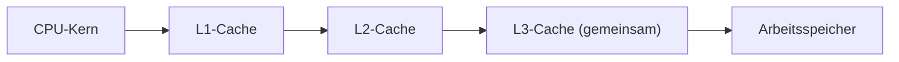

# CPU - Aufbau und Kenngrößen

> [!summary] Kurz & knapp
> Die **CPU (Central Processing Unit)** führt die Befehle aller Programme aus. Ihre Leistung hängt v. a. von **Kernanzahl**, **Threads**, **Taktfrequenz**, **Cache** und **Architektur** (CISC/RISC) ab. Grundbaustein ist der **Transistor**, ein winziger elektronischer Schalter für 0 und 1.

## Aufgabenblatt Prozessor – Antworten

### 1. CPU
**C**entral **P**rocessing **U**nit = zentrale Verarbeitungseinheit, das „Gehirn“ des Computers.

### 2. Was macht die CPU beim Befehl „Drucken“?
Die Anwendung ruft den Druckbefehl auf. Die CPU führt den Code von Programm, Betriebssystem und **Druckertreiber** aus: Sie wandelt das Dokument in Druckdaten um (Rendering, z. B. in PCL/PostScript), legt den Auftrag in die **Druckwarteschlange (Spooler)** und übergibt die Daten über eine Schnittstelle (USB/Netzwerk) an den Drucker. Danach ist die CPU wieder frei. Das eigentliche Drucken macht der Drucker selbst.

### 3. Kleinstes Bauteil
Der **Transistor**. Er arbeitet als elektronischer Schalter (an = 1, aus = 0). Aus Transistoren werden Logikgatter, Register, Rechenwerk und Cache aufgebaut. Moderne CPUs haben **Milliarden** davon.

### 4./5./6. Cache
- **Cache** = sehr schneller Zwischenspeicher (SRAM) direkt in der CPU. Er hält häufig benötigte Daten und Befehle bereit, damit die CPU nicht auf den langsamen RAM warten muss.
- Für den Benutzer: Programme reagieren schneller. Das Prinzip „Cache“ gibt es auch anderswo: Browser-Cache, Festplatten-Cache, DNS-Cache.
- **Größe:** Mehr Cache bedeutet mehr Treffer (Cache-Hits) und weniger RAM-Zugriffe, also mehr Leistung. Größere Caches sind aber teurer und etwas langsamer im Zugriff.
- **Feste Größe?** Der CPU-Cache ist in Hardware gebaut und hat eine **feste Größe**:

| Ebene | typische Größe | Zuordnung | Geschwindigkeit |
| --- | --- | --- | --- |
| L1 | ca. 32–80 KB pro Kern (Daten + Befehle getrennt) | pro Kern | am schnellsten |
| L2 | ca. 256 KB – 2 MB pro Kern | pro Kern | schnell |
| L3 | ca. 8 – 100+ MB | von allen Kernen gemeinsam genutzt | langsamer, aber viel schneller als RAM |

(Software-Caches wie der Browser-Cache sind dagegen in der Größe einstellbar.)

### 7. Wie viele Kerne hat eine CPU?
Unterschiedlich: von 1 (alte CPUs) über 4–24 (Desktop) bis 64–192 (Server).

> [!warning] Korrektur
> In der Mitschrift steht „immer eine gerade Anzahl wegen dem Binärsystem“. Das stimmt nicht. Die Kernanzahl hat nichts mit dem Binärsystem zu tun. Es gibt CPUs mit **3 Kernen** (AMD Phenom X3), **6 Kernen** und Hybrid-CPUs wie **14 Kerne** (6 Performance + 8 Effizienz) oder 10 Kerne. Gerade Zahlen sind nur verbreitet, weil Hersteller Kerne gern paarweise anordnen.

### 8. Zusammenarbeit von Kern und Cache
Der Kern sucht Daten zuerst im **L1**, dann im **L2**, dann im gemeinsamen **L3** und erst zuletzt im **RAM**. Gefundene Daten werden in die schnelleren Caches kopiert. L1/L2 hat jeder Kern für sich, den L3 teilen sich alle Kerne.

### 9. Taktfrequenz
- Anzahl der Arbeitstakte pro Sekunde, in **GHz** (3 GHz = 3 Milliarden Takte/s).
- Höherer Takt → mehr Befehle pro Sekunde → schneller (bei gleicher Architektur).
- Aber: mehr Takt → mehr **Stromverbrauch und Wärme**. Bei Überhitzung drosselt die CPU (Throttling), wird instabil oder schaltet ab.
- Moderne CPUs haben **Basistakt** und **Turbotakt** (z. B. bis 5,8 GHz).

> [!warning] Korrektur
> „Zu hohe Taktfrequenz sorgt zum Verkleben“ ist falsch. Gemeint ist: Zu hoher Takt führt zu **Überhitzung** und **Instabilität** (Abstürze, Rechenfehler). Die CPU schützt sich dann durch Drosselung (Thermal Throttling) bzw. Notabschaltung.

### 10. Bedeutung der Transistoranzahl
Mehr Transistoren ermöglichen mehr Kerne, größere Caches und zusätzliche Recheneinheiten (z. B. Grafik, KI-Einheiten). Das bringt mehr Leistung. Durch kleinere Strukturen (nm) passen mehr Transistoren auf gleiche Fläche, und der Stromverbrauch pro Transistor sinkt (**Mooresches Gesetz**: Verdopplung etwa alle 2 Jahre).

### 11. Threads
- Ein **Thread** ist ein Ausführungsstrang, also ein Teilprozess eines Programms, den die CPU einplant und abarbeitet.
- **Software-Threads**: vom Programm/Betriebssystem erzeugt (z. B. UI-Thread, Hintergrund-/Worker-Thread für Berechnungen, Grafik).
- **Hardware-Threads** (logische Kerne): Durch **Multithreading** (Intel Hyper-Threading, AMD SMT) kann ein physischer Kern zwei Threads gleichzeitig bearbeiten.
- **Multicore** = mehrere physische Kerne arbeiten parallel.
- Beispiel: 8 Kerne mit SMT = **16 logische Threads**. Ohne SMT sind es nur 8. Bei Hybrid-CPUs gilt das oft nur für die Performance-Kerne, z. B. 16 Kerne / 24 Threads.

### 12. CISC und RISC

| | CISC (Complex Instruction Set Computer) | RISC (Reduced Instruction Set Computer) |
| --- | --- | --- |
| Befehlssatz | viele, komplexe Befehle unterschiedlicher Länge | wenige, einfache Befehle mit fester Länge |
| Ausführung | ein Befehl kann mehrere Takte brauchen | meist ein Befehl pro Takt, gut für Pipelining |
| Programmcode | kompakter, braucht weniger Speicher | länger (mehr Befehle) |
| Stromverbrauch | eher höher | eher niedriger |
| Beispiele | Intel/AMD **x86** | **ARM** (Smartphones, Apple M-Chips), RISC-V |

> [!tip] Merke
> - Leistungsmerkmale: Kerne, Threads, Takt, Cache, Architektur, Fertigungsgröße.
> - Cache: L1 (pro Kern, am schnellsten) → L2 → L3 (gemeinsam) → RAM.
> - Multicore = mehrere Kerne. Multithreading = ein Kern bearbeitet mehrere Threads.
> - CISC = komplex (x86), RISC = einfach (ARM).

## Lernfragen
> [!question]- Was ist der Unterschied zwischen Multicore und Multithreading?
> Multicore: mehrere physische Kerne arbeiten parallel. Multithreading (Hyper-Threading/SMT): ein Kern bearbeitet zwei Threads gleichzeitig, indem er ungenutzte Recheneinheiten ausnutzt.

> [!question]- Wozu dient der CPU-Cache?
> Er speichert häufig benötigte Daten und Befehle in sehr schnellem SRAM nah am Kern. So muss die CPU seltener auf den langsamen RAM warten.

> [!question]- Warum kann man die Taktfrequenz nicht beliebig erhöhen?
> Mit dem Takt steigen Stromverbrauch und Wärme. Die CPU wird instabil oder drosselt sich (Thermal Throttling).

> [!question]- Nenne je ein Beispiel für eine CISC- und eine RISC-Architektur.
> CISC: x86 (Intel, AMD). RISC: ARM (Smartphones, Apple M1–M4).

> [!question]- Was ist das kleinste Bauteil einer CPU und welche Funktion hat es?
> Der Transistor, ein elektronischer Schalter, der die Zustände 0 und 1 darstellt.

> [!question]- Wie viele Threads hat ein 8-Kern-Prozessor mit Hyper-Threading?
> 16 logische Threads (2 pro Kern).

## Siehe auch
- [[Von-Neumann-Architektur]]
- [[Speicherarten]]
- [[Bussysteme]]
- [[Übung - Arbeitsplatz für einen Fotografen]]
- [[Mainboard-Bestandteile]]
