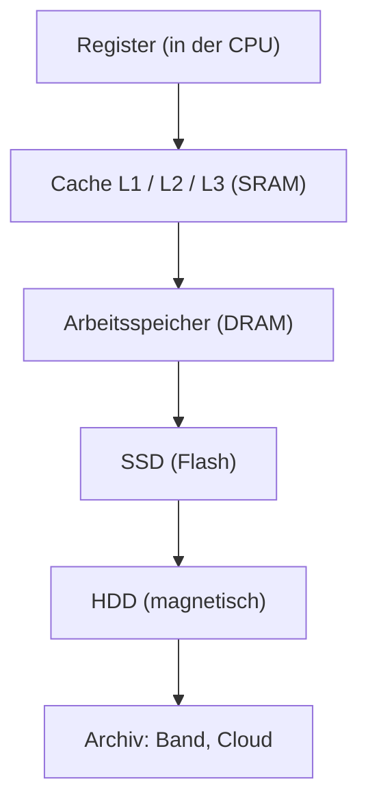

# Speicherarten

> [!summary] Kurz & knapp
> **Flüchtige** Speicher (RAM, Cache, VRAM) verlieren ihren Inhalt ohne Strom, sind aber sehr schnell. **Nichtflüchtige** Speicher (ROM, EEPROM, Flash/SSD, HDD) behalten die Daten dauerhaft. Halbleiterspeicher bestehen aus Transistoren/Kondensatoren auf Chips. Die HDD ist dagegen ein **magnetischer** Speicher.

## Flüchtig vs. nichtflüchtig (Aufgabe 4: Halbleiterspeichertechnologien)

| Flüchtige Speicher | Nichtflüchtige Speicher |
| --- | --- |
| **RAM** – Arbeitsspeicher | **ROM** – Read Only Memory (nur lesbar) |
| **Cache** – schneller Puffer in der CPU (SRAM) | **SSD** – Flash-basierter Massenspeicher |
| **VRAM** – Grafikspeicher (z. B. GDDR6) | **Flashspeicher** – USB-Sticks, SD-Karten |
| **DRAM** – dynamischer RAM | **EPROM / EEPROM** – (elektrisch) löschbarer, programmierbarer ROM |

> [!warning] Korrektur
> - In der Mitschrift steht „**HDD**/SSD“ bei den Halbleiterspeichern. Die **HDD** ist zwar nichtflüchtig, aber **kein Halbleiterspeicher**. Sie speichert magnetisch auf rotierenden Scheiben. Die SSD (Flash) ist ein Halbleiterspeicher.
> - „E-ROM“ heißt richtig **EPROM** (Erasable Programmable ROM).
> - RAM und DRAM sind keine getrennten Kategorien: **DRAM** ist die übliche Bauart des Arbeitsspeichers (RAM). Daneben gibt es **SRAM** (schneller, teurer, z. B. für den Cache).

## Die wichtigsten Halbleiterspeicher

| Speicher | Funktionsprinzip | Einsatz |
| --- | --- | --- |
| **SRAM** (statisch) | Flipflops aus ca. 6 Transistoren, kein Auffrischen nötig, sehr schnell | CPU-Cache (L1–L3) |
| **DRAM** (dynamisch) | Kondensator + Transistor, muss ständig aufgefrischt werden (Refresh) | Arbeitsspeicher (DDR4/DDR5), VRAM (GDDR) |
| **ROM** | fest bei der Herstellung programmiert | früher Firmware |
| **PROM** | einmal programmierbar | |
| **EPROM** | mit UV-Licht löschbar | ältere BIOS-Chips |
| **EEPROM** | elektrisch lösch- und beschreibbar | Konfigurationsdaten |
| **Flash** | Weiterentwicklung des EEPROM, blockweise löschbar | BIOS/UEFI-Chip, SSD, USB-Stick, SD-Karte |

## Speicherhierarchie

Von oben nach unten: **langsamer, größer, billiger pro GB**. Oben flüchtig, unten nichtflüchtig.

> [!tip] Merke
> - Flüchtig = Daten weg ohne Strom: RAM, Cache, VRAM.
> - Nichtflüchtig = Daten bleiben: ROM/EEPROM/Flash, SSD, HDD.
> - Cache = **SRAM**, Arbeitsspeicher = **DRAM**.
> - HDD = magnetisch, SSD = Halbleiter (Flash).

## Lernfragen
> [!question]- Was ist der Unterschied zwischen flüchtigem und nichtflüchtigem Speicher?
> Flüchtiger Speicher verliert seinen Inhalt ohne Stromversorgung (RAM, Cache). Nichtflüchtiger Speicher behält ihn (ROM, Flash, SSD, HDD).

> [!question]- Worin unterscheiden sich SRAM und DRAM?
> SRAM speichert in Flipflops, ist sehr schnell, braucht keinen Refresh und ist teuer → Cache. DRAM speichert in Kondensatoren, muss ständig aufgefrischt werden, ist günstiger und dichter → Arbeitsspeicher.

> [!question]- Ist eine HDD ein Halbleiterspeicher?
> Nein. Die HDD speichert magnetisch auf rotierenden Scheiben. Sie ist nichtflüchtig, aber kein Halbleiterspeicher.

> [!question]- Wofür steht EEPROM und wo wird Flash-Speicher eingesetzt?
> Electrically Erasable Programmable Read-Only Memory. Flash (Weiterentwicklung) steckt in SSDs, USB-Sticks, SD-Karten und im BIOS/UEFI-Chip.

> [!question]- Was ist VRAM?
> Der Grafikspeicher auf der Grafikkarte (z. B. GDDR6). Er ist flüchtig und speichert Texturen und Bilddaten.

## Siehe auch
- [[HDD und SSD]]
- [[CPU - Aufbau und Kenngrößen]]
- [[Von-Neumann-Architektur]]
- [[BIOS und UEFI]]
- [[Mainboard-Bestandteile]]
