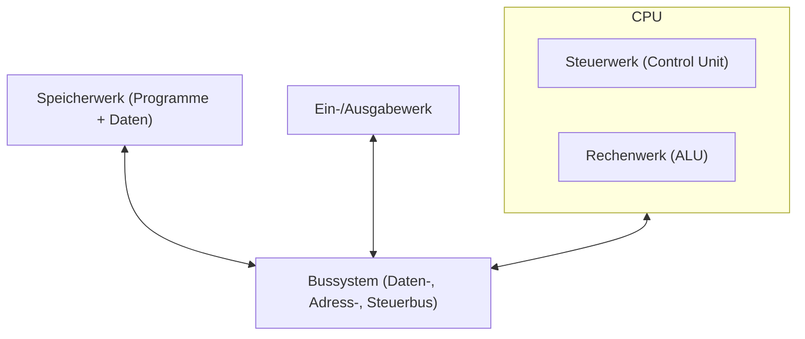
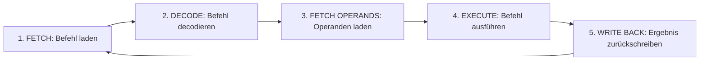

# Von-Neumann-Architektur

> [!summary] Kurz & knapp
> Die Von-Neumann-Architektur ist das Grundmodell fast aller heutigen Computer: **Programme und Daten liegen im selben Speicher** und werden über ein gemeinsames **Bussystem** zwischen Rechenwerk, Steuerwerk, Speicher und Ein-/Ausgabe transportiert. Befehle werden im **Von-Neumann-Zyklus** (Fetch – Decode – Fetch Operands – Execute – Write Back) nacheinander abgearbeitet.

## Wer war John von Neumann?
- ungarisch-amerikanischer Mathematiker (1903–1957)
- beschrieb 1945 das Konzept des **gespeicherten Programms**: Programme und Daten im gleichen Speicher
- arbeitete im Zweiten Weltkrieg am **Manhattan-Projekt** (Atombombe) mit und lieferte dort wichtige mathematische Berechnungen
- Seine Architektur steckt bis heute in PCs, Laptops, Smartphones und Servern.

## Warum ein „Universalrechner“?
Weil das Programm im Speicher liegt und einfach ausgetauscht werden kann, löst derselbe Rechner ganz unterschiedliche Probleme, **ohne dass die Hardware umgebaut werden muss**. Frühere Rechner wurden für jede neue Aufgabe neu verkabelt.

## Bausteine

| Baustein | Aufgabe | Heute im PC |
| --- | --- | --- |
| **Rechenwerk** (ALU) | führt arithmetische (+, −) und logische (UND, ODER) Operationen aus | Teil jedes CPU-Kerns |
| **Steuerwerk** (Control Unit) | holt und decodiert Befehle, steuert den Ablauf aller anderen Einheiten | Teil der CPU |
| **Speicherwerk** | speichert Programme **und** Daten | Arbeitsspeicher (RAM), dazu Cache |
| **Ein-/Ausgabewerk** | Verbindung zur Außenwelt | Tastatur, Maus, Monitor, USB, Netzwerk, Festplatten |
| **Bussystem** | verbindet alle Einheiten und transportiert Daten, Adressen, Steuersignale | Mainboard-Busse, PCIe, DMI ([[Bussysteme]]) |

## Der Von-Neumann-Zyklus

1. **Fetch:** Das Steuerwerk holt den nächsten Befehl aus dem Speicher. Die Adresse steht im Befehlszähler, der danach erhöht wird.
2. **Decode:** Das Steuerwerk entschlüsselt den Befehl: Was soll getan werden?
3. **Fetch Operands:** Die benötigten Daten (Operanden) werden aus dem Speicher bzw. den Registern geladen.
4. **Execute:** Das Rechenwerk führt die Operation aus.
5. **Write Back:** Das Ergebnis wird in ein Register oder in den Speicher zurückgeschrieben. Danach beginnt der Zyklus von vorn.

## Von-Neumann-Flaschenhals
Da Befehle und Daten über **denselben Bus** laufen, kann immer nur eins von beiden transportiert werden. Der Bus bremst die schnelle CPU aus. Abhilfe heute: **Cache** (schneller Zwischenspeicher in der CPU), getrennte L1-Caches für Befehle und Daten (angelehnt an die **Harvard-Architektur**), Pipelining.

> [!tip] Merke
> - Kernidee: **Programm und Daten im selben Speicher** → Universalrechner.
> - 5 Bausteine: Rechenwerk, Steuerwerk, Speicherwerk, Ein-/Ausgabewerk, Bussystem.
> - Zyklus: Fetch → Decode → Fetch Operands → Execute → Write Back.
> - Nachteil: Von-Neumann-Flaschenhals.

## Lernfragen
> [!question]- Was ist die zentrale Idee der Von-Neumann-Architektur?
> Programme und Daten liegen gemeinsam im selben Speicher. Der Rechner ist dadurch frei programmierbar und ein Universalrechner.

> [!question]- Aus welchen Bausteinen besteht ein Von-Neumann-Rechner?
> Rechenwerk (ALU), Steuerwerk, Speicherwerk, Ein-/Ausgabewerk, verbunden über ein Bussystem.

> [!question]- Nenne die fünf Phasen des Von-Neumann-Zyklus.
> Fetch (Befehl holen), Decode (decodieren), Fetch Operands (Operanden laden), Execute (ausführen), Write Back (Ergebnis zurückschreiben).

> [!question]- Was versteht man unter dem Von-Neumann-Flaschenhals?
> Befehle und Daten teilen sich einen Bus. Die CPU muss auf den langsameren Speicherzugriff warten. Caches mildern das.

> [!question]- Welche Bausteine findet man heute in der CPU?
> Rechenwerk (ALU) und Steuerwerk, dazu Register und Cache. Der Speicher ist der RAM, die E/A-Einheiten sind Schnittstellen wie USB oder PCIe.

## Siehe auch
- [[CPU - Aufbau und Kenngrößen]]
- [[Bussysteme]]
- [[Speicherarten]]
- [[Mainboard-Bestandteile]]
- [[Hardwarekategorien]]
