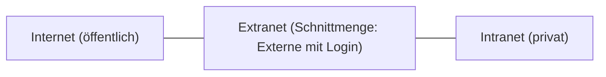

# Netzwerk-Grundbegriffe und Topologien

> [!summary] Kurz & knapp
> **Internet** (öffentlich), **Intranet** (privat, nur intern) und **Extranet** (für ausgewählte Externe wie Kunden und Lieferanten freigegeben) beschreiben, wer auf ein Netz zugreifen darf. Die **Topologie** beschreibt den Aufbau eines Netzes: physikalisch (Geräte und Kabel), logisch (Datenfluss) und geometrisch (Form, z. B. Stern).

## Internet, Intranet, Extranet

| Begriff | Zugriff | Beispiel |
| --- | --- | --- |
| **Internet** | öffentlich, für alle | öffentliche Webseiten |
| **Intranet** | privat, nur für Mitarbeitende (internes Firmennetz) | Mitarbeiterportal, interne Wikis |
| **Extranet** | Teil des Intranets, für ausgewählte Externe nach **Anmeldung** freigegeben | Kundenbereich eines Webshops, Lieferantenportal |

Tafelbeispiel Amazon: Der Shop **ohne Anmeldung** ist Internet, der Bereich **mit Anmeldung als „Kunde“** (Bestellungen, Konto) ist Extranet.

### DMZ (demilitarisierte Zone)
Ein durch Firewalls abgetrenntes Netzsegment **zwischen Internet und internem Netz**. Dort stehen Server, die von außen erreichbar sein müssen (Webserver, Mailserver). Wird ein solcher Server gehackt, ist das interne Netz trotzdem noch geschützt.

## Öffentliche und private IP-Adressen
Private Adressen werden **nicht im Internet geroutet** und sind frei für interne Netze nutzbar (RFC 1918). Öffentliche Adressen vergibt der Provider.

| Privater Bereich | Netz (CIDR) |
| --- | --- |
| 10.0.0.0 – 10.255.255.255 | 10.0.0.0/8 |
| 172.16.0.0 – 172.31.255.255 | 172.16.0.0/12 |
| 192.168.0.0 – 192.168.255.255 | 192.168.0.0/16 (im Heimnetz meist ein /24-Teilnetz, z. B. 192.168.1.0/24) |

## Netzgrößen
- **LAN** (Local Area Network): lokales Netz, z. B. ein Gebäude
- **CAN** (Campus Area Network): verbindet **mehrere lokale Netze** auf einem Gelände (Universität, Firmencampus, Schule). Vorteile: schnelle Datenübertragung, einfache zentrale Administration und Sicherheit, Gastzugänge möglich
- **MAN** (Metropolitan Area Network): Stadtnetz
- **WAN** (Wide Area Network): weiträumig, z. B. das Internet

## Topologien
- **Physikalische Topologie:** der tatsächliche Aufbau mit **Netzwerkkopplungsgeräten** (Switch, Router) und **Leitungen**
- **Logische Topologie:** der **Datenfluss**, also wie die Daten tatsächlich durch das Netz laufen
- **Geometrische Topologie:** die Form des Netzes

| Topologie | Aufbau | Vor- und Nachteil |
| --- | --- | --- |
| **Stern** (Star) | alle Geräte hängen an einem zentralen Switch | einfach erweiterbar, Kabelausfall betrifft nur ein Gerät. Fällt der Switch aus, ist alles weg. Heute Standard im LAN. |
| Bus | alle an einer gemeinsamen Leitung | wenig Kabel. Ein Leitungsfehler legt alles lahm (veraltet). |
| Ring | jedes Gerät mit zwei Nachbarn | Ausfall eines Geräts kann den Ring unterbrechen |
| Baum | mehrere Sterne hierarchisch verbunden | typisch für Gebäudeverkabelung |
| Vermascht | Geräte mehrfach verbunden | sehr ausfallsicher, teuer (Internet, WAN) |

> [!tip] Merke
> - Internet = öffentlich, Intranet = intern, Extranet = Externe mit Login.
> - DMZ = Pufferzone für öffentlich erreichbare Server.
> - Private IPs: 10/8, 172.16/12, 192.168/16.
> - Heutiges LAN: physikalisch **Stern** (bzw. erweiterter Stern/Baum).

## Lernfragen
> [!question]- Was unterscheidet ein Extranet von einem Intranet?
> Das Intranet ist nur für interne Mitarbeitende. Das Extranet öffnet Teile davon nach Anmeldung für ausgewählte Externe (Kunden, Lieferanten, Partner).

> [!question]- Wozu dient eine DMZ?
> Sie trennt öffentlich erreichbare Server (Web, Mail) per Firewall sowohl vom Internet als auch vom internen Netz. Ein kompromittierter Server gefährdet dann nicht direkt das LAN.

> [!question]- Nenne die drei privaten IPv4-Adressbereiche.
> 10.0.0.0/8, 172.16.0.0/12 und 192.168.0.0/16.

> [!question]- Was ist der Unterschied zwischen physikalischer und logischer Topologie?
> Die physikalische Topologie beschreibt die reale Verkabelung und die Geräte. Die logische beschreibt den Weg der Daten.

> [!question]- Was ist ein CAN?
> Ein Campus Area Network, das mehrere LANs auf einem Gelände (z. B. Uni- oder Firmencampus) verbindet.

## Siehe auch
- [[Netzwerkkabel - Twisted Pair und Kategorien]]
- [[Patchkabel herstellen - T568A und T568B]]
- [[Power over Ethernet]]
