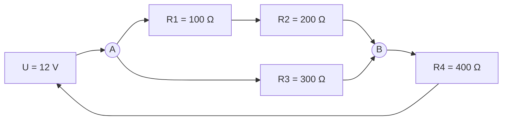

# Übung - Gemischte Schaltung

> [!summary] Kurz & knapp
> Tafelbeispiel „Gemischte Schaltungen“: Gesamtwiderstand einer Reihen-Parallel-Schaltung schrittweise bestimmen, dann Strom und Leistung berechnen.

![[LF2.pdf#page=50]]

## Aufgabe
Gegeben ist folgende Schaltung an $U = 12\,\text{V}$:
- $R_1 = 100\,\Omega$ und $R_2 = 200\,\Omega$ in Reihe,
- dazu parallel $R_3 = 300\,\Omega$,
- und das Ganze in Reihe mit $R_4 = 400\,\Omega$.

Berechne den Gesamtwiderstand, den Gesamtstrom und die aufgenommene Leistung.

> [!success]- Lösung
> **Schritt I – Reihenschaltung R1, R2:**
> $R_{12} = R_1 + R_2 = 100\,\Omega + 200\,\Omega = 300\,\Omega$
>
> **Schritt II – Parallelschaltung R12 ∥ R3** (gleiche Spannung, $I = I_{12} + I_3$):
> $\dfrac{1}{R_{123}} = \dfrac{1}{300\,\Omega} + \dfrac{1}{300\,\Omega} = \dfrac{2}{300\,\Omega} = \dfrac{1}{150\,\Omega}$ → $R_{123} = 150\,\Omega$
>
> **Schritt III – Reihenschaltung mit R4:**
> $R_{ges} = R_{123} + R_4 = 150\,\Omega + 400\,\Omega = \mathbf{550\,\Omega}$
>
> **Strom:**
> $I = \dfrac{U}{R_{ges}} = \dfrac{12\,\text{V}}{550\,\Omega} \approx 0{,}0218\,\text{A} = \mathbf{21{,}8\,mA}$
>
> **Leistung:**
> $P = U \cdot I = 12\,\text{V} \cdot 0{,}0218\,\text{A} \approx \mathbf{0{,}26\,W}$
>
> *Zusatz – Teilspannungen und -ströme:*
> - $U_4 = 400\,\Omega \cdot 0{,}0218\,\text{A} \approx 8{,}73\,\text{V}$
> - $U_{123} = 150\,\Omega \cdot 0{,}0218\,\text{A} \approx 3{,}27\,\text{V}$ (Probe: $8{,}73 + 3{,}27 = 12\,\text{V}$)
> - $I_3 = I_{12} = 3{,}27\,\text{V} / 300\,\Omega \approx 10{,}9\,\text{mA}$

> [!warning] Korrektur
> An der Tafel wurde $I = 0{,}021\,\text{A}$ (21 mA) gerundet und damit $P = 0{,}252\,\text{W}$ berechnet. Genauer ist $I \approx 0{,}0218\,\text{A}$ und $P \approx 0{,}262\,\text{W}$. Erst am Ende runden!

## Siehe auch
- [[Reihen- und Parallelschaltung]]
- [[Ohmsches Gesetz]]
- [[Elektrische Leistung und Energie]]
