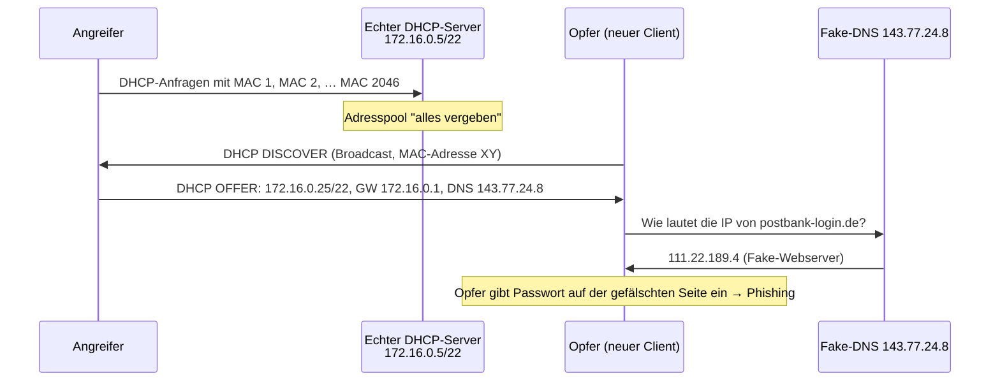

# DHCP-Starvation-Angriff

> [!summary] Kurz & knapp
> Bei der **DHCP-Starvation-Attack** („Aushungern“) fordert ein Angreifer mit vielen gefälschten MAC-Adressen so lange IP-Adressen an, bis der Pool des echten DHCP-Servers **leer** ist. Danach spielt er selbst DHCP-Server (**Rogue DHCP**). Er verteilt einen **gefälschten DNS-Server** und kann Opfer so auf **Phishing-Seiten** umleiten (Man in the Middle).

## Ablauf (nach dem Tafelbild)

1. **Aushungern:** Der Angreifer schickt massenhaft DHCP-Anfragen mit gefälschten MAC-Adressen (MAC 1 … MAC 2046). Der echte DHCP-Server (172.16.0.5/22) vergibt alle Adressen → „alles vergeben“.
2. **Rogue DHCP-Server:** Ein neuer Client meldet sich per DHCP an (DISCOVER). Nur noch der Angreifer antwortet mit einem OFFER: IPv4 172.16.0.25/22, Subnetzmaske 255.255.252.0, Gateway 172.16.0.1, **DNS 143.77.24.8** (Fake-DNS).
3. **DNS-Spoofing:** Der echte DNS-Server (z. B. 88.134.42.107) würde `postbank-login.de` → **89.22.117.9** (echter Webserver) auflösen. Der Fake-DNS liefert stattdessen **111.22.189.4**.
4. **Phishing:** Der Fake-Webserver sieht aus wie das Original und zeichnet die eingegebenen Passwörter auf.

Optional kann der Angreifer auch sich selbst als **Gateway** eintragen und damit den gesamten Verkehr mitlesen (**Man in the Middle**).

Tafelbild: ![[LF3.pdf#page=32]]

## Schutzmaßnahmen
- **DHCP-Snooping** auf dem Switch: Nur vertrauenswürdige Ports dürfen DHCP-Antworten senden
- **Port-Security:** Anzahl der MAC-Adressen pro Switch-Port begrenzen
- Netzwerk-Zugangskontrolle (IEEE 802.1X), Netzsegmentierung ([[VLAN]])
- Nutzerseitig: HTTPS-Zertifikat und Adresse prüfen

> [!tip] Merke
> - Starvation = DHCP-Pool mit gefälschten MACs leeren
> - Danach eigener (Rogue) DHCP-Server → falsches Gateway/DNS
> - Folge: Man in the Middle, DNS-Spoofing, Phishing
> - Schutz: DHCP-Snooping, Port-Security

## Lernfragen
> [!question]- Was ist das Ziel einer DHCP-Starvation-Attack?
> Den Adresspool des echten DHCP-Servers zu erschöpfen, sodass neue Clients keine Adresse mehr bekommen oder der Angreifer selbst als DHCP-Server antworten kann.

> [!question]- Wie gelingt es dem Angreifer, so viele Adressen anzufordern?
> Er schickt DHCP-Anfragen mit vielen gefälschten (zufälligen) MAC-Adressen.

> [!question]- Warum ist ein gefälschter DNS-Server im DHCP-Angebot gefährlich?
> Der Client fragt dann den Fake-DNS nach Adressen. Dieser kann bekannte Domains (z. B. Bank-Login) auf Phishing-Server umleiten.

> [!question]- Mit welcher Switch-Funktion schützt man sich gegen Rogue-DHCP-Server?
> DHCP-Snooping (dazu Port-Security gegen die vielen MAC-Adressen).

## Siehe auch
- [[DHCP]]
- [[DNS]]
- [[MAC-Adresse]]
- [[Übung DHCP-Aufgaben]]
