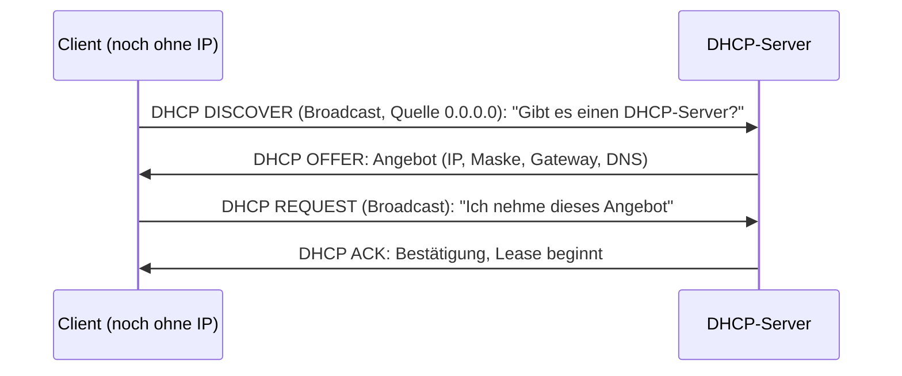

# DHCP (Dynamic Host Configuration Protocol)

> [!summary] Kurz & knapp
> DHCP verteilt **automatisch** die Netzwerkkonfiguration an Clients: **IPv4-Adresse, Subnetzmaske, Standardgateway und DNS-Server**. Ein neuer Client sucht den DHCP-Server per **Broadcast** (DHCP DISCOVER), weil er noch keine IP-Adresse hat. Der Ablauf heißt **DORA**: Discover, Offer, Request, Acknowledge.

## Ablauf (DORA)

| Nachricht | Bedeutung (Tafelbild) |
|---|---|
| DHCP DISCOVER | Erkennen (Suchen) des DHCP-Servers per Broadcast, mit der MAC-Adresse des Clients |
| DHCP OFFER | Angebot(e) vom DHCP-Server |
| DHCP REQUEST | Client fordert das gewählte Angebot an |
| DHCP ACK | Server bestätigt, die Adresse ist für die Lease-Dauer vergeben |

## Beispiel aus dem Tafelbild (Netz 172.16.0.0/22)
Ein DHCP-OFFER enthält z. B.:
- IPv4-Adresse: **172.16.0.25/22**
- Subnetzmaske: **255.255.252.0**
- Gateway: **172.16.0.1**
- DNS-Server: z. B. 88.134.42.107

Ein /22-Netz hat 2¹⁰ − 2 = **1022** vergebbare Adressen.

## Technische Eckdaten
- Transport über **UDP**: Server Port **67**, Client Port **68**
- Adressen werden für eine bestimmte Zeit **verliehen (Lease)** und müssen verlängert werden
- Bekommt ein Client keine Antwort, vergibt er sich selbst eine **APIPA**-Adresse (169.254.x.x), siehe [[Private und reservierte IPv4-Adressen]]
- Feste Zuordnung einer IP zu einer MAC-Adresse ist als **Reservierung** möglich
- DHCP ist ein Protokoll der **Anwendungsschicht (Schicht 7)**, transportiert per UDP/IP
- **DHCPv6** nutzt UDP-Port **547** (Server/Relay) und **546** (Client)
- Paketaufbau: **236 Byte** fester Teil (u. a. Client-MAC, angebotene IP) + variables **Optionsfeld** (Maske, Gateway, DNS, Lease-Dauer …). Jeder Client muss Pakete von mindestens **576 Byte** annehmen können.

## Weitere DHCP-Nachrichten
| Nachricht | Richtung | Bedeutung |
|---|---|---|
| DHCP NAK | Server → Client | Ablehnung: Die angefragte Adresse ist nicht (mehr) verfügbar oder passt nicht ins Netz, z. B. Laptop aus einem anderen Netz. Der Client beginnt neu mit DISCOVER. |
| DHCP DECLINE | Client → Server | Der Client hat per **ARP** festgestellt, dass die zugewiesene Adresse **schon benutzt wird** (Adresskonflikt), und lehnt sie ab. |
| DHCP RELEASE | Client → Server | Der Client gibt seine Adresse vorzeitig zurück (`ipconfig /release`). |
| DHCP INFORM | Client → Server | Der Client hat schon eine (statische) IP und fragt nur weitere Optionen ab, z. B. DNS-Server. |

## Lease-Erneuerung (Refresh)
- Nach **50 %** der Lease-Dauer (T1): REQUEST per **Unicast** an den bisherigen Server, ACK verlängert die Lease.
- Nach **87,5 %** (T2) ohne Antwort: REQUEST per **Broadcast** an jeden DHCP-Server (Rebinding).
- Lease abgelaufen: Adresse abgeben, neu mit DISCOVER beginnen.
- Windows: `ipconfig /release` gibt die Adresse ab, `ipconfig /renew` fordert neu an.

## Zuordnungsarten
| Art | Ablauf |
|---|---|
| **Manuell / statisch (Reservierung)** | feste Zuordnung MAC → IP im DHCP-Server, z. B. für Drucker und Server |
| **Automatisch** | Adresse aus dem Pool, **dauerhaft** vergeben |
| **Dynamisch** | Adresse aus dem Pool, **zeitlich begrenzt** (Lease), der Regelfall |

Eine IP-Adresse, die direkt am Gerät eingetragen wird, ist dagegen gar keine DHCP-Zuweisung.

## DHCP-Relay-Agent
Router leiten **keine Broadcasts** weiter. Steht der DHCP-Server in einem anderen Subnetz, nimmt ein **Relay-Agent** (meist der Router) den DISCOVER-Broadcast an und leitet ihn per **Unicast** an den Server weiter. So reicht ein zentraler DHCP-Server für viele Subnetze (Cisco: `ip helper-address <Server-IP>`).

## Fehlersuche: Client bekommt keine IP
- DHCP-Server nicht erreichbar (Kabel, falsches VLAN, fehlender Relay-Agent, Firewall)
- DHCP-Dienst gestoppt oder falsch konfiguriert
- Adresspool erschöpft (z. B. durch einen [[DHCP-Starvation-Angriff]])
- Folge in allen Fällen: APIPA-Adresse 169.254.x.x, also kein Gateway und kein Internet

## Sicherheitsrisiko
Weil Clients jedem antwortenden DHCP-Server vertrauen, kann ein Angreifer einen **falschen DHCP-Server** einschleusen, siehe [[DHCP-Starvation-Angriff]]. Schutz: **DHCP-Snooping** auf dem Switch, Port-Security.

> [!info] DHCP-Fragebogen
> Zum DHCP gab es einen Fragebogen auf CryptPad (Link im Original, PDF-Seite 31). Die eigenen Antworten mit Korrekturen stehen in [[Übung DHCP-Aufgaben]].

> [!tip] Merke
> - DHCP verteilt IP, Maske, Gateway, DNS
> - DORA: Discover → Offer → Request → Ack
> - Discover per Broadcast, da der Client noch keine IP hat
> - UDP-Ports 67 (Server) / 68 (Client)
> - DECLINE = Client meldet Adresskonflikt (per ARP erkannt), NAK = Server lehnt ab
> - Relay-Agent leitet DHCP über Subnetzgrenzen weiter, weil Router keine Broadcasts weiterleiten

## Lernfragen
> [!question]- Welche Informationen erhält ein Client per DHCP mindestens?
> IP-Adresse, Subnetzmaske, Standardgateway, DNS-Server (und die Lease-Dauer).

> [!question]- Nenne die vier Schritte von DHCP in der richtigen Reihenfolge.
> DISCOVER, OFFER, REQUEST, ACK (DORA).

> [!question]- Warum verschickt der Client die DISCOVER-Nachricht als Broadcast?
> Er hat noch keine IP-Adresse und kennt den DHCP-Server nicht.

> [!question]- Ein Client hat die Adresse 169.254.3.4. Was ist los?
> Kein DHCP-Server hat geantwortet, der Client hat sich per APIPA selbst eine Adresse gegeben.

> [!question]- Welche Ports und welches Transportprotokoll nutzt DHCP?
> UDP, Server-Port 67, Client-Port 68.

> [!question]- Wozu braucht man einen DHCP-Relay-Agent?
> Router leiten den DISCOVER-Broadcast nicht in andere Subnetze weiter. Der Relay-Agent nimmt ihn an und schickt ihn per Unicast an den DHCP-Server in einem anderen Subnetz.

> [!question]- Wann sendet ein Client DHCP DECLINE?
> Wenn er nach der Zuweisung per ARP feststellt, dass die Adresse bereits von einem anderen Gerät benutzt wird.

> [!question]- Wann versucht ein Client, seine Lease zu verlängern?
> Nach 50 % der Lease-Dauer per Unicast beim eigenen Server, ohne Antwort nach 87,5 % per Broadcast bei jedem DHCP-Server.

## Siehe auch
- [[DHCP-Starvation-Angriff]]
- [[MAC-Broadcast und Multicast]]
- [[DNS]]
- [[UDP]]
- [[Übung DHCP-Aufgaben]]
