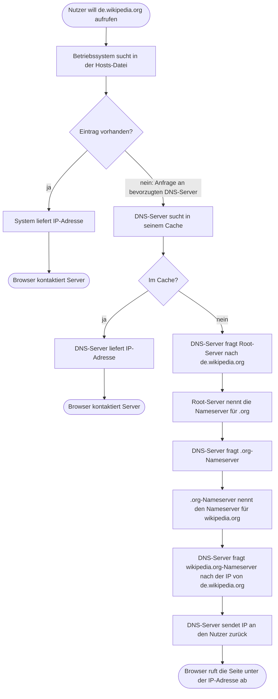

# DNS (Domain Name System)

> [!summary] Kurz & knapp
> DNS übersetzt **Namen** (z. B. `de.wikipedia.org`) in **IP-Adressen**, wie ein Telefonbuch des Internets. Bei einer Abfrage prüft der Rechner zuerst die **Hosts-Datei**, dann fragt er seinen **DNS-Server**. Dieser antwortet aus dem **Cache** oder fragt sich rekursiv über **Root-Server → TLD-Nameserver → zuständigen Nameserver** durch.

## Ablauf einer DNS-Abfrage

Original-Grafik (Wikipedia): ![[LF3.pdf#page=51]]

## Vorteile von DNS
- Menschen müssen sich nur **Namen** merken statt IP-Adressen.
- **Änderungen von IP-Adressen** (z. B. Umstieg von IPv4 auf IPv6) bleiben für Besucher unsichtbar, der Name bleibt gleich.
- **Lastverteilung:** Mehrere Webserver mit verschiedenen IP-Adressen sind unter einer Domain erreichbar. Der am wenigsten ausgelastete Server bekommt die nächste Anfrage → **Serverfarmen** sind möglich.
- Dadurch auch **Ausfallsicherheit**.
- **Tippfehler** fallen bei Namen eher auf als bei Zahlen.
- Lokale DNS-Server können Internetseiten **sperren**.
- Besonders bei **IPv6** sind Adressen mühselig einzugeben, DNS vereinfacht das Surfen.

## Technische Eckdaten
- Port **53**, meist über **UDP** (bei großen Antworten oder Zonentransfers TCP)
- Wichtige Einträge (Resource Records): **A** (IPv4), **AAAA** (IPv6), **NS** (Nameserver), **MX** (Mailserver), **CNAME** (Alias)
- Den DNS-Server bekommt der Client meist per [[DHCP]] zugewiesen
- Werkzeug: `nslookup` bzw. `dig`

> [!tip] Merke
> - DNS = Name → IP-Adresse
> - Reihenfolge: Hosts-Datei → DNS-Cache → Root → TLD → autoritativer Nameserver
> - Port 53, meist UDP
> - Ein manipulierter DNS-Server ermöglicht Phishing, siehe [[DHCP-Starvation-Angriff]]

## Lernfragen
> [!question]- Welche Aufgabe hat DNS?
> Es löst Domainnamen in IP-Adressen auf (und umgekehrt).

> [!question]- Wo sucht ein Rechner zuerst nach der IP-Adresse eines Namens?
> In der lokalen Hosts-Datei (bzw. im lokalen Cache), danach fragt er den eingestellten DNS-Server.

> [!question]- Beschreibe die Abfragekette, wenn der DNS-Server den Namen nicht im Cache hat.
> Root-Server → liefert den TLD-Nameserver (.org) → dieser liefert den Nameserver der Domain (wikipedia.org) → dieser liefert die IP von de.wikipedia.org → Antwort an den Client.

> [!question]- Nenne drei Vorteile von DNS.
> Namen sind leichter zu merken, IP-Wechsel bleiben unsichtbar, Lastverteilung/Ausfallsicherheit, Sperren von Seiten möglich.

> [!question]- Welcher Port und welches Protokoll werden für DNS-Abfragen genutzt?
> Port 53, meist UDP.

## Siehe auch
- [[URL, Domain und Hostname]]
- [[DHCP]]
- [[DHCP-Starvation-Angriff]]
- [[UDP]]
