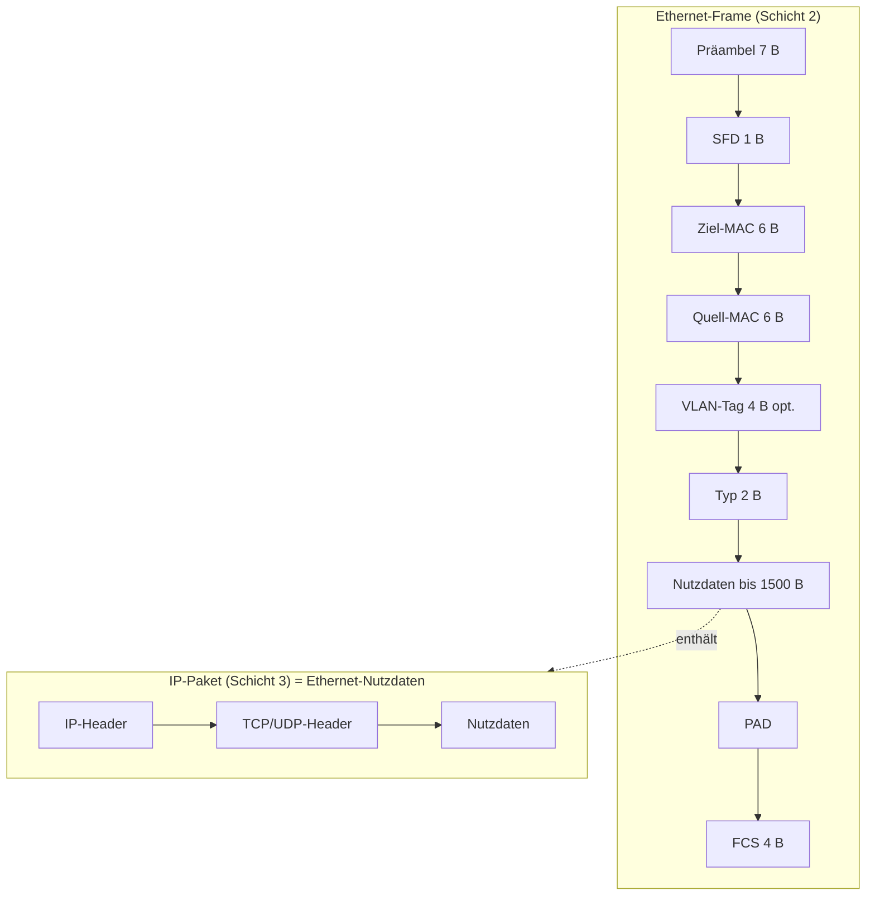

# Datenkapselung im TCP/IP-Modell

> [!summary] Kurz & knapp
> Jede Schicht verpackt die Daten der Schicht darüber in ihren eigenen Header. Das **IP-Paket** ist dabei die Nutzlast (Payload) des **Ethernet-Frames**, und das TCP/UDP-Segment ist die Nutzlast des IP-Pakets.

## Aufbau (Folie „IP-Paket als Nutzlast des Ethernet-Frames“)

| Bezeichnung | umfasst |
|---|---|
| Ethernet-Daten | IP-Header + TCP/UDP-Header + Nutzdaten |
| Internet-Daten (IP-Nutzlast) | TCP/UDP-Header + Nutzdaten |
| TCP/UDP-Daten | Nutzdaten der Anwendung |

Original-Grafik: ![[LF3.pdf#page=37]]

## Bezeichnungen der Dateneinheiten (PDU)
| Schicht | Dateneinheit |
|---|---|
| 4 Transport | Segment (TCP) / Datagramm (UDP) |
| 3 Vermittlung | Paket |
| 2 Sicherung | Frame (Rahmen) |
| 1 Bitübertragung | Bits |

> [!tip] Merke
> - Beim Senden kommt von oben nach unten je ein Header dazu (Kapselung). Beim Empfangen wird von unten nach oben ausgepackt.
> - Die maximale Nutzlast des Ethernet-Frames (MTU) beträgt **1500 Byte**. Davon gehen mindestens 20 Byte für den IP-Header und 20 Byte für den TCP-Header ab.
> - Im Typ-Feld des Ethernet-Frames steht, was in der Nutzlast steckt (0x0800 = IPv4).

## Lernfragen
> [!question]- Was ist die Nutzlast eines Ethernet-Frames?
> Das IP-Paket, also IP-Header, TCP/UDP-Header und Nutzdaten.

> [!question]- Wie heißen die Dateneinheiten auf Schicht 2, 3 und 4?
> Frame, Paket, Segment (TCP) bzw. Datagramm (UDP).

> [!question]- Woran erkennt der Empfänger, dass im Ethernet-Frame ein IPv4-Paket steckt?
> Am Typ-Feld (EtherType) mit dem Wert 0x0800.

> [!question]- Wie viele Nutzdaten bleiben für die Anwendung bei TCP über Ethernet maximal?
> 1500 − 20 (IP-Header) − 20 (TCP-Header) = **1460 Byte** (= MSS), wenn keine Optionen gesetzt sind.

## Siehe auch
- [[Ethernet-Frame]]
- [[IPv4-Header]]
- [[TCP-Header]] · [[UDP]]
- [[OSI-Schichtenmodell]]
