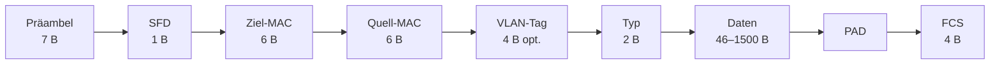

# Ethernet-Frame

> [!summary] Kurz & knapp
> Ein Ethernet-Paket besteht aus **Präambel + SFD** (Synchronisation) und dem eigentlichen **Frame**: Ziel-MAC, Quell-MAC, optionaler VLAN-Tag, Typ, Nutzdaten (46–1500 Byte, ggf. mit PAD aufgefüllt) und FCS-Prüfsumme. Ein Frame ist **min. 64 Byte** und **max. 1518 Byte** groß (mit VLAN-Tag 1522 Byte).

## Aufbau

| Feld | Größe | Inhalt / Zweck |
|---|---|---|
| Präambel | 7 Byte | 7 × 0x55 (`01010101`), Synchronisation |
| SFD (Start Frame Delimiter) | 1 Byte | 0xD5, markiert den Frame-Beginn |
| Ziel-MAC-Adresse | 6 Byte | Empfänger |
| Quell-MAC-Adresse | 6 Byte | Absender |
| VLAN-Tag (optional) | 4 Byte | TPID 0x8100 + TCI (Priorität, DE, VLAN-ID) |
| Typ (EtherType) | 2 Byte | Protokoll der Nutzdaten |
| Nutzdaten | 46–1500 Byte (mit VLAN-Tag 42–1500) | z. B. IP-Paket |
| PAD (Füllfeld) | 0–46 Byte | füllt zu kurze Nutzdaten mit Nullen auf |
| FCS (Frame Check Sequence) | 4 Byte | CRC-32-Prüfsumme |

**Ethernet-Frame** = Ziel-MAC bis FCS: min. 64 Byte, max. 1518 Byte (mit VLAN-Tag 1522 Byte).
**Ethernet-Paket** = Präambel + SFD + Frame.

Original-Grafiken mit Beispielwerten:
![[LF3.pdf#page=19]]
![[LF3.pdf#page=20]]

## Die Felder im Detail

### Präambel
- Steht vor dem eigentlichen Frame (Präambel = Einleitung, Vorwort), **7 Byte**.
- Testsignal mit **maximaler Signaländerung pro Zeit** (abwechselnd 1 und 0).
- Der Empfänger synchronisiert damit seinen Takt auf den Sender (**Synchronisationsprozess**). Er muss aus den Präambel-Daten 7 × 0x55 erkennen.
- Durch Trägheit und physikalische Eigenschaften der Leitung kann es passieren, dass Bits nicht korrekt erkannt werden.

### Start Frame Delimiter (SFD)
- Markiert das **Ende der Präambel** und den **Start des Frames**.
- Wert **0xD5** = `1101 0101`. Auf der Leitung (LSB first) wird `1010 1011` übertragen. Die abschließende **„11“** signalisiert: Jetzt folgen die Informationen (Ziel-MAC).

### VLAN-Tag (IEEE 802.1Q, optional)
- Kennzeichnet **virtuelle Netze** (z. B. LBS-Gast, LBS-Verwaltung), siehe [[VLAN]]
- Wird vom **Switch** gesetzt bzw. ausgewertet
- **TPID** (Tag Protocol Identifier, 16 Bit) = **0x8100** zeigt an, dass ein VLAN-Tag folgt
- **TCI** (Tag Control Information, 16 Bit):
  - **PCP** (3 Bit): Priorität 0–7 (802.1p, Quality of Service)
  - **DE** (1 Bit): Drop Eligible, darf bei Überlast verworfen werden
  - **VLAN-ID** (12 Bit): 2¹² = 4096 Werte. 0x000 und 0xFFF sind reserviert → **1–4094** nutzbar

> [!example] Beispiel aus der Grafik
> VLAN-Tag `81 00 03 E9`: TPID = 0x8100. TCI = 0x03E9 = `000 0 0011 1110 1001` → PCP = 0, DE = 0, VLAN-ID = 0x3E9 = **1001** (dezimal).

### Typ (EtherType)
Gibt an, zu welchem Protokoll die Nutzdaten gehören:

| Wert | Protokoll |
|---|---|
| 0x0800 | IPv4 |
| 0x86DD | IPv6 |
| 0x0806 | ARP |
| 0x0842 | Wake on LAN (WoL) |
| 0x8100 | VLAN-Tag (802.1Q), steht an der Stelle des Typ-Felds |

### Nutzdaten und PAD
- **Minimal 46 Byte** (mit VLAN-Tag 42 Byte), damit der Frame mindestens 64 Byte lang ist
- Ist die Mindestgröße nicht erreicht, füllt das **PAD-Füllfeld** den Rest mit Nullen auf
- **Maximal 1500 Byte** = **MTU** (Maximum Transmission Unit)

### FCS (Frame Check Sequence)
- 4 Byte **CRC-Prüfsumme** (Cyclic Redundancy Check), berechnet aus dem Inhalt des Frames
- Der Empfänger berechnet die Prüfsumme neu. Ist sie ungleich, wird der Frame **verworfen** und den höheren Schichten ein Fehler gemeldet.
- Ethernet kann Fehler also **erkennen, aber nicht korrigieren**.

> [!warning] Korrektur
> - „Max. 1500 Byte (**MSS**)“: Die 1500 Byte sind die **MTU** (Maximum Transmission Unit). Die MSS (Maximum Segment Size) ist ein TCP-Begriff: 1500 − 20 − 20 = 1460 Byte.
> - „**Cycle** Redundancy Check“: Richtig heißt es **Cyclic** Redundancy Check.
> - SFD „Kanonische Schreibweise: 1010 1011“: Genau umgekehrt. **0xD5 = 1101 0101** ist die kanonische (Hex-)Schreibweise, `1010 1011` ist die Bitfolge auf der Leitung. Siehe [[MAC-Adresse - Darstellung und kanonische Form]].
> - „Ist die Präambel nicht korrekt, wird die Übertragungsgeschwindigkeit halbiert“: Das ist **keine** Funktion der Präambel. Sie dient nur der Taktsynchronisation. Die Übertragungsgeschwindigkeit handeln die Geräte beim Verbindungsaufbau per **Autonegotiation** aus. Bei schlechter Leitung kann dort eine niedrigere Geschwindigkeit gewählt werden.

> [!tip] Merke
> - Reihenfolge: Präambel (7) – SFD (1) – Ziel-MAC (6) – Quell-MAC (6) – [VLAN-Tag (4)] – Typ (2) – Daten (46–1500) – FCS (4)
> - **Ziel-MAC steht vor Quell-MAC!**
> - Frame: 64–1518 Byte (1522 mit VLAN-Tag)
> - EtherType 0x0800 = IPv4, 0x86DD = IPv6, 0x0806 = ARP
> - FCS/CRC = Fehlererkennung, keine Fehlerkorrektur

## Lernfragen
> [!question]- Nenne die Felder des Ethernet-Frames in der richtigen Reihenfolge mit Größen.
> Präambel 7 B, SFD 1 B, Ziel-MAC 6 B, Quell-MAC 6 B, (VLAN-Tag 4 B), Typ 2 B, Nutzdaten 46–1500 B (+PAD), FCS 4 B.

> [!question]- Wozu dienen Präambel und SFD?
> Mit der Präambel synchronisiert sich der Empfänger auf den Takt des Senders. Der SFD (0xD5) markiert das Ende der Präambel und den Beginn des Frames.

> [!question]- Was passiert, wenn die Nutzdaten nur 20 Byte groß sind?
> Das PAD-Feld füllt sie mit Nullen auf die Mindestgröße von 46 Byte auf (mit VLAN-Tag 42 Byte), damit der Frame mindestens 64 Byte lang ist.

> [!question]- Wie viele VLANs sind mit dem VLAN-Tag möglich und warum?
> Die VLAN-ID hat 12 Bit → 2¹² = 4096 Werte. 0 und 4095 sind reserviert → 4094 nutzbare VLANs (1–4094).

> [!question]- Was macht der Empfänger, wenn die FCS nicht stimmt?
> Er verwirft den Frame und meldet einen Fehler an die höheren Schichten. Es gibt keine Fehlerkorrektur, nur eine Fehlererkennung.

> [!question]- Welcher EtherType kennzeichnet IPv4, IPv6 und ARP?
> 0x0800, 0x86DD und 0x0806.

## Siehe auch
- [[MAC-Adresse]]
- [[VLAN]]
- [[Datenkapselung im TCP-IP-Modell]]
- [[IPv4-Header]]
