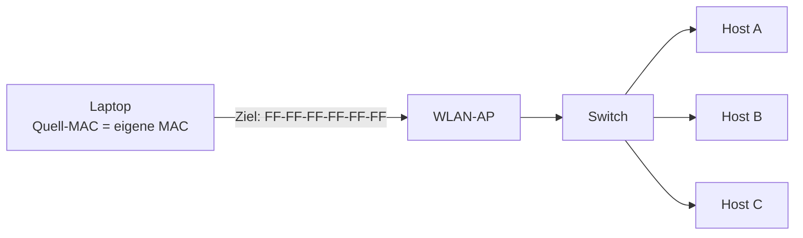

# MAC-Broadcast und Multicast

> [!summary] Kurz & knapp
> Ein **Broadcast** (Rundruf) geht an **alle** Stationen im lokalen Netz, ein **Multicast** an eine **Gruppe** von Stationen. Es gibt genau eine MAC-Broadcast-Adresse: **FF-FF-FF-FF-FF-FF** (alle 48 Bit = 1). Broadcast- und Multicast-Adressen gibt es nur als **Zieladressen**.

## Arten der Adressierung
| Art | Empfänger | Zieladresse |
|---|---|---|
| Unicast | genau eine Station | normale MAC (I/G = 0) |
| Multicast | Gruppe von Stationen | I/G-Bit = 1, z. B. standardisierte Multicast-Adressen |
| Broadcast | alle Stationen im Netz | FF-FF-FF-FF-FF-FF |

| | Bitmuster | Kanonische Form |
|---|---|---|
| Broadcast-Adresse | 11111111 11111111 11111111 11111111 11111111 11111111 | FF-FF-FF-FF-FF-FF |

## Beispiel aus dem Unterricht: Anmeldung im Netz
Laptop → WLAN-Access-Point → Switch (Netz „LBS-Gast“)

Beim Anmeldevorgang, z. B. bei der DHCP-Anfrage, kennt der Laptop noch keinen Empfänger. Deshalb schickt er einen Frame mit:
- **Ziel:** MAC-Broadcast-Adresse FF-FF-FF-FF-FF-FF → alle im gleichen lokalen Netz (hier LBS-Gast) erhalten den Frame
- **Quelle:** seine eigene physikalische MAC-Adresse

Jeder Frame enthält also **2 MAC-Adressen** (Ziel und Quelle).

## Broadcast-Sturm
- Broadcasts **belasten** das Netz stark, denn jede Station muss den Frame verarbeiten.
- Bei einem **Broadcast-Sturm** werden Broadcasts immer weiter vervielfältigt, z. B. durch Schleifen zwischen Switches. Das Netz kann dadurch komplett **zum Erliegen kommen**.
- Broadcasts über Netzgrenzen hinweg vermeidet man daher. **Router leiten Broadcasts nicht weiter**, ein Subnetz bzw. VLAN bildet eine eigene Broadcast-Domäne. Siehe [[Subnetting]] und [[VLAN]].

> [!warning] Korrektur
> In der Mitschrift stand, die Broadcast-Adresse „beginnt mit 11, weil sie per Software erzeugt ist“. Richtig ist: Die Broadcast-Adresse besteht aus **lauter Einsen** (FF-FF-FF-FF-FF-FF). Deshalb sind auch I/G = 1 (Gruppe) und U/L = 1. Mit „Software erzeugt“ hat das nichts zu tun. Außerdem hat sie 12 F (48 Bit), nicht 6 (in der Mitschrift waren nur 24 Bit notiert).

> [!tip] Merke
> - Broadcast-MAC = FF-FF-FF-FF-FF-FF, nur als Zieladresse
> - Broadcast = Rundruf an alle im selben Netz (Broadcast-Domäne)
> - Broadcast-Sturm = Überlastung durch massenhaft Broadcasts
> - Router begrenzen Broadcast-Domänen

## Lernfragen
> [!question]- Wie lautet die MAC-Broadcast-Adresse?
> FF-FF-FF-FF-FF-FF (48 × Bit 1).

> [!question]- Warum verwendet ein Client bei der Anmeldung im Netz die Broadcast-Adresse als Ziel?
> Er kennt die MAC-Adresse des Ziels (z. B. des DHCP-Servers) noch nicht. Per Broadcast erreicht er alle Stationen im lokalen Netz.

> [!question]- Was ist ein Broadcast-Sturm?
> Broadcasts vervielfältigen sich, z. B. durch Switch-Schleifen, bis das Netz überlastet ist und zum Erliegen kommt.

> [!question]- Können Broadcast-Adressen als Quelladresse verwendet werden?
> Nein. Broadcast- und Multicast-Adressen gibt es nur als Zieladressen.

> [!question]- Wodurch wird eine Broadcast-Domäne begrenzt?
> Durch Router bzw. die Aufteilung in Subnetze oder VLANs.

## Siehe auch
- [[MAC-Adresse]]
- [[DHCP]]
- [[Subnetting]] · [[VLAN]]
