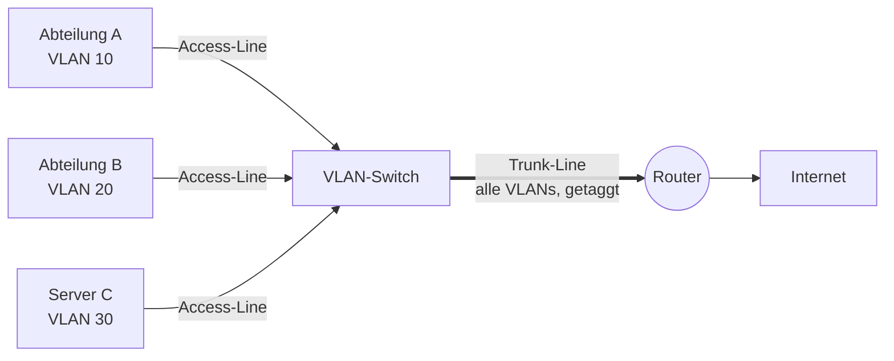

# VLAN (Virtual Local Area Network)

> [!summary] Kurz & knapp
> Mit VLANs wird **ein physikalischer Switch in mehrere logische Switches** aufgeteilt. Jeder Port gehört zu einem VLAN. Frames werden nur an Ports **desselben VLANs** weitergegeben. Zwischen VLANs kommuniziert man nur über einen **Router** (Inter-VLAN-Routing). Das spart Hardware und Kosten.

## Ausgangslage: bisheriger Aufbau (ohne VLAN)
Jede Abteilung (A: 15 PCs, B: 5 PCs, C: 2 Server) hat einen **eigenen Switch**, und alle Switches hängen am Router (Gateway) zum Internet.

**Probleme:**
- Hardware wird schlecht ausgelastet oder ist komplett belegt, ein Ausgleich untereinander ist nicht möglich
- Viel Hardware, die teilweise ungenutzt ist → **Kosten ↑** (Energie, Geräte, Platz im Rack)

## Neue Lösung mit VLAN

- **Access-Line (Access-Port):** überträgt nur **ein** zugelassenes VLAN, getrennt von den anderen. Endgeräte hängen hier ungetaggt.
- **Trunk-Line (Trunk-Port):** überträgt **mehrere VLANs** über eine Leitung, z. B. zum Router, damit dieser zwischen den VLANs vermitteln kann. Die Frames werden dabei mit dem VLAN-Tag (802.1Q) gekennzeichnet.

## Eigenschaften
- Ein physikalischer Switch wird in **mehrere logische Switches** unterteilt
- Die **Ports** des Switches werden **VLANs zugeordnet**
- VLANs werden anhand der **VLAN-ID (1 … 4094)** unterschieden, siehe VLAN-Tag im [[Ethernet-Frame]]
- Datensätze, die an einem VLAN-Port eingehen, werden **nur an Ports desselben VLANs** weitergegeben
- **Nur mit Hilfe eines Routers** (oder Layer-3-Switches) ist **Inter-VLAN-Routing** möglich
- Jedes VLAN ist eine eigene **Broadcast-Domäne** und bekommt in der Regel ein eigenes IP-Subnetz

## Vorteile
- In diesem Beispiel nur noch **1 Switch** nötig
- Hardwareauslastung **flexibler** gestaltbar
- → **weniger Hardware** → **Kosten ↓**
- Weitere Vorteile wie bei [[Subnetting]]: weniger Broadcast-Last, Zugriffsberechtigungen steuerbar (Sicherheit), bessere Übersicht

Tafelbilder:
![[LF3.pdf#page=59]]
![[LF3.pdf#page=60]]
![[LF3.pdf#page=61]]

> [!tip] Merke
> - VLAN = logische Aufteilung eines physikalischen Switches
> - Access-Port = 1 VLAN; Trunk-Port = mehrere VLANs (getaggt nach 802.1Q)
> - VLAN-ID 12 Bit → 1–4094 nutzbar
> - Kommunikation zwischen VLANs nur über Router/Layer-3-Switch

## Lernfragen
> [!question]- Was ist ein VLAN?
> Eine logische Aufteilung eines physikalischen Switches in mehrere virtuelle Netze. Ports werden VLANs zugeordnet, und Frames bleiben innerhalb ihres VLANs.

> [!question]- Was unterscheidet eine Access-Line von einer Trunk-Line?
> Die Access-Line überträgt nur ein VLAN (Anschluss von Endgeräten). Die Trunk-Line überträgt mehrere VLANs mit VLAN-Tag, z. B. zwischen Switches oder zum Router.

> [!question]- Wie können zwei Rechner in verschiedenen VLANs miteinander kommunizieren?
> Nur über einen Router bzw. Layer-3-Switch (Inter-VLAN-Routing).

> [!question]- Nenne zwei Vorteile von VLANs gegenüber getrennten physischen Switches.
> Weniger Hardware und damit geringere Kosten (Energie, Geräte). Die Ports lassen sich flexibel nutzen und besser auslasten. Außerdem gibt es kleinere Broadcast-Domänen und eine Zugriffssteuerung.

> [!question]- Wo im Ethernet-Frame steht die VLAN-Zugehörigkeit?
> Im optionalen 4-Byte-VLAN-Tag (TPID 0x8100 + TCI mit 12-Bit-VLAN-ID) zwischen Quell-MAC und Typ-Feld.

## Siehe auch
- [[Ethernet-Frame]]
- [[Subnetting]]
- [[Routing und Default Route]]
- [[MAC-Broadcast und Multicast]]
