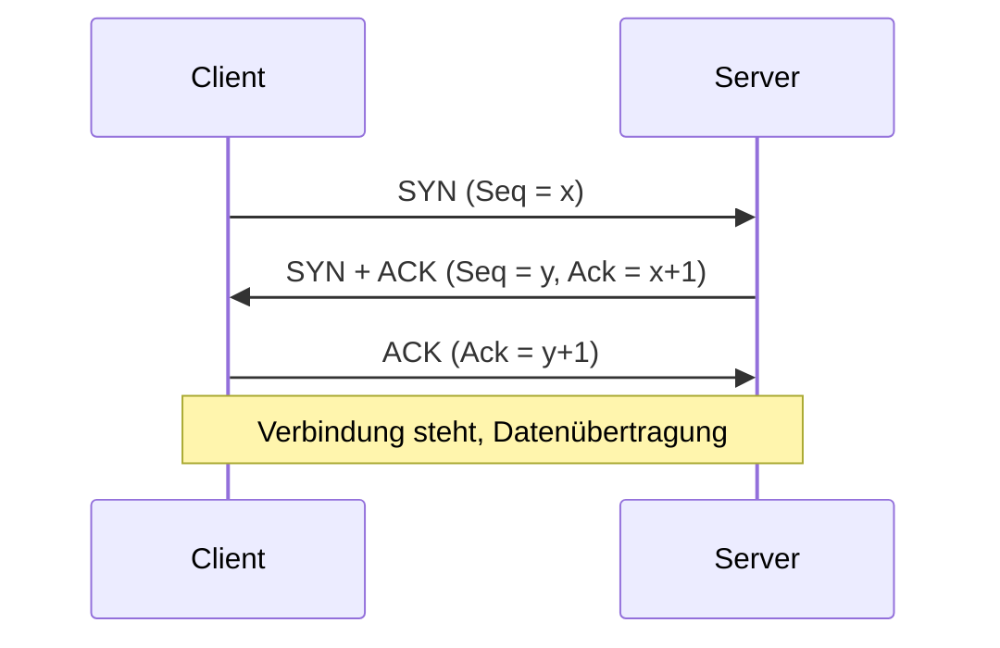

# TCP und der TCP-Header

> [!summary] Kurz & knapp
> TCP (Transmission Control Protocol) ist ein **verbindungsorientiertes, zuverlässiges** Transportprotokoll (Schicht 4). Mit **Sequenz- und Bestätigungsnummern** sichert es Reihenfolge und Vollständigkeit, mit dem **Window**-Feld steuert es den Datenfluss. Der Header ist mindestens **20 Byte** groß.

## Aufbau des TCP-Headers

| Bit 0–15 | Bit 16–31 |
|---|---|
| Source Port (16) | Destination Port (16) |
| Sequence Number (32) | |
| Acknowledgement Number (32) | |
| Data Offset (4) · Reserved · Flags | Window (16) |
| Checksum (16) | Urgent Pointer (16) |
| Options (0–40 Byte) + Padding | |
| *Daten beginnen hier …* | |

Original: ![[LF3.pdf#page=57]]

## Die Felder

| Feld | Größe | Bedeutung |
|---|---|---|
| **Quell-/Zielport** | je 16 Bit | geben an, welcher Dienst bzw. welche Anwendung genutzt wird (z. B. Port 443 für HTTPS). Der Client wählt für jede neue Anfrage einen eigenen Quellport, damit der Rechner die Daten richtig zuordnen kann |
| **Sequence Number** | 32 Bit | Beim Verbindungsaufbau wird eine zufällige Startnummer (ISN) erzeugt. Damit kann der Empfänger die Pakete in die **richtige Reihenfolge** bringen. Er wartet, bis die erwartete Nummer eintrifft: Duplikate (zu kleine Nummern) werden verworfen, zu früh eintreffende (größere) zwischengespeichert |
| **Acknowledgement Number** | 32 Bit | bestätigt den Erhalt der bisherigen Daten und gibt an, **welches Byte als Nächstes erwartet** wird. So weiß der Sender, welche Daten angekommen sind und nicht mehr zwischengespeichert werden müssen |
| **Data Offset** | 4 Bit | Länge des TCP-Headers (in 32-Bit-Worten) → zeigt, **wo die Nutzdaten beginnen** |
| **Reserved (RSV)** | ursprünglich 6 Bit (heute 3–4) | für künftige Funktionen reserviert, wird mit 0 aufgefüllt |
| **Flags** | ursprünglich 6 Bit (heute bis 9) | steuern den Ablauf der Verbindung: Aufbau, Bestätigung, Abbau. **URG, ACK, PSH, RST, SYN, FIN** |
| **Window** | 16 Bit | teilt dem Sender mit, wie viele Bytes der Empfänger ab dem bestätigten Byte noch aufnehmen kann → **Flusssteuerung**, schützt den Empfänger vor Überflutung |
| **Checksum** | 16 Bit | wird aus TCP-Header und Daten berechnet (plus Pseudo-Header mit IP-Adressen). Sender und Empfänger berechnen sie und gleichen sie ab. Bei Abweichung wird das Segment verworfen und, weil die Bestätigung fehlt, erneut gesendet |
| **Urgent Pointer** | 16 Bit | nur gültig, wenn das URG-Flag gesetzt ist. Markiert den Bereich mit **dringenden Daten**, die vorrangig behandelt werden |
| **Options** | bis 40 Byte | Zusatzfunktionen, z. B. **MSS**, **Window Scaling** (Fenster vergrößern → schneller, effizienter), **Selective Acknowledgement** (Empfänger meldet, was er schon hat und was noch fehlt) |

## Flags (Steuerbits)
| Flag | Bedeutung |
|---|---|
| SYN | Verbindungsaufbau, Sequenznummern synchronisieren |
| ACK | Acknowledgement-Nummer ist gültig (Bestätigung) |
| FIN | geordneter Verbindungsabbau |
| RST | Verbindung sofort zurücksetzen/abbrechen |
| PSH | Daten sofort an die Anwendung weitergeben |
| URG | Urgent Pointer ist gültig |

## Verbindungsaufbau (3-Way-Handshake)

> [!warning] Korrektur
> - **Acknowledgement Number:** In der Mitschrift stand „zuletzt empfangene Sequence Number + 1“. Genau ist: Ack = empfangene Sequence Number **+ Anzahl empfangener Datenbytes** (= nächstes erwartetes Byte). Das „+1“ gilt nur für SYN und FIN, die je eine Sequenznummer verbrauchen.
> - **Window:** Die Notiz „gleichzusetzen mit Präambel vom Ethernet-Frame“ ist falsch. Die Präambel dient der Taktsynchronisation, das Window der **Flusssteuerung**.
> - **Window = 0:** Die Übertragung wird nicht *abgebrochen*, sondern **pausiert**, bis der Empfänger wieder ein Fenster > 0 meldet (Zero Window).

> [!tip] Merke
> - TCP: verbindungsorientiert, zuverlässig, Header min. 20 Byte
> - Sequence Number → Reihenfolge; Ack Number → Bestätigung; Window → Flusssteuerung
> - 3-Way-Handshake: SYN → SYN/ACK → ACK
> - Protokollnummer im IP-Header: 6

## Lernfragen
> [!question]- Wodurch unterscheidet sich TCP von UDP?
> TCP ist verbindungsorientiert (Handshake), bestätigt Daten (ACK), sendet Verlorenes erneut, sichert die Reihenfolge und steuert den Fluss. Header min. 20 Byte. UDP ist verbindungslos, ohne Bestätigung, 8-Byte-Header, schneller.

> [!question]- Wozu dienen Sequence und Acknowledgement Number?
> Die Sequence Number nummeriert die gesendeten Bytes (Reihenfolge, Duplikaterkennung). Die Acknowledgement Number bestätigt den Empfang und nennt das nächste erwartete Byte.

> [!question]- Welche Aufgabe hat das Window-Feld?
> Flusssteuerung: Der Empfänger teilt mit, wie viele Bytes er noch aufnehmen kann, bevor eine neue Bestätigung nötig ist.

> [!question]- Beschreibe den 3-Way-Handshake.
> Der Client sendet SYN, der Server antwortet mit SYN+ACK, der Client bestätigt mit ACK.

> [!question]- Wozu dient das Data-Offset-Feld?
> Es gibt die Länge des TCP-Headers an (wegen der variablen Optionen), also wo die Nutzdaten beginnen.

## Siehe auch
- [[UDP]]
- [[IPv4-Header]]
- [[Datenkapselung im TCP-IP-Modell]]
- [[OSI-Schichtenmodell]]
