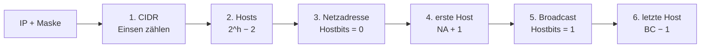

# Netzbestimmung in 6 Schritten

> [!summary] Kurz & knapp
> Aus einer **IPv4-Adresse** und der **Subnetzmaske** bestimmt man in 6 Schritten die Netzkonfiguration und -größe: CIDR, Hostanzahl, Netzadresse, erste Hostadresse, Broadcastadresse und letzte Hostadresse.

**Gegeben:** IPv4-Adresse und Subnetzmaske
**Gesucht:** Netzkonfiguration und Größe (Skalierung)

## Die 6 Schritte

| Nr. | Gesucht | Bildungsregel | Wofür? |
|---|---|---|---|
| 1 | Subnetzmaske in **CIDR-Notation** | Anzahl der 1-Bits der Maske zählen | Kurzschreibweise |
| 2 | **Anzahl möglicher Hosts** | 2^Hostbits − 2 | Größe des Netzes |
| 3 | **Netzadresse** | alle Hostbits der IP auf **0** | Routing zwischen Netzen |
| 4 | **Erste Hostadresse** | Netzadresse + 1 | meist für das Gateway |
| 5 | **Broadcastadresse** | alle Hostbits der IP auf **1** | Rundruf, z. B. bei Anmeldung im Netz |
| 6 | **Letzte Hostadresse** | Broadcastadresse − 1 | |

## Kurzbeispiel: 172.16.209.250 / 255.255.248.0
1. 255.255.248.0 = 11111111.11111111.11111**000**.00000000 → **/21** (11 Hostbits)
2. 2¹¹ − 2 = **2046 Hosts**
3. Das 3. Oktett ist das „interessante“: 209 = 11010**001** → Hostbits auf 0 → 11010**000** = 208 → **172.16.208.0**
4. **172.16.208.1**
5. 11010**111**.11111111 → **172.16.215.255**
6. **172.16.215.254**

Ausführlich: [[Übung Netzbestimmung 172.16.209.250-21]] · weiteres Beispiel: [[Übung Netzbestimmung 192.168.53.173-19]]

> [!tip] Schnellweg über die Blockgröße
> Blockgröße = 256 − Maskenwert im interessanten Oktett (hier 256 − 248 = **8**).
> Netze im 3. Oktett: 0, 8, 16, … 200, **208**, 216 … → 209 liegt im Block 208–215.
> Netzadresse = 172.16.208.0, Broadcast = 172.16.215.255.

> [!tip] Merke
> - Netzadresse: alle Hostbits **0**. Broadcast: alle Hostbits **1**.
> - Erste Host = NA + 1 (oft Gateway), letzte Host = BC − 1
> - Nur in dem Oktett rechnen, in dem sich Netz- und Hostanteil trennen. Links davon bleibt alles gleich, rechts davon ist es 0 (NA) bzw. 255 (BC).

## Lernfragen
> [!question]- Wie bildet man die Netzadresse?
> Alle Hostbits der IP-Adresse auf 0 setzen (bitweise UND von IP und Maske).

> [!question]- Wie bildet man die Broadcastadresse?
> Alle Hostbits der IP-Adresse auf 1 setzen.

> [!question]- Bestimme Netz- und Broadcastadresse von 10.0.5.77/22.
> /22 → 3. Oktett, Blockgröße 4. 5 liegt im Block 4–7 → NA **10.0.4.0**, BC **10.0.7.255**, Hosts 1022.

> [!question]- Wofür wird die erste Hostadresse häufig verwendet?
> Für das Standardgateway (Router-Interface).

> [!question]- Wofür werden Netzadresse und Broadcastadresse benötigt?
> Die Netzadresse für das Routing (Einträge in Routingtabellen), die Broadcastadresse für Rundrufe an alle Hosts, z. B. bei der Anmeldung per DHCP.

## Siehe auch
- [[Subnetzmaske und CIDR-Notation]]
- [[Subnetting]]
- [[Übung Netzbestimmung 172.16.209.250-21]]
- [[Übung Netzbestimmung 192.168.53.173-19]]
- [[Übung Subnetting Patiententrakt]]
