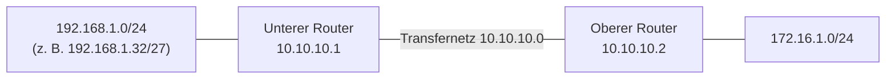

# Routing und Default Route

> [!summary] Kurz & knapp
> Ein Router leitet IP-Pakete anhand seiner **Routingtabelle** weiter. Jeder Eintrag besteht aus **Netzwerk, Maske und Next Hop**. Die **Default Route** (0.0.0.0/0) gilt für alle unbekannten Ziele. Auf einem Client entspricht sie dem **Standardgateway**.

## Routingtabelle
| Spalte | Bedeutung |
|---|---|
| Network | Zielnetz (Netzadresse) |
| Mask | Subnetzmaske des Zielnetzes |
| Next Hop | Adresse des nächsten Routers, an den das Paket geschickt wird |

Der Router sucht den **passendsten** (spezifischsten, längstes Präfix) Eintrag. Passt keiner, gilt die Default Route.

## Default Route
| Network | Mask | Next Hop |
|---|---|---|
| 0.0.0.0 | 0.0.0.0 | x.y.z (z. B. Router des Providers) |

„Alle Datenpakete mit IPv4-Adressen, die dem Router **unbekannt** sind, sende an den Next Hop.“
Auf dem Client heißt die Default Route **Gateway-Adresse** (Standardgateway).

**Routingtabelle anzeigen** (Windows-Kommandofenster): `route print` (Linux: `ip route`)

## Beispiel aus dem Unterricht (Tafelbild)
Auf der Tafel stehen zwei Routingeinträge (Transfernetz 10.10.10.0 zwischen den Routern):

| Tafel-Überschrift | Network | Mask | Next Hop | Bedeutung |
|---|---|---|---|---|
| unterer Router | 192.168.1.32 | 255.255.255.224 | 10.10.10.1 | Pakete ins Subnetz 192.168.1.32/27 an 10.10.10.1 senden |
| oberer Router | 172.16.1.0 | 255.255.255.0 | 10.10.10.2 | Datenpakete an alle IP-Adressen 172.16.1.1 – 172.16.1.254 an 10.10.10.2 senden |

**Interpretation:** Die Überschriften bezeichnen den Router, **hinter dem** das Zielnetz liegt. Der untere Router hat im Transfernetz die Adresse 10.10.10.1 und versorgt das Netz 192.168.1.0/24 (aufgeteilt in 8 × /27). Der obere Router hat 10.10.10.2 und versorgt 172.16.1.0/24. Jeder Router braucht also einen Eintrag für das Netz des **jeweils anderen** Routers, mit dessen Transfernetz-Adresse als Next Hop.

Auf der Tafel wurde der Eintrag für 192.168.1.0/24 nacheinander für einzelne /27-Subnetze durchgespielt (.32, .96, .160, .192; Maske .224). Entweder gibt es pro Subnetz einen eigenen Eintrag, oder man fasst alle mit **einem** Eintrag 192.168.1.0/24 zusammen.

> [!warning] Unsicher
> Die Zuordnung der Router-Adressen (10.10.10.1 = unten, 10.10.10.2 = oben) ist aus dem Tafelfoto abgeleitet und nicht ausdrücklich beschriftet. Bitte mit dem Foto vergleichen: ![[LF3.pdf#page=58]]

> [!tip] Merke
> - Routingeintrag = Zielnetz + Maske + Next Hop
> - Default Route = 0.0.0.0/0.0.0.0 → „alles Unbekannte an …“
> - Client: Default Route = Standardgateway (muss im eigenen Subnetz liegen!)
> - `route print` zeigt die Routingtabelle unter Windows

## Lernfragen
> [!question]- Aus welchen Angaben besteht ein Eintrag in einer Routingtabelle?
> Zielnetz (Network), Subnetzmaske (Mask) und Next Hop (Gateway/nächster Router), dazu oft das Interface und eine Metrik.

> [!question]- Wie lautet die Default Route und was bedeutet sie?
> Network 0.0.0.0, Mask 0.0.0.0. Alle Pakete an unbekannte Ziele werden an den angegebenen Next Hop geschickt.

> [!question]- Was entspricht auf einem Client der Default Route?
> Das Standardgateway.

> [!question]- Mit welchem Befehl zeigst du unter Windows die Routingtabelle an?
> `route print`.

> [!question]- Warum muss das Standardgateway im eigenen Subnetz liegen?
> Der Client kann das Gateway nur direkt per Schicht 2 (MAC/ARP) erreichen. Ein Gateway außerhalb des eigenen Subnetzes ist für ihn nicht erreichbar.

## Siehe auch
- [[Subnetting]]
- [[Netzbestimmung in 6 Schritten]]
- [[IPv4-Header - Time to Live]]
- [[VLAN]]
