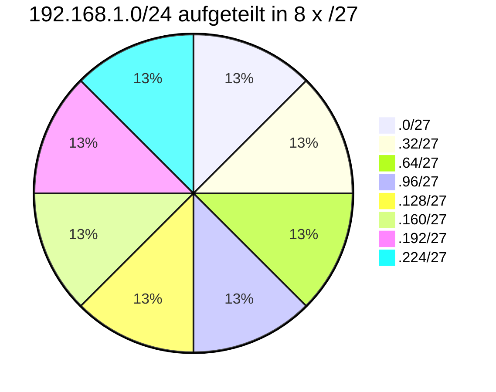

# Subnetting

> [!summary] Kurz & knapp
> Beim Subnetting teilt man ein großes Netz in mehrere kleinere **Subnetze**, indem man Hostbits zu Netzbits macht (längeres Präfix). Jedes Subnetz ist eine eigene **Broadcast-Domäne**. Das steigert die Performance, erleichtert die Übersicht und erlaubt Zugriffssteuerung.

## Vorteile von Subnetting (Tafelbild)
- **Netzperformance:** Ein Subnetz belastet nicht das ganze Netz, außer man will bewusst netzübergreifend arbeiten.
- **Broadcasts begrenzen:** Broadcasts, z. B. zur Anmeldung, bleiben im Subnetz. Ein Subnetz ist die Grenze einer Broadcast-Domäne, denn **ein Broadcast endet beim Router**.
- **Besserer Überblick:** Geräte lassen sich IPv4-Adressbereichen zuordnen (z. B. pro Abteilung oder Trakt) → die **Fehlersuche** wird erleichtert.
- **Zugriffsberechtigungen steuern:** Der Router/die Firewall zwischen den Subnetzen kann regeln, wer mit wem kommunizieren darf.

## Prinzip: Netz in gleich große Teile zerlegen
Beispiel aus dem Unterricht: **192.168.1.0/24** wird in **8 Subnetze /27** geteilt.
3 zusätzliche Netzbits → 2³ = 8 Subnetze, je 2⁵ = 32 Adressen (30 Hosts).

| Subnetz | Netzadresse | erste Host | letzte Host | Broadcast |
|---|---|---|---|---|
| 1 | 192.168.1.0 | .1 | .30 | .31 |
| 2 | 192.168.1.32 | .33 | .62 | .63 |
| 3 | 192.168.1.64 | .65 | .94 | .95 |
| 4 | 192.168.1.96 | .97 | .126 | .127 |
| 5 | 192.168.1.128 | .129 | .158 | .159 |
| 6 | 192.168.1.160 | .161 | .190 | .191 |
| 7 | 192.168.1.192 | .193 | .222 | .223 |
| 8 | 192.168.1.224 | .225 | .254 | .255 |

## Vorgehen
1. Wie viele Subnetze bzw. wie viele Hosts pro Subnetz werden gebraucht?
2. Zusätzliche Netzbits n bestimmen: 2ⁿ ≥ Anzahl Subnetze (bzw. Hostbits h: 2ʰ − 2 ≥ Hosts)
3. Neue Maske = altes Präfix + n
4. Blockgröße = 2^Hostbits → Netzadressen sind Vielfache der Blockgröße
5. Pro Subnetz [[Netzbestimmung in 6 Schritten|Netzbestimmung]] durchführen

> [!tip] Merke
> - Mehr Netzbits → mehr Subnetze, aber weniger Hosts pro Subnetz
> - Subnetz-Grenze = Broadcast-Grenze = Router
> - Alle Geräte eines Subnetzes brauchen dieselbe Maske und ein Gateway **im eigenen Subnetz**

## Lernfragen
> [!question]- Nenne drei Vorteile von Subnetting.
> Weniger Netzlast (Broadcasts bleiben im Subnetz), bessere Übersicht und leichtere Fehlersuche, Zugriffssteuerung zwischen Subnetzen.

> [!question]- In wie viele /26-Netze lässt sich ein /24-Netz teilen und wie viele Hosts haben sie?
> 2² = 4 Subnetze mit je 2⁶ − 2 = 62 Hosts.

> [!question]- Warum endet ein Broadcast beim Router?
> Router leiten Broadcasts nicht in andere Netze weiter. Jedes Subnetz ist eine eigene Broadcast-Domäne.

> [!question]- Zu welchem /27-Subnetz gehört 192.168.1.100?
> Blockgröße 32: 96–127 → Netz 192.168.1.96/27, Broadcast .127.

## Siehe auch
- [[Subnetzmaske und CIDR-Notation]]
- [[Netzbestimmung in 6 Schritten]]
- [[VLAN]]
- [[Routing und Default Route]]
- [[Übung Subnetting Patiententrakt]]
