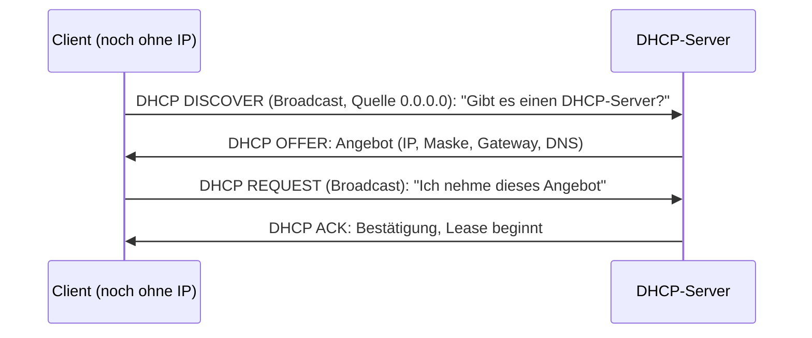

# DHCP (Dynamic Host Configuration Protocol)

> [!summary] Kurz & knapp
> DHCP verteilt **automatisch** die Netzwerkkonfiguration an Clients: **IPv4-Adresse, Subnetzmaske, Standardgateway und DNS-Server**. Ein neuer Client sucht den DHCP-Server per **Broadcast** (DHCP DISCOVER), weil er noch keine IP-Adresse hat. Der Ablauf heißt **DORA**: Discover, Offer, Request, Acknowledge.

## Ablauf (DORA)

| Nachricht | Bedeutung (Tafelbild) |
|---|---|
| DHCP DISCOVER | Erkennen (Suchen) des DHCP-Servers per Broadcast, mit der MAC-Adresse des Clients |
| DHCP OFFER | Angebot(e) vom DHCP-Server |
| DHCP REQUEST | Client fordert das gewählte Angebot an |
| DHCP ACK | Server bestätigt, die Adresse ist für die Lease-Dauer vergeben |

## Beispiel aus dem Tafelbild (Netz 172.16.0.0/22)
Ein DHCP-OFFER enthält z. B.:
- IPv4-Adresse: **172.16.0.25/22**
- Subnetzmaske: **255.255.252.0**
- Gateway: **172.16.0.1**
- DNS-Server: z. B. 88.134.42.107

Ein /22-Netz hat 2¹⁰ − 2 = **1022** vergebbare Adressen.

## Technische Eckdaten
- Transport über **UDP**: Server Port **67**, Client Port **68**
- Adressen werden für eine bestimmte Zeit **verliehen (Lease)** und müssen verlängert werden
- Bekommt ein Client keine Antwort, vergibt er sich selbst eine **APIPA**-Adresse (169.254.x.x), siehe [[Private und reservierte IPv4-Adressen]]
- Feste Zuordnung einer IP zu einer MAC-Adresse ist als **Reservierung** möglich

## Sicherheitsrisiko
Weil Clients jedem antwortenden DHCP-Server vertrauen, kann ein Angreifer einen **falschen DHCP-Server** einschleusen, siehe [[DHCP-Starvation-Angriff]]. Schutz: **DHCP-Snooping** auf dem Switch, Port-Security.

> [!info] DHCP-Fragebogen
> Zum DHCP gab es einen Fragebogen auf CryptPad (Link im Original, PDF-Seite 31). Die Antworten sind **nicht** im PDF enthalten.

> [!tip] Merke
> - DHCP verteilt IP, Maske, Gateway, DNS
> - DORA: Discover → Offer → Request → Ack
> - Discover per Broadcast, da der Client noch keine IP hat
> - UDP-Ports 67 (Server) / 68 (Client)

## Lernfragen
> [!question]- Welche Informationen erhält ein Client per DHCP mindestens?
> IP-Adresse, Subnetzmaske, Standardgateway, DNS-Server (und die Lease-Dauer).

> [!question]- Nenne die vier Schritte von DHCP in der richtigen Reihenfolge.
> DISCOVER, OFFER, REQUEST, ACK (DORA).

> [!question]- Warum verschickt der Client die DISCOVER-Nachricht als Broadcast?
> Er hat noch keine IP-Adresse und kennt den DHCP-Server nicht.

> [!question]- Ein Client hat die Adresse 169.254.3.4. Was ist los?
> Kein DHCP-Server hat geantwortet, der Client hat sich per APIPA selbst eine Adresse gegeben.

> [!question]- Welche Ports und welches Transportprotokoll nutzt DHCP?
> UDP, Server-Port 67, Client-Port 68.

## Siehe auch
- [[DHCP-Starvation-Angriff]]
- [[MAC-Broadcast und Multicast]]
- [[DNS]]
- [[UDP]]
