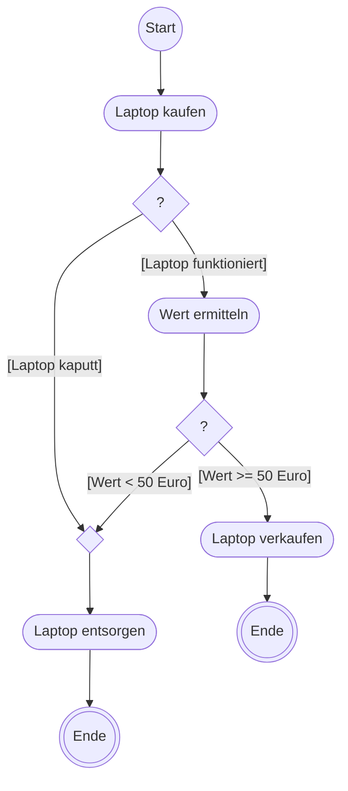

# UML-Aktivitätsdiagramm

> [!summary] Kurz & knapp
> Ein Aktivitätsdiagramm (UML) stellt einen **Ablauf** dar: welche Aktionen in welcher Reihenfolge passieren, wo verzweigt wird (Entscheidung) und was parallel läuft (Gabelung/Vereinigung). Mit **Verantwortungsbereichen** (Swimlanes) zeigt man zusätzlich, wer welche Aktion ausführt.

## Elemente

| Symbol | Name | Bedeutung |
| --- | --- | --- |
| ● ausgefüllter Kreis | **Startknoten** | Beginn der Aktivität |
| ◉ Kreis mit Punkt | **Endknoten** (Aktivitätsende) | beendet die **gesamte** Aktivität |
| ⊗ Kreis mit Kreuz | **Ablaufende** | beendet nur **diesen einen** Ablaufzweig, andere parallele Zweige laufen weiter |
| abgerundetes Rechteck | **Aktion** | ein einzelner Schritt, z. B. „Laptop kaufen“ |
| Raute ◇ | **Entscheidung / Zusammenführung** | Verzweigung mit Bedingungen in eckigen Klammern, den **Guards**, z. B. `[Wert < 50 Euro]` |
| dicker Balken | **Gabelung (Fork) / Vereinigung (Join)** | Fork: ab hier parallel. Join: wartet, bis alle eingehenden Zweige fertig sind |
| Rechteck (eckig) | **Objektknoten** | Objekt/Daten, die entstehen oder weitergegeben werden, z. B. „Bauabnahmebestätigung“ |
| kleines Quadrat an Aktion | **Pin** | Ein-/Ausgabeparameter einer Aktion, z. B. `PWD` |
| Pfeil | **Kontrollfluss / Objektfluss** | Reihenfolge |
| Spalten mit Überschrift | **Verantwortungsbereich (Swimlane)** | wer die Aktion ausführt, z. B. Anwender und Server |
| abgerundeter Rahmen mit Namen | **Aktivität** | umschließt das gesamte Diagramm, z. B. „UserLogin“ |

## Beispiel: Laptop

Die Raute links ist hier eine **Zusammenführung**: Zwei Wege („kaputt“ oder „zu wenig wert“) führen beide zu „Laptop entsorgen“.

## Beispiel mit Swimlanes: UserLogin
Das Beispiel aus dem Unterrichtsmaterial (Anwender und Server) zeigt Gabelung/Vereinigung (Passwort und Code parallel eingeben), Pins (`PWD`, `Code`), eine Schleife über `ErrorCount < 3` und ein Ablaufende ⊗ nach der Info-Mail:

![[LF5.pdf#page=16]]

> [!tip] Merke
> - **Guards** stehen in eckigen Klammern und müssen sich gegenseitig ausschließen, z. B. `[else]`.
> - **Endknoten** ◉ beendet alles, **Ablaufende** ⊗ nur einen Zweig.
> - Nach einem **Fork** muss irgendwo ein **Join** folgen, wenn beide Zweige fertig sein müssen.

## Lernfragen
> [!question]- Was ist der Unterschied zwischen Endknoten und Ablaufende?
> Der Endknoten beendet die gesamte Aktivität einschließlich aller parallelen Abläufe. Das Ablaufende beendet nur den Zweig, in dem es steht.

> [!question]- Wofür verwendet man Gabelung und Vereinigung?
> Die Gabelung (Fork) teilt den Ablauf in parallel laufende Zweige. Die Vereinigung (Join) wartet, bis alle eingehenden Zweige fertig sind, und führt sie dann zusammen.

> [!question]- Wie werden Bedingungen an einer Entscheidung notiert?
> Als Guards in eckigen Klammern an den ausgehenden Kanten, z. B. `[Laptop kaputt]` / `[Laptop funktioniert]`.

> [!question]- Wozu dienen Verantwortungsbereiche (Swimlanes)?
> Sie teilen das Diagramm in Spalten auf. Jede Spalte gehört einem Akteur oder System (z. B. Anwender, Server), so sieht man, wer welche Aktion ausführt.

> [!question]- Wie unterscheidet sich eine Aktion optisch von einem Objektknoten?
> Eine Aktion ist ein Rechteck mit abgerundeten Ecken, ein Objektknoten ein eckiges Rechteck.

## Siehe auch
- [[UML-Aufgabe Hausbau]]
- [[LF5 - Übersicht]]
