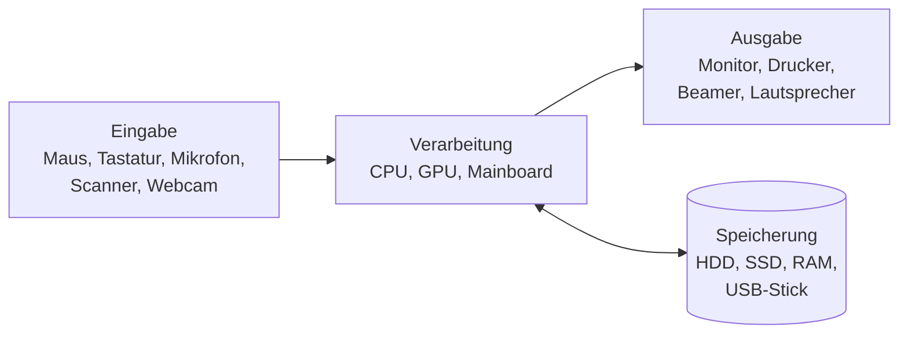

# Hardwarekategorien

> [!summary] Kurz & knapp
> Hardware lässt sich nach ihrer Aufgabe in vier Kategorien einteilen: **Eingabe**, **Verarbeitung**, **Ausgabe** und **Speicherung**. Das entspricht dem EVA-Prinzip (Eingabe, Verarbeitung, Ausgabe), ergänzt um die Speicherung.

## Die vier Kategorien

| Kategorie | Aufgabe | Beispiele |
| --- | --- | --- |
| **Eingabegeräte** | Daten/Befehle in den Computer bringen | Maus, Tastatur (Peripheriegeräte), Mikrofon, Scanner, Webcam |
| **Verarbeitungsgeräte** | Daten berechnen und verarbeiten | Prozessor (CPU), Grafikkarte (GPU), Mainboard |
| **Ausgabegeräte** | Ergebnisse für den Menschen ausgeben | Monitor, Drucker, Beamer, Lautsprecher |
| **Speichergeräte** | Daten kurz- oder langfristig ablegen | Festplatte (HDD), SSD, Arbeitsspeicher (RAM), USB-Sticks |

![[LF5.pdf#page=4]]

> [!note] Peripherie
> „Peripherie“ ist keine eigene Kategorie. Der Begriff meint alle Geräte, die **außen** an den Computer angeschlossen werden. Das können Eingabe- (Maus), Ausgabe- (Drucker) oder Speichergeräte (externe Festplatte) sein. Manche Geräte sind beides: Ein Touchscreen ist Ein- **und** Ausgabegerät.

## Speichergeräte im Vergleich: HDD und SSD

| | HDD (Hard Disk Drive) | SSD (Solid State Drive) |
| --- | --- | --- |
| Technik | magnetisch, rotierende Scheiben mit Schreib-/Lesekopf | Flash-Speicherzellen, keine beweglichen Teile |
| Geschwindigkeit | langsamer (mechanische Zugriffszeit) | deutlich schneller |
| Preis pro GB | günstig | teurer |
| Robustheit | stoßempfindlich | stoßunempfindlich, leise |
| Langzeitlagerung | gut für Archiv/Backup | ohne Strom über sehr lange Zeit Datenverlust möglich; begrenzte Schreibzyklen |

**RAM** ist **flüchtig**: Beim Ausschalten gehen die Daten verloren. Er hält Programm- und Prozessdaten bereit, auf die die CPU sehr schnell zugreifen muss. Wenig RAM bedeutet, dass ausgelagert werden muss (auf SSD/HDD), und dann wird der PC langsam.

> [!tip] Merke
> - **EVA**: Eingabe → Verarbeitung → Ausgabe, plus Speicherung.
> - Der Monitor ist ein Ausgabegerät, der Scanner ein Eingabegerät, der RAM ein (flüchtiger) Speicher.
> - Backups bei Servern: RAID schützt vor Plattenausfall, **ersetzt aber kein Backup**. Für Backups eignet sich z. B. ein NAS. Siehe [[RAID-Level]].

## Lernfragen
> [!question]- Nenne die vier Hardwarekategorien mit je einem Beispiel.
> Eingabe (Tastatur), Verarbeitung (CPU), Ausgabe (Monitor), Speicherung (SSD).

> [!question]- Zu welcher Kategorie gehört ein Touchscreen?
> Er ist Eingabe- und Ausgabegerät zugleich.

> [!question]- Erkläre den Unterschied zwischen HDD und SSD.
> Eine HDD speichert magnetisch auf rotierenden Scheiben. Sie ist günstiger pro GB, aber langsamer und stoßempfindlich. Eine SSD speichert in Flash-Zellen ohne bewegliche Teile. Sie ist deutlich schneller und robuster, aber teurer pro GB.

> [!question]- Warum ist der RAM wichtig für die Leistung eines Computers?
> Im RAM liegen die gerade benötigten Programme und Daten. Die CPU kann darauf viel schneller zugreifen als auf HDD/SSD. Ist zu wenig RAM vorhanden, muss ausgelagert werden, und das System wird langsam.

> [!question]- Was bedeutet „flüchtiger Speicher“?
> Der Speicher verliert seinen Inhalt, sobald die Stromversorgung wegfällt. Beispiel: RAM.

## Siehe auch
- [[Mainboard-Bestandteile]]
- [[RAID-Level]]
- [[Test Grundbegriffe Hardware und Software]]
- [[LF2 - Übersicht]]
