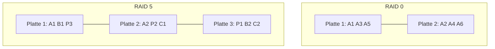

# RAID-Level

> [!summary] Kurz & knapp
> **RAID** (Redundant Array of Independent Disks) fasst mehrere Festplatten zu einem logischen Laufwerk zusammen. Je nach Level bringt das mehr **Geschwindigkeit** (RAID 0), mehr **Ausfallsicherheit** (RAID 1) oder beides bei guter Speichernutzung (RAID 5). RAID ist **kein Backup**.

## Die wichtigsten Level

| Level | Prinzip | Min. Platten | Nutzbare Kapazität | Ausfallsicherheit |
| --- | --- | --- | --- | --- |
| **RAID 0** (Striping) | Daten werden in Blöcke aufgeteilt und abwechselnd auf mehrere Platten geschrieben | 2 | 100 % (n × Größe) | **keine**: fällt eine Platte aus, sind alle Daten weg |
| **RAID 1** (Mirroring) | identische Kopie auf jeder Platte | 2 | 50 % (bei 2 Platten) | 1 Platte darf ausfallen |
| **RAID 5** (Striping mit Parität) | Daten **und Paritätsinformationen** verteilt auf alle Platten | 3 | (n − 1) × Größe | 1 Platte darf ausfallen |
| **RAID 10** (1+0) | gespiegelte Paare, die gestriped werden | 4 | 50 % | 1 Platte pro Spiegelpaar |

## RAID 5 gegenüber RAID 0
- **Datensicherheit:** RAID 5 übersteht den Ausfall **einer** Festplatte, RAID 0 keinen.
- **Effiziente Speichernutzung:** Für die Parität geht nur die Kapazität **einer** Platte verloren (z. B. 4 × 1 TB = 3 TB nutzbar).
- **Gute Leseleistung:** Gelesen wird parallel von mehreren Platten.
- Nachteil gegenüber RAID 0: Schreiben ist langsamer, weil die Parität berechnet werden muss.

> [!warning] RAID ist kein Backup
> RAID schützt nur vor dem **Hardwareausfall** einer Platte. Versehentliches Löschen, Ransomware oder Brand betreffen alle Platten gleichzeitig. Deshalb braucht man zusätzlich ein Backup, z. B. auf ein NAS oder extern (3-2-1-Regel).

> [!tip] Merke
> - 0 = **schnell, aber riskant**. 1 = **Spiegel**. 5 = **Parität, n − 1 nutzbar**.
> - Kapazität bei RAID 5: (Anzahl Platten − 1) × kleinste Plattengröße.
> - Verwaltet wird der Verbund vom **RAID-Controller** (Hardware) oder per Software.

## Lernfragen
> [!question]- Wofür steht RAID?
> Redundant Array of Independent Disks.

> [!question]- Wie viel nutzbaren Speicher hat ein RAID 5 aus 4 Platten à 2 TB?
> (4 − 1) × 2 TB = 6 TB.

> [!question]- Welche Vorteile hat RAID 5 gegenüber RAID 0?
> RAID 5 übersteht den Ausfall einer Platte (Parität), nutzt den Speicher trotzdem effizient (nur eine Platte für die Parität) und liest gut parallel. RAID 0 ist zwar schnell, hat aber keinerlei Redundanz.

> [!question]- Warum ersetzt ein RAID 1 kein Backup?
> Jede Änderung wird sofort gespiegelt, auch Löschungen, Verschlüsselung durch Schadsoftware oder Dateifehler. RAID schützt nur gegen den Ausfall einer Platte.

> [!question]- Was macht ein RAID-Controller?
> Er verwaltet die Festplatten im RAID-Verbund: Er verteilt die Daten, berechnet die Parität und baut den Verbund nach einem Plattentausch wieder auf (Rebuild).

## Siehe auch
- [[Server-Hardware]]
- [[Hardwarekategorien]]
- [[Test Server-Hardware]]
