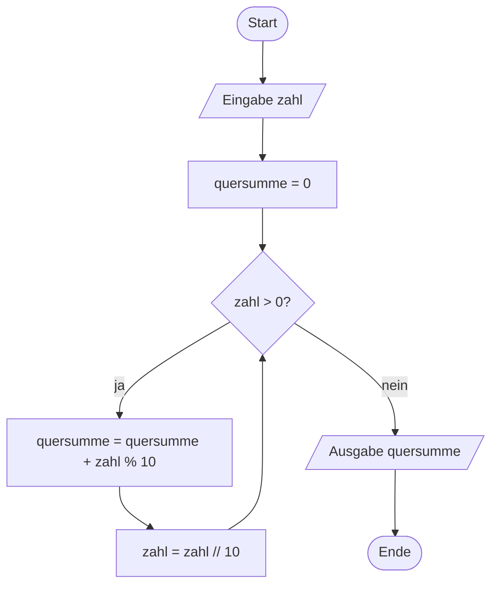
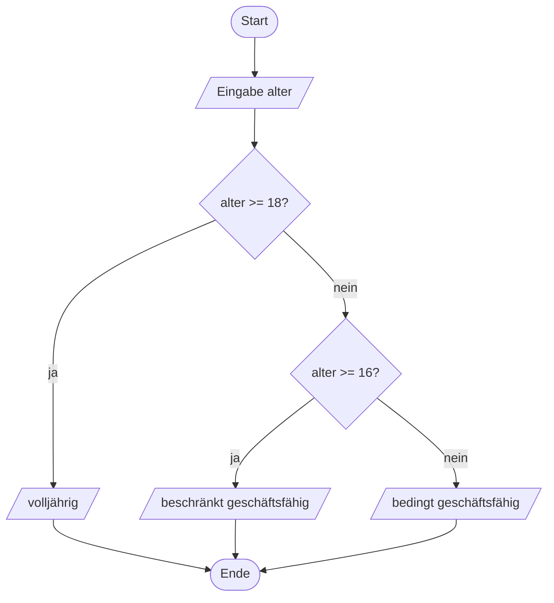

# Programmablaufplan und Flussdiagramm

> [!summary] Kurz & knapp
> Ein **Programmablaufplan (PAP)**, englisch **flowchart**, zeigt den Ablauf eines Programms grafisch **vor** dem Programmieren. Die Symbole sind in **DIN 66001** genormt. Jede Grundstruktur hat ein Gegenstück im Code: **Folge** (Anweisungen nacheinander), **Verzweigung** (`if`) und **Schleife** (`while`/`for`).

## Symbole

| Symbol | Bedeutung | englisch | Python |
| --- | --- | --- | --- |
| Oval / abgerundetes Rechteck | Start, Ende | terminator | Programmanfang/-ende |
| Rechteck | Verarbeitung | process | `summe = summe + zahl` |
| Parallelogramm | Ein-/Ausgabe | input/output | `input()`, `print()` |
| Raute | Verzweigung (ja/nein) | decision | `if`, Bedingung einer `while` |
| Pfeil | Ablaufrichtung | flow line | |
| Rechteck mit doppelten Seitenlinien | Unterprogramm | predefined process | Funktionsaufruf |

## Beispiel: Quersumme
PAP zu [[Übung Python Quersumme]]. Die Schleife erkennt man am Pfeil, der **zurück** vor die Raute führt.

## Beispiel: Verzweigung (Altersprüfung)

> [!tip] Merke
> - **oval** = Start/Ende, **Rechteck** = Verarbeitung, **Raute** = Entscheidung, **Parallelogramm** = Ein-/Ausgabe.
> - Eine Raute hat **genau zwei** beschriftete Ausgänge (ja/nein).
> - Eine Schleife ist im PAP eine Raute mit Rücksprung. Ein eigenes Schleifensymbol braucht man nicht.
> - Ähnliche Diagrammart in UML: [[UML-Aktivitätsdiagramm]].

## Lernfragen
> [!question]- Welches Symbol steht für `input()`?
> Das Parallelogramm (Ein-/Ausgabe).

> [!question]- Woran erkennt man im PAP eine Schleife?
> An einem Pfeil, der zu einer früheren Raute zurückführt.

> [!question]- Welche drei Grundstrukturen kennt die strukturierte Programmierung?
> Folge (Sequenz), Verzweigung (Auswahl) und Wiederholung (Schleife).

## Siehe auch
- [[Übung Flowcharts if-else und Zahlenraten]]
- [[Python Verzweigungen]]
- [[Python Schleifen for und while]]
- [[UML-Aktivitätsdiagramm]]
- [[LF5 - Übersicht]]
