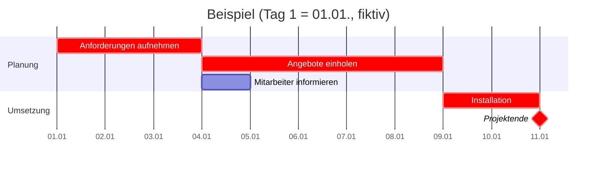

# Gantt-Diagramm

> [!summary] Kurz & knapp
> Ein **Gantt-Diagramm** (Balkendiagramm, nach Henry Gantt) stellt die **zeitliche Planung** eines Projekts dar. Links stehen die **Vorgänge**, rechts die **Zeitachse**. Jeder Vorgang ist ein **Balken** von Start bis Ende, die Länge entspricht der **Dauer**. Man sieht auf einen Blick, was wann und was parallel läuft. **Abhängigkeiten** werden als Pfeile, **Meilensteine** als Raute ◆ dargestellt.

## Aufbau

| Bestandteil | Bedeutung |
| --- | --- |
| **Vorgang** (Aufgabe, Arbeitspaket) | eine Tätigkeit mit Nummer und Bezeichnung, z. B. „2 Angebote einholen“ |
| **Zeitachse** | Tage, Wochen oder Kalenderdaten, waagerecht |
| **Balken** | Start (linkes Ende), Ende (rechtes Ende), Länge = **Dauer** |
| **Abhängigkeit** | Pfeil von einem Vorgang zum nächsten: B kann erst beginnen, wenn A fertig ist (Ende-Anfang-Beziehung) |
| **Meilenstein** ◆ | wichtiges Ereignis **ohne Dauer** (Dauer 0), z. B. „Projektabnahme“, „Arbeitsaufnahme“ |
| **Sammelvorgang** | fasst mehrere Vorgänge zu einer Phase zusammen |
| **Fortschritt** | teilweise gefüllter Balken zeigt, wie viel erledigt ist |

## Lesen eines Gantt-Diagramms
1. **Dauer** ablesen: Anzahl der Zeiteinheiten, die ein Balken überdeckt.
2. **Parallele Vorgänge**: Balken, die sich zeitlich überlappen, laufen gleichzeitig (z. B. Lieferung und Raumauswahl).
3. **Abhängigkeiten**: Ein Vorgang, der genau dort beginnt, wo ein anderer endet, hängt meist von ihm ab.
4. **Projektdauer**: vom Beginn des ersten bis zum Ende des letzten Vorgangs.
5. **Kritischer Pfad**: die längste Kette voneinander abhängiger Vorgänge.

## Kritischer Pfad und Puffer
- Der **kritische Pfad** ist die Folge von Vorgängen ohne **Puffer** (Zeitreserve). Verzögert sich ein kritischer Vorgang um einen Tag, verschiebt sich das **gesamte Projektende** um einen Tag.
- **Puffer** (Pufferzeit): wie lange sich ein nicht kritischer Vorgang verschieben darf, ohne das Projektende zu gefährden. Beispiel: Testen von Gerät 1 dauert 1 Tag, Gerät 2 dauert 2 Tage, beide laufen parallel und danach folgt die Lieferantenauswahl. Gerät 1 hat also 1 Tag Puffer.
- Kritische Vorgänge werden oft **rot** markiert.
- Genauer berechnet werden Puffer und kritischer Pfad im **Netzplan** (Vorgangsknoten mit FAZ, FEZ, SAZ, SEZ). Das Gantt-Diagramm ist dafür die **anschaulichere** Darstellung.

## Beispiel

„Mitarbeiter informieren“ hat 4 Tage Puffer, alle roten Vorgänge liegen auf dem kritischen Pfad.

## Vor- und Nachteile

| Vorteile | Nachteile |
| --- | --- |
| sehr anschaulich, auch für Nicht-Fachleute | Abhängigkeiten bei vielen Vorgängen unübersichtlich |
| Zeitplan und Parallelität sofort erkennbar | Puffer und kritischer Pfad nicht direkt ablesbar (besser: Netzplan) |
| einfach mit Excel oder MS Project zu erstellen | Ressourcen und Kosten sieht man nicht |
| Soll-Ist-Vergleich durch Fortschrittsbalken | bei Änderungen viel Nacharbeit (in Excel) |

> [!tip] Merke
> - Gantt = **Balken auf einer Zeitachse**. Länge = Dauer, Lage = Zeitraum.
> - **Meilenstein** = Dauer 0, Symbol ◆.
> - **Kritischer Pfad** = Vorgänge ohne Puffer. Jede Verzögerung dort verschiebt das Projektende.
> - Gantt zeigt die Planung **anschaulich**, der Netzplan **rechnet** Puffer exakt aus.

## Lernfragen
> [!question]- Was stellt die Länge eines Balkens im Gantt-Diagramm dar?
> Die Dauer des Vorgangs.

> [!question]- Was ist ein Meilenstein und wie wird er dargestellt?
> Ein wichtiges Ereignis ohne Dauer (z. B. Projektabnahme), dargestellt als Raute ◆.

> [!question]- Was passiert, wenn sich ein Vorgang auf dem kritischen Pfad um zwei Tage verzögert?
> Das Projektende verschiebt sich ebenfalls um zwei Tage, weil kritische Vorgänge keinen Puffer haben.

> [!question]- Woran erkennt man im Gantt-Diagramm parallele Vorgänge?
> Ihre Balken überlappen sich auf der Zeitachse.

> [!question]- Nenne einen Nachteil des Gantt-Diagramms gegenüber dem Netzplan.
> Abhängigkeiten und Pufferzeiten sind bei vielen Vorgängen schwer abzulesen. Der Netzplan berechnet sie exakt.

## Siehe auch
- [[Übung Gantt-Diagramm Einführung neuer Computer]]
- [[UML-Aktivitätsdiagramm]]
- [[LF5 - Übersicht]]
