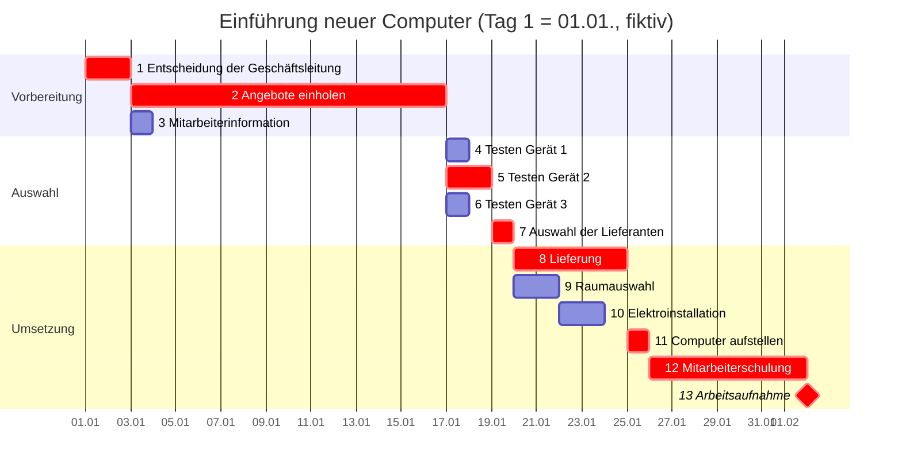

# Übung Gantt-Diagramm Einführung neuer Computer

> [!summary] Kurz & knapp
> Übung zum [[Gantt-Diagramm]]: Für die Einführung neuer Computerarbeitsplätze (Entscheidung, Angebote, Tests, Lieferung, Installation, Schulung) wurde in Excel ein Gantt-Diagramm mit 13 Vorgängen über rund 33 Tage erstellt. Der Plan ist schlüssig. Es fehlen Spaltenköpfe für die letzten Tage, und die Arbeitsaufnahme sollte ein Meilenstein sein.

## Aufgabe (rekonstruiert)
Die Aufgabenstellung liegt nicht vor. Aus der Tabelle ergibt sich: Erstelle zu den vorgegebenen Vorgängen 1 bis 13 ein Gantt-Diagramm mit einer Zeitachse in Tagen. Achte dabei auf die Reihenfolge und darauf, was parallel laufen kann.

## Eigene Lösung
Originale: [[Gantt-Diagramm.xlsx]] und PDF-Export

![[Gantt-Diagramm.pdf]]

### Abgelesen aus der Excel-Datei

| Nr. | Vorgang | Tage | Dauer |
| --- | --- | --- | --- |
| 1 | Entscheidung der Geschäftsleitung | 1–2 | 2 |
| 2 | Angebote einholen | 3–16 | 14 |
| 3 | Mitarbeiterinformation | 3 | 1 |
| 4 | Testen des Gerätes 1 | 17 | 1 |
| 5 | Testen des Gerätes 2 | 17–18 | 2 |
| 6 | Testen des Gerätes 3 | 17 | 1 |
| 7 | Auswahl der Lieferanten | 19 | 1 |
| 8 | Lieferung | 20–24 | 5 |
| 9 | Raumauswahl (im Original „Rahmauswahl“) | 20–21 | 2 |
| 10 | Elektroinstallation | 22–23 | 2 |
| 11 | Computer aufstellen | 25 | 1 |
| 12 | Mitarbeiterschulung | 26–32 | 7 |
| 13 | Arbeitsaufnahme | 33–37 (Spalten ohne Überschrift) | 5 |

### Als Mermaid-Gantt (mit Abhängigkeiten)
Tag 1 entspricht dem fiktiven Datum 01.01. Rot = kritischer Pfad.

## Auswertung
- **Abhängigkeiten** (aus der Lage der Balken abgeleitet): 1 → 2 → Tests 4/5/6 → 7 → Lieferung 8 und Raumauswahl 9 parallel → 9 → 10 → (8 und 10) → 11 → 12 → 13.
- **Kritischer Pfad:** 1 → 2 → 5 → 7 → 8 → 11 → 12 → 13 mit 2 + 14 + 2 + 1 + 5 + 1 + 7 = **32 Tage**. Die Arbeitsaufnahme erfolgt also an **Tag 33**.
- **Puffer:** Test Gerät 1 und 3 je 1 Tag. Raumauswahl und Elektroinstallation zusammen 1 Tag (fertig an Tag 23, Lieferung erst Tag 24). Die Mitarbeiterinformation hat viel Puffer: Sie muss nur vor der Schulung (Tag 26) stattfinden.
- Größter Hebel zur Verkürzung: „Angebote einholen“ (14 Tage) und die Schulung (7 Tage).

## Review
> [!warning] Korrektur
> - **Spaltenköpfe fehlen:** Die Balken von Vorgang 13 liegen in den Spalten nach „Tag 32“, die keine Überschrift haben. Im PDF erscheinen sie als einzelne Seite ohne Beschriftung. Die Zeitachse muss bis zum letzten Balken beschriftet sein (Tag 33 …).
> - **Arbeitsaufnahme ist ein Meilenstein:** Die Aufnahme des Regelbetriebs ist ein Ereignis ohne Dauer. Darstellung als Raute ◆ an Tag 33 statt eines 5-tägigen Balkens.
> - **Tippfehler:** „Rahmauswahl“ → Raumauswahl, „Arbeitsaufnhame“ → Arbeitsaufnahme, „Computeraufstellen“ → Computer aufstellen.

> [!tip] Verbesserung
> - Spalten **Start**, **Dauer** und **Vorgänger** ergänzen. Dann sind die Abhängigkeiten nachvollziehbar, und die Balken können mit bedingter Formatierung automatisch gefärbt werden (z. B. `=UND(Tag>=Start; Tag<Start+Dauer)`).
> - Den **kritischen Pfad** farblich hervorheben (z. B. kritische Vorgänge rot, andere grau).
> - Beim PDF-Export **Querformat** und „Auf eine Seite anpassen“ wählen. Sonst wird das Diagramm wie hier auf 5 Seiten verteilt.

## Zum Selbsttest
> [!question]- Die Lieferung verzögert sich um 2 Tage. Wann beginnt die Arbeitsaufnahme?
> Die Lieferung liegt auf dem kritischen Pfad, also verschiebt sich alles Folgende um 2 Tage: Arbeitsaufnahme an Tag 35.

> [!question]- Die Elektroinstallation verzögert sich um 1 Tag. Folgen?
> Keine. Sie endet dann an Tag 24, gleichzeitig mit der Lieferung. Der Puffer ist aufgebraucht, die Elektroinstallation ist jetzt aber ebenfalls kritisch.

> [!question]- Warum dürfen die drei Gerätetests parallel laufen?
> Sie hängen nicht voneinander ab, nur gemeinsam vom Vorliegen der Angebote. Erst die Lieferantenauswahl braucht alle drei Ergebnisse.

## Siehe auch
- [[Gantt-Diagramm]]
- [[LF5 - Übersicht]]
