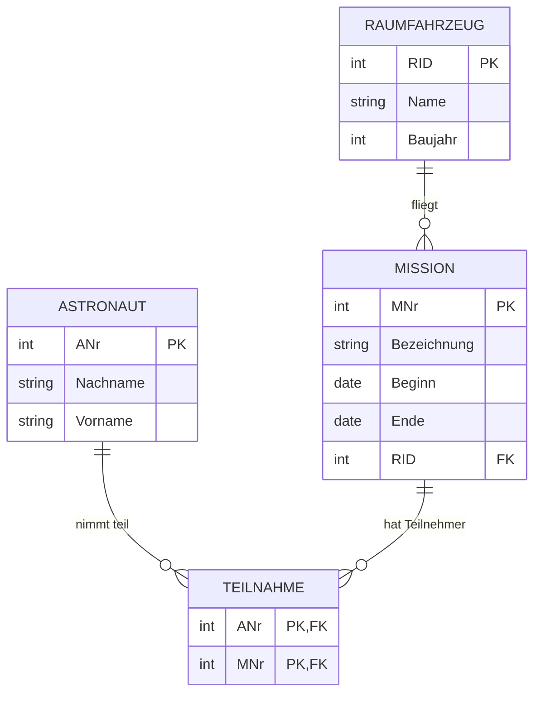

# ER-Modell in Tabellen überführen

> [!summary] Kurz & knapp
> Beim Übergang vom [[ER-Modell]] zum **relationalen Modell** (logische Phase) wird jede Entität zu einer Tabelle. Beziehungen werden je nach Kardinalität umgesetzt: **1:n** über einen **Fremdschlüssel auf der n-Seite**, **m:n** über eine **eigene Zwischentabelle** mit beiden Schlüsseln.

## Regeln

| Kardinalität | Umsetzung |
| --- | --- |
| Entität | eigene Tabelle; Schlüsselattribut wird **Primärschlüssel (PK)** |
| **1:1** | Fremdschlüssel in **einer** der beiden Tabellen (oder beide Tabellen zusammenlegen) |
| **1:n** | PK der **1-Seite** wird als **Fremdschlüssel (FK)** in die Tabelle der **n-Seite** aufgenommen |
| **m:n** | neue **Zwischentabelle** (Beziehungstabelle) mit den PKs beider Seiten als FKs. Zusammen bilden sie den **zusammengesetzten PK**. Attribute der Beziehung kommen ebenfalls hierhin |

## Beispiel: Astronaut – Mission – Raumfahrzeug

ER-Modell: Astronaut **m:n** Mission (Beziehung „nimmt teil“), Mission **n:1** Raumfahrzeug (Beziehung „hat“).

**Relationales Modell (Kurzschreibweise, PK unterstrichen, FK mit ↑):**
- Astronaut(<u>ANr</u>, Nachname, Vorname)
- Mission(<u>MNr</u>, Bezeichnung, Beginn, Ende, ↑RID)
- Raumfahrzeug(<u>RID</u>, Name, Baujahr)
- Teilnahme(<u>↑ANr, ↑MNr</u>)

> [!warning] Häufiger Fehler
> Eine m:n-Beziehung **nicht** über einen einfachen Fremdschlüssel lösen. Steht `ANr` als FK in `Mission`, kann jede Mission nur **einen** Astronauten haben. Das ist dann eine 1:n-Beziehung. Für m:n braucht man immer eine Zwischentabelle.

> [!tip] Merke
> - **1:n → FK auf die n-Seite** („das Viele zeigt auf das Eine“).
> - **m:n → Zwischentabelle** mit zusammengesetztem PK.
> - Danach wird das Modell [[Normalisierung|normalisiert]].

## Lernfragen
> [!question]- Wie wird eine 1:n-Beziehung in Tabellen umgesetzt?
> Der Primärschlüssel der 1-Seite kommt als Fremdschlüssel in die Tabelle der n-Seite.

> [!question]- Wie wird eine m:n-Beziehung umgesetzt?
> Über eine eigene Zwischentabelle. Sie enthält die Primärschlüssel beider Tabellen als Fremdschlüssel, die zusammen den Primärschlüssel bilden. Attribute der Beziehung werden ebenfalls dort gespeichert.

> [!question]- Kunde 1:n Bestellung: In welche Tabelle kommt der Fremdschlüssel?
> In die Tabelle Bestellung (n-Seite): `Bestellung(BestellNr, Datum, ↑KundenNr)`.

> [!question]- Warum ist `ANr` als Fremdschlüssel in der Tabelle `Mission` falsch, wenn Astronaut und Mission m:n verbunden sind?
> Dann kann jede Mission nur einen Astronauten speichern. Mehrere Astronauten pro Mission bräuchten doppelte Missionszeilen, also Redundanz. Richtig ist eine Zwischentabelle `Teilnahme(ANr, MNr)`.

## Siehe auch
- [[ER-Modell]]
- [[Relationale Datenbanken]]
- [[Normalisierung]]
- [[Kompetenzcheck ER-Modell]]
