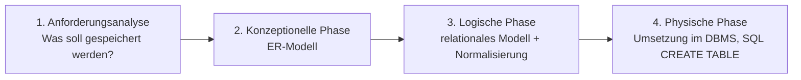

# ER-Modell

> [!summary] Kurz & knapp
> Das **Entity-Relationship-Modell (ERM)** beschreibt die Daten einer Anwendung grafisch und unabhängig von der Technik: **Entitäten** (Objekte), ihre **Attribute** und die **Beziehungen** zwischen ihnen mit **Kardinalitäten** (1:1, 1:n, m:n). Es entsteht in der **konzeptionellen Phase** des Datenbankentwurfs.

## Phasen des Datenbankentwurfs

- Die Phasen werden **nacheinander** durchlaufen, keine darf übersprungen werden.
- Am Ende steht eine **funktionstüchtige Datenbank**.
- Fehler in einer frühen Phase setzen sich fort: Aus einem schlechten logischen Design folgt eine schlechte physische Umsetzung.

## Elemente (Chen-Notation)

| Symbol | Element | Beispiel |
| --- | --- | --- |
| Rechteck | **Entitätstyp**: Klasse gleichartiger Objekte | Astronaut, Mission, Konto |
| Ellipse | **Attribut**: Eigenschaft | Nachname, Beginn |
| Ellipse mit **unterstrichenem** Namen | **Schlüsselattribut** (Primärschlüssel) | ANr, MNr |
| Raute | **Beziehungstyp** | nimmt teil, hat |
| Zahlen/Buchstaben an den Linien | **Kardinalität** | 1, n, m |

## Kardinalitäten

| Kardinalität | Bedeutung | Beispiel |
| --- | --- | --- |
| **1:1** | einem A ist genau ein B zugeordnet und umgekehrt | Person – Personalausweis |
| **1:n** | einem A sind viele B zugeordnet, jedem B genau ein A | Raumfahrzeug – Mission (ein Raumfahrzeug fliegt viele Missionen) |
| **m:n** | einem A sind viele B zugeordnet und umgekehrt | Astronaut – Mission |

So liest man es: „**Ein** Astronaut nimmt an **n** Missionen teil, an **einer** Mission nehmen **m** Astronauten teil.“

![[LF8.pdf#page=8]]

> [!note] Attribute an Beziehungen
> Auch Beziehungen können Attribute haben, z. B. **von wann bis wann** ein Musiker bei einer Veranstaltung auftritt (`Beginn`, `Ende` an der Beziehung „tritt auf“). Bei m:n-Beziehungen landen diese Attribute später in der Zwischentabelle.

> [!tip] Merke
> - **Substantive** im Text → Entitäten. **Verben** → Beziehungen. **Eigenschaften** → Attribute.
> - Jede Entität braucht einen **Schlüssel** (unterstrichen).
> - Kardinalitäten immer an **beide** Seiten der Beziehung schreiben.
> - ERM = konzeptionelle Phase, Normalisierung = logische Phase.

## Lernfragen
> [!question]- Welche Phasen hat der Datenbankentwurf und in welcher entsteht das ER-Modell?
> Anforderungsanalyse, konzeptionelle Phase, logische Phase, physische Phase. Das ER-Modell entsteht in der konzeptionellen Phase.

> [!question]- Welche Symbole verwendet die Chen-Notation für Entität, Attribut und Beziehung?
> Rechteck für die Entität, Ellipse für das Attribut (Schlüssel unterstrichen), Raute für die Beziehung.

> [!question]- Nenne ein Beispiel für eine m:n-Beziehung.
> Astronaut und Mission: Ein Astronaut nimmt an mehreren Missionen teil, an einer Mission nehmen mehrere Astronauten teil. Weitere Beispiele: Schüler – Kurs, Musiker – Veranstaltung.

> [!question]- In welcher Phase wird normalisiert?
> In der logischen Phase, nachdem das ER-Modell in ein relationales Modell überführt wurde.

> [!question]- Wie findet man in einem Aufgabentext Entitäten, Attribute und Beziehungen?
> Substantive, über die man Daten speichern will, sind Entitäten. Ihre Eigenschaften sind Attribute. Verben, die Entitäten verbinden, sind Beziehungen.

## Siehe auch
- [[ER-Modell in Tabellen überführen]]
- [[Relationale Datenbanken]]
- [[Normalisierung]]
- [[Kompetenzcheck ER-Modell]]
