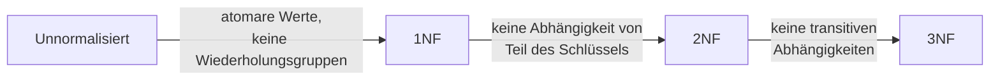

# Normalisierung

> [!summary] Kurz & knapp
> **Normalisierung** zerlegt Tabellen schrittweise so, dass **Redundanzen** und daraus folgende **Anomalien** (Einfüge-, Änderungs-, Löschanomalie) verschwinden. Sie gehört zur **logischen Phase** des Datenbankentwurfs. Für die Praxis reichen meist die ersten drei Normalformen (1NF, 2NF, 3NF).

## Warum normalisieren? Anomalien
Ausgangstabelle (nicht normalisiert): `Bestellungen(id, kunde_name, kunde_email, ort, plz, bestell_datum, produkt_name, produkt_preis)`

| Anomalie | Beispiel |
| --- | --- |
| **Einfügeanomalie** | Ein neues Produkt kann erst gespeichert werden, wenn jemand es bestellt. |
| **Änderungsanomalie** | Zieht ein Kunde um, muss der Ort in **allen** seinen Bestellungen geändert werden. Vergisst man eine Zeile, sind die Daten widersprüchlich. |
| **Löschanomalie** | Löscht man die einzige Bestellung eines Kunden, sind auch seine Kundendaten weg. |

## Die drei Normalformen

| Normalform | Bedingung | Vorgehen |
| --- | --- | --- |
| **1NF** | Alle Attributwerte sind **atomar**, es gibt keine Wiederholungsgruppen (Listen in einer Zelle). | Mehrfachwerte in eigene Zeilen auflösen, zusammengesetzte Werte aufteilen (Name → Vorname, Nachname); Primärschlüssel festlegen |
| **2NF** | 1NF **und** jedes Nichtschlüsselattribut hängt vom **gesamten** Primärschlüssel ab, nicht nur von einem Teil. | Nur relevant bei **zusammengesetztem** Schlüssel: Attribute, die nur von einem Schlüsselteil abhängen, in eigene Tabelle auslagern |
| **3NF** | 2NF **und** kein Nichtschlüsselattribut hängt **transitiv** (über ein anderes Nichtschlüsselattribut) vom Schlüssel ab. | Attribute, die von einem Nichtschlüsselattribut abhängen (z. B. PLZ → Ort), in eigene Tabelle auslagern |

## Kurzbeispiel Länder und Flüsse
- **Unnormalisiert:** `Land(LandID, "Deutschland/Berlin", "Donau, Rhein, Elbe …")`. Name/Hauptstadt ist zusammengesetzt, die Flüsse stehen als Liste in einer Zelle.
- **1NF:** pro Land-Fluss-Kombination eine Zeile, Schlüssel `(LandID, Flussname)`
- **2NF:** `Name` und `Hauptstadt` hängen nur von `LandID` ab, `Länge` nur von `Flussname`. Das ergibt die Tabellen `Land`, `Fluss`, `LandFluss`.
- **3NF:** keine transitiven Abhängigkeiten mehr, fertig

Die ausführliche Lösung steht in [[Übungsaufgaben]].

## Merksatz
> „Jedes Nichtschlüsselattribut hängt ab **vom Schlüssel (1NF), vom ganzen Schlüssel (2NF) und von nichts als dem Schlüssel (3NF)**.“

> [!tip] Merke
> - 1NF = **atomar**
> - 2NF = **voll funktional abhängig** vom ganzen Schlüssel. Hat eine Tabelle nur einen einfachen PK und ist sie in 1NF, ist sie automatisch in 2NF.
> - 3NF = **keine transitive Abhängigkeit**, z. B. PLZ → Ort auslagern
> - Ergebnis: mehr Tabellen, verknüpft über Fremdschlüssel, ohne Redundanz

## Lernfragen
> [!question]- Welches Ziel hat die Normalisierung?
> Redundanzen vermeiden und damit Einfüge-, Änderungs- und Löschanomalien verhindern. Die Datenbank bleibt konsistent.

> [!question]- Wann ist eine Tabelle in der 1. Normalform?
> Wenn alle Attributwerte atomar sind und es keine Wiederholungsgruppen gibt, also keine Listen oder zusammengesetzten Werte in einer Zelle.

> [!question]- Was verlangt die 2. Normalform und wann ist sie automatisch erfüllt?
> Jedes Nichtschlüsselattribut muss vom gesamten Primärschlüssel abhängen. Bei einem einfachen (nicht zusammengesetzten) Primärschlüssel ist das in 1NF automatisch erfüllt.

> [!question]- Was ist eine transitive Abhängigkeit? Nenne ein Beispiel.
> Ein Nichtschlüsselattribut hängt über ein anderes Nichtschlüsselattribut vom Schlüssel ab. Beispiel: KundenNr → PLZ → Ort. Ort hängt eigentlich von der PLZ ab, deshalb wird `PLZ, Ort` ausgelagert (3NF).

> [!question]- Nenne die drei Anomalien und erkläre eine davon.
> Einfüge-, Änderungs- und Löschanomalie. Beispiel Löschanomalie: Löscht man die letzte Bestellung eines Kunden, gehen auch dessen Kundendaten verloren, weil sie nur in der Bestelltabelle stehen.

> [!question]- In welcher Phase des Datenbankentwurfs wird normalisiert?
> In der logischen Phase, nach der Überführung des ER-Modells in das relationale Modell.

## Übungen
- [[Übungsaufgaben]]: Länder und Flüsse (1NF bis 3NF mit ausführlicher Lösung), Mitglieder und Kontakt
- [[Datenbank Aufgaben]]: Bestellungen in die Tabellen Kunde, Produkt und Bestellung zerlegen

## Siehe auch
- [[Relationale Datenbanken]]
- [[ER-Modell in Tabellen überführen]]
- [[LF8 - Übersicht]]
