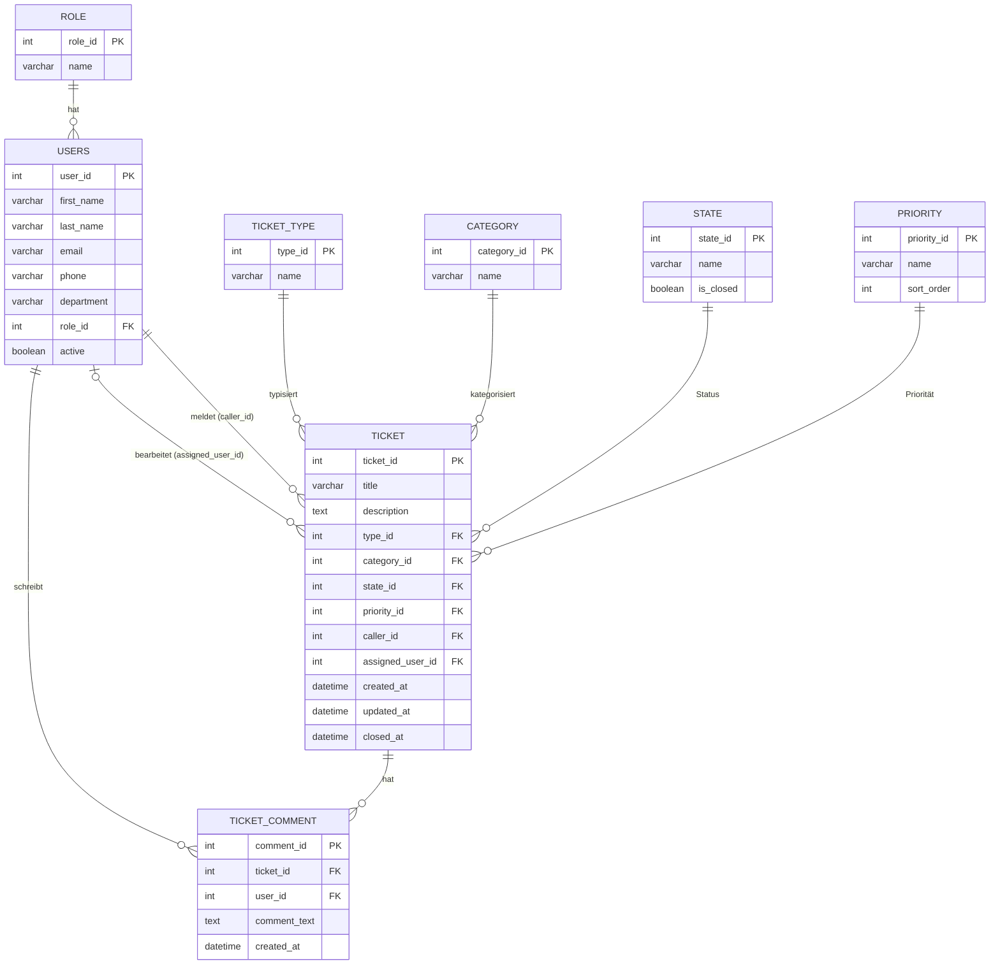

# Grobkonzept: IT-Ticketportal

> Zusammenfassung und Überarbeitung der Notizen aus [[Planung]].
> Gliederung nach den Phasen der Projektarbeit: **1. Informieren → 2. Planen → 3. Entscheiden**.
> Abschnitte mit ✏️ markieren Korrekturen bzw. Ergänzungen gegenüber den ursprünglichen Notizen.

---

## 1 · Informieren – Problembeschreibung und Anforderungen

### Welches Problem soll die Datenbank lösen?
Unsere IT-Abteilung bekommt derzeit alle Anliegen per E-Mail. Dadurch gehen viele Anfragen unter, es ist nicht klar, wer was bearbeitet, wie dringend etwas ist und wie der aktuelle Stand ist. Auswertungen (z. B. „Wie viele Tickets sind offen?“) sind praktisch unmöglich.

**Ziel:** Ein zentrales IT-Ticketportal, in dem jedes Anliegen als Ticket erfasst, einer Kategorie und Priorität zugeordnet, einem IT-Mitarbeiter zugewiesen und bis zum Abschluss nachverfolgt wird.

### Wer nutzt die Datenbank?
| Nutzergruppe | Aufgabe im System |
| --- | --- |
| **Mitarbeiter** (Melder) | erstellen Tickets und sehen den Status ihrer eigenen Tickets |
| **IT-Mitarbeiter** (Bearbeiter) | übernehmen Tickets, ändern Status/Priorität, dokumentieren die Lösung |
| **Administrator** | verwaltet Benutzer, Rollen und Stammdaten (Kategorien, Prioritäten …) |

### Welche Daten liegen vor, welche werden zusätzlich benötigt?
- **Vorhanden** (bisher in E-Mails): Absender, Betreff, Beschreibung des Problems, Datum.
- **Zusätzlich benötigt:** Typ (Störung/Anfrage), Kategorie, Priorität, Status, zuständiger Bearbeiter, Erstellungs-, Änderungs- und Abschlusszeitpunkt, strukturierte Kontaktdaten der Benutzer.

### Was soll mit den Daten geschehen? (Auswertungen)
- Liste aller **offenen Tickets**, sortiert nach Priorität und Alter
- **Meine Tickets** – je Mitarbeiter bzw. je Bearbeiter
- Anzahl Tickets **pro Kategorie / Typ / Status**
- **Durchschnittliche Bearbeitungsdauer** (Erstellung → Abschluss)
- **Arbeitslast** pro IT-Mitarbeiter (Anzahl zugewiesener offener Tickets)
- Nicht zugewiesene Tickets (Bearbeiter fehlt)

---

## 2 · Planen – Datenmodell

### ✏️ Korrekturen gegenüber den ursprünglichen Notizen
| Ursprünglich                                 | Problem                                                                                                   | Korrektur                                                                                                    |
| -------------------------------------------- | --------------------------------------------------------------------------------------------------------- | ------------------------------------------------------------------------------------------------------------ |
| eigene Tabellen `caller` und `assigned_user` | Das sind keine eigenen Entitäten, sondern nur **Rollen eines Benutzers** im Ticket → unnötige Tabellen    | Zwei **Fremdschlüssel** in `ticket`: `caller_id` und `assigned_user_id`, beide verweisen auf `users.user_id` |
| `contact` in `user`                          | **nicht atomar** (Name, Mail, Telefon in einem Feld)                                                      | aufgeteilt in `first_name`, `last_name`, `email`, `phone`, zusätzlich `department`                           |
| Datentypen „String, Integer“                 | reicht nicht – Zeitpunkte und lange Texte fehlen                                                          | `INT`, `VARCHAR(n)`, `TEXT`, `DATETIME`, `BOOLEAN` (siehe unten)                                             |
| „überwiegend atomar“                         | Ziel ist 1. Normalform → **vollständig** atomar                                                           | durch Aufteilen von `contact` erfüllt                                                                        |
| Schlüssel nur `user_id`, `ticket_id`         | Die Wertetabellen (type, category, …) brauchen ebenfalls Primärschlüssel; `ticket` braucht Fremdschlüssel | vollständige Schlüsselliste siehe unten                                                                      |
| „alles muss eingegeben werden außer der ID“  | Mehrere Werte werden automatisch gesetzt oder berechnet                                                   | siehe Abschnitt *Eingabe vs. Berechnung*                                                                     |
| Rollen nur `customer`, `admin`               | Normale IT-Mitarbeiter bräuchten sonst volle Adminrechte                                                  | drei Rollen: `employee`, `agent`, `admin`                                                                    |
| Priorität `middle`                           | unüblich, keine Sortierreihenfolge                                                                        | `medium`; zusätzliches Attribut `sort_order` (critical = 1 … low = 4)                                        |
| Tabellenname `user`                          | in vielen DBMS reserviertes Wort                                                                          | Tabelle heißt `users`                                                                                        |
| `short_information` / `information`          | unklare Bezeichnung                                                                                       | `title` / `description`                                                                                      |
| —                                            | Ticket hat keinen Zeitbezug                                                                               | `created_at`, `updated_at`, `closed_at` ergänzt                                                              |

### Tabellen, Attribute und Datentypen

**PK** = Primärschlüssel, **FK** = Fremdschlüssel

#### `ticket` (Kerntabelle)
| Attribut | Datentyp | Schlüssel | Pflicht | Bemerkung |
| --- | --- | --- | --- | --- |
| ticket_id | INT, AUTO_INCREMENT | PK | ja | automatisch |
| title | VARCHAR(150) | | ja | Kurzbeschreibung (Betreff) |
| description | TEXT | | ja | ausführliche Beschreibung |
| type_id | INT | FK → ticket_type | ja | Störung / Anfrage |
| category_id | INT | FK → category | ja | |
| state_id | INT | FK → state | ja | Standardwert: `new` |
| priority_id | INT | FK → priority | ja | Standardwert: `medium` |
| caller_id | INT | FK → users | ja | Melder, automatisch der angemeldete Benutzer |
| assigned_user_id | INT | FK → users | **nein** | bei neuen Tickets noch leer (NULL) |
| created_at | DATETIME | | ja | automatisch (aktueller Zeitpunkt) |
| updated_at | DATETIME | | ja | automatisch bei jeder Änderung |
| closed_at | DATETIME | | nein | wird beim Schließen gesetzt |

#### `users`
| Attribut | Datentyp | Schlüssel | Pflicht |
| --- | --- | --- | --- |
| user_id | INT, AUTO_INCREMENT | PK | ja |
| first_name | VARCHAR(50) | | ja |
| last_name | VARCHAR(50) | | ja |
| email | VARCHAR(100), UNIQUE | | ja |
| phone | VARCHAR(30) | | nein |
| department | VARCHAR(50) | | nein |
| role_id | INT | FK → role | ja |
| active | BOOLEAN | | ja (Standard: true) |

> Telefonnummern als `VARCHAR`, nicht als Zahl – sie enthalten führende Nullen, `+` und Leerzeichen und es wird nicht damit gerechnet.

#### Wertetabellen (Stammdaten / Lookup-Tabellen)
Alle haben den Aufbau `<name>_id INT PK` + `name VARCHAR(30) UNIQUE`.

| Tabelle | Datensätze | Zusatzattribut |
| --- | --- | --- |
| `ticket_type` | incident (Störung), request (Anfrage) | – |
| `category` | hardware, software, network, permissions | – |
| `state` | new, in progress, on hold, closed | `is_closed BOOLEAN` (nur `closed` = true) |
| `priority` | critical, high, medium, low | `sort_order INT` (1–4) |
| `role` | employee, agent, admin | – |

> **Warum Wertetabellen statt freiem Text?** Jeder Wert ist nur einmal gespeichert → keine Tippfehler oder Varianten („Netzwerk“ / „network“ / „Netz“), Änderungen nur an einer Stelle, und die Auswahl im Portal kann direkt aus der Tabelle befüllt werden.

#### ✏️ Ergänzung (optional): `ticket_comment`
Damit die Kommunikation zum Ticket nicht wieder per Mail läuft:

| Attribut | Datentyp | Schlüssel |
| --- | --- | --- |
| comment_id | INT, AUTO_INCREMENT | PK |
| ticket_id | INT | FK → ticket |
| user_id | INT | FK → users |
| comment_text | TEXT | |
| created_at | DATETIME | |

### Beziehungen und Kardinalitäten
Die Aussage „immer 1:n“ stimmt – es gibt keine m:n-Beziehung, die eine Zwischentabelle erfordern würde. Genauer:

| Beziehung | Kardinalität | Erklärung |
| --- | --- | --- |
| users (Melder) – ticket | 1 : n | ein Benutzer meldet beliebig viele Tickets, jedes Ticket hat genau einen Melder |
| users (Bearbeiter) – ticket | 1 : n (**optional**, 0..1 auf Ticketseite) | ein IT-Mitarbeiter bearbeitet viele Tickets, ein Ticket hat höchstens einen Bearbeiter |
| role – users | 1 : n | jeder Benutzer hat genau eine Rolle |
| ticket_type / category / state / priority – ticket | je 1 : n | jedes Ticket hat genau einen Wert je Wertetabelle |
| ticket – ticket_comment | 1 : n | ein Ticket kann viele Kommentare haben |
| users – ticket_comment | 1 : n | |

Zwischen `users` und `ticket` bestehen also **zwei getrennte Beziehungen**.

### ER-Diagramm



### Relationales Datenmodell (Kurzschreibweise)
- **ticket**(<u>ticket_id</u>, title, description, ↑type_id, ↑category_id, ↑state_id, ↑priority_id, ↑caller_id, ↑assigned_user_id, created_at, updated_at, closed_at)
- **users**(<u>user_id</u>, first_name, last_name, email, phone, department, ↑role_id, active)
- **role**(<u>role_id</u>, name)
- **ticket_type**(<u>type_id</u>, name)
- **category**(<u>category_id</u>, name)
- **state**(<u>state_id</u>, name, is_closed)
- **priority**(<u>priority_id</u>, name, sort_order)
- **ticket_comment**(<u>comment_id</u>, ↑ticket_id, ↑user_id, comment_text, created_at)

(<u>unterstrichen</u> = Primärschlüssel, ↑ = Fremdschlüssel)

### Eingabe vs. Berechnung
| Wird vom Benutzer eingegeben | Wird automatisch gesetzt | Wird berechnet (nicht gespeichert) |
| --- | --- | --- |
| title, description | ticket_id (AUTO_INCREMENT) | Bearbeitungsdauer = closed_at − created_at |
| Typ, Kategorie | created_at, updated_at | Alter eines offenen Tickets = jetzt − created_at |
| Priorität (vom Melder vorgeschlagen, vom IT-Mitarbeiter anpassbar) | caller_id (angemeldeter Benutzer) | Anzahl Tickets je Kategorie/Status/Bearbeiter |
| Bearbeiter, Status (durch IT-Mitarbeiter) | state = `new` als Standardwert | Durchschnittliche Bearbeitungsdauer |
| Benutzerdaten (durch Admin) | closed_at beim Statuswechsel auf `closed` | |

Berechenbare Werte werden **nicht gespeichert**, sonst könnten sie veralten und widersprüchlich werden.

### Vermeidung von Redundanz und Widersprüchen
- **Normalisierung bis zur 3. Normalform:** alle Attribute atomar (1. NF), einfache Primärschlüssel (2. NF automatisch erfüllt), keine transitiven Abhängigkeiten – z. B. steht der Name einer Kategorie nur in `category`, nicht in jedem Ticket (3. NF).
- **Fremdschlüssel mit referenzieller Integrität:** Ein Ticket kann nur auf existierende Benutzer, Kategorien usw. verweisen.
- **Constraints:** `NOT NULL` für Pflichtfelder, `UNIQUE` für E-Mail und Namen in Wertetabellen, Standardwerte (`DEFAULT`).
- **Benutzer nicht löschen, sondern deaktivieren** (`active = false`), damit alte Tickets ihren Melder/Bearbeiter behalten.

### Zugriffsrechte
| Recht | employee | agent | admin |
| --- | :---: | :---: | :---: |
| Ticket erstellen | ✅ | ✅ | ✅ |
| eigene Tickets ansehen / kommentieren | ✅ | ✅ | ✅ |
| alle Tickets ansehen | ❌ | ✅ | ✅ |
| Status, Priorität, Bearbeiter ändern | ❌ | ✅ | ✅ |
| Benutzer und Rollen verwalten | ❌ | ❌ | ✅ |
| Wertetabellen (Kategorien usw.) pflegen | ❌ | ❌ | ✅ |

### Zusätzliche Attribute für Sortierungen
Ja, erforderlich:
- `priority.sort_order` – damit „critical“ vor „high“ vor „medium“ vor „low“ sortiert wird (alphabetisch wäre die Reihenfolge falsch).
- `created_at` – Sortierung nach Alter (älteste offene Tickets zuerst).
- `state.is_closed` – einfache Filterung offener vs. geschlossener Tickets, auch wenn später weitere Status hinzukommen.

---

## 3 · Entscheiden – Lösungsweg

### Wahl des Datenbanksystems: MySQL / MariaDB
- **Relationales DBMS** passt, da die Daten klar strukturiert sind und über Schlüssel verknüpft werden.
- Unterstützt Fremdschlüssel, Constraints, `AUTO_INCREMENT`, `DEFAULT CURRENT_TIMESTAMP` und Benutzerrechte (`GRANT`).
- Kostenlos, weit verbreitet, einfach über **XAMPP / phpMyAdmin** einsetzbar und gut mit einem Web-Frontend (z. B. PHP) kombinierbar.
- Mehrbenutzerfähig – wichtig, da viele Mitarbeiter gleichzeitig Tickets erstellen.

### Wichtige Entwurfsentscheidungen
1. **Wertetabellen** statt Freitext für Typ, Kategorie, Status, Priorität und Rolle.
2. **Eine Benutzertabelle** für alle Nutzergruppen; Unterscheidung über die Rolle.
3. **Zwei Fremdschlüssel** von `ticket` auf `users` (Melder und Bearbeiter) statt eigener Tabellen.
4. **Zeitstempel** im Ticket als Grundlage für alle zeitlichen Auswertungen.
5. Berechnete Werte werden **per Abfrage** ermittelt, nicht gespeichert.

### Vorgesehene Auswertungen (Beispiel-SQL)
```sql
-- Offene Tickets nach Priorität und Alter
SELECT t.ticket_id, t.title, p.name AS priority, s.name AS state, t.created_at
FROM ticket t
JOIN priority p ON t.priority_id = p.priority_id
JOIN state s    ON t.state_id    = s.state_id
WHERE s.is_closed = FALSE
ORDER BY p.sort_order, t.created_at;

-- Anzahl Tickets je Kategorie
SELECT c.name, COUNT(*) AS anzahl
FROM ticket t JOIN category c ON t.category_id = c.category_id
GROUP BY c.name;

-- Durchschnittliche Bearbeitungsdauer in Stunden
SELECT AVG(TIMESTAMPDIFF(HOUR, created_at, closed_at)) AS avg_stunden
FROM ticket
WHERE closed_at IS NOT NULL;

-- Arbeitslast je IT-Mitarbeiter
SELECT u.first_name, u.last_name, COUNT(t.ticket_id) AS offene_tickets
FROM users u
JOIN role r ON u.role_id = r.role_id
LEFT JOIN ticket t ON t.assigned_user_id = u.user_id
     AND t.state_id IN (SELECT state_id FROM state WHERE is_closed = FALSE)
WHERE r.name = 'agent'
GROUP BY u.user_id, u.first_name, u.last_name;
```

### Umsetzungsplanung (Arbeitsschritte)
| Nr. | Arbeitsschritt | Ergebnis |
| --- | --- | --- |
| 1 | Grobkonzept fertigstellen und **abgeben** | abgenommenes Konzept |
| 2 | ER-Modell final prüfen (Kardinalitäten, Normalformen) | finales Datenmodell |
| 3 | Datenbank und Tabellen anlegen (`CREATE TABLE`, zuerst Wertetabellen, dann `users`, dann `ticket`) | leere Datenbank mit Constraints |
| 4 | Stammdaten einfügen (Typen, Kategorien, Status, Prioritäten, Rollen) | befüllte Wertetabellen |
| 5 | Testdaten einfügen (Benutzer, ca. 20–30 Tickets) | testbare Datenbank |
| 6 | Abfragen / Auswertungen erstellen und testen | SQL-Skripte |
| 7 | Benutzerrechte einrichten | Rechtekonzept umgesetzt |
| 8 | Tests (Integrität, Pflichtfelder, Fehlerfälle) | Testprotokoll |
| 9 | Dokumentation erstellen (Konzept übernehmen) | Projektdokumentation |
