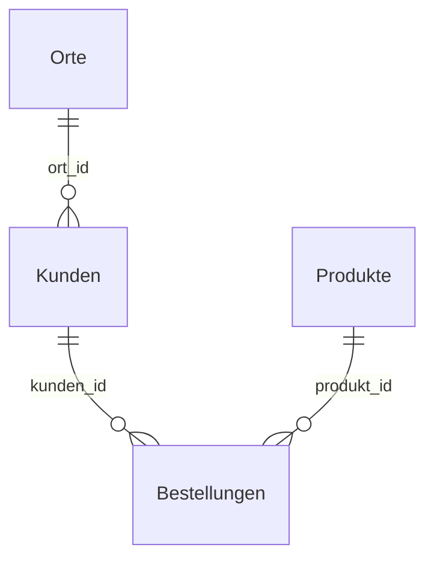

# SQL - SELECT und JOIN

> [!summary] Kurz & knapp
> `SELECT` liest Daten aus einer oder mehreren Tabellen. Die Grundform lautet **`SELECT Spalten FROM Tabelle WHERE Bedingung ORDER BY Spalte`**. Nach der [[Normalisierung]] sind die Daten auf mehrere Tabellen verteilt. Mit **`JOIN ... ON`** setzt man sie über **Primär- und Fremdschlüssel** wieder zusammen, z. B. in der Sicht `Bestelluebersicht`.

## Aufbau einer Abfrage
```sql
SELECT   name, preis          -- welche Spalten (* = alle)
FROM     Produkte             -- aus welcher Tabelle
WHERE    preis < 50           -- welche Zeilen
ORDER BY preis DESC;          -- Sortierung (ASC = aufsteigend, Standard)
```
Die Reihenfolge der Klauseln ist fest: `SELECT – FROM – WHERE – GROUP BY – HAVING – ORDER BY`.

## WHERE-Bedingungen
| Operator | Beispiel |
|---|---|
| `=`, `<>`, `<`, `>`, `<=`, `>=` | `WHERE plz = '24768'` |
| `AND`, `OR`, `NOT` | `WHERE preis > 10 AND preis < 50` |
| `BETWEEN a AND b` | `WHERE datum BETWEEN '2026-10-01' AND '2026-10-31'` |
| `IN (...)` | `WHERE ort IN ('Kiel', 'Rendsburg')` |
| `LIKE` mit `%` (beliebig viele Zeichen) und `_` (ein Zeichen) | `WHERE email LIKE '%@gmail.com'` |
| `IS NULL` / `IS NOT NULL` | `WHERE email IS NULL` |

## DISTINCT, Alias, Aggregatfunktionen
```sql
SELECT DISTINCT ort, plz FROM BestellungenRoh;   -- doppelte Zeilen nur einmal

SELECT name AS produkt, preis * 1.19 AS brutto   -- AS = Alias (Spaltenname im Ergebnis)
FROM Produkte;

SELECT COUNT(*) AS anzahl, AVG(preis) AS durchschnitt, MAX(preis), MIN(preis), SUM(preis)
FROM Produkte;
```

### GROUP BY und HAVING
```sql
-- Anzahl Bestellungen je Kunde, nur Kunden mit mehr als 1 Bestellung
SELECT kunden_id, COUNT(*) AS anzahl
FROM Bestellungen
GROUP BY kunden_id
HAVING COUNT(*) > 1;
```
`WHERE` filtert **Zeilen vor** dem Gruppieren, `HAVING` filtert **Gruppen danach**.

## JOIN – Tabellen verbinden


### INNER JOIN
Liefert nur Zeilen, zu denen es in **beiden** Tabellen einen passenden Partner gibt.
```sql
SELECT k.name, o.ort, o.plz
FROM Kunden k
INNER JOIN Orte o ON k.ort_id = o.ort_id;
```
- `k` und `o` sind **Tabellen-Aliase**, sie sparen Schreibarbeit.
- Nach `ON` steht die Verknüpfung: **Fremdschlüssel = Primärschlüssel**.
- `JOIN` allein bedeutet `INNER JOIN`.

### Mehrere Tabellen verbinden
```sql
SELECT k.name, k.email, o.ort, o.plz, p.name AS produkt, p.preis, b.datum
FROM Bestellungen b
JOIN Kunden   k ON b.kunden_id  = k.kunden_id
JOIN Orte     o ON k.ort_id     = o.ort_id
JOIN Produkte p ON b.produkt_id = p.produkt_id
ORDER BY b.datum;
```
Das ist der Inhalt der Sicht `Bestelluebersicht`: dieselbe Ansicht wie die alte Tabelle `BestellungenRoh`, aber ohne redundant gespeicherte Daten.

### LEFT JOIN
Liefert **alle** Zeilen der linken Tabelle, auch ohne Partner. Fehlende Werte werden `NULL`.
```sql
-- Kunden, die noch nie bestellt haben
SELECT k.name
FROM Kunden k
LEFT JOIN Bestellungen b ON k.kunden_id = b.kunden_id
WHERE b.bestell_id IS NULL;
```

| JOIN-Art | Ergebnis |
|---|---|
| `INNER JOIN` | nur Datensätze mit Partner in beiden Tabellen |
| `LEFT JOIN` | alle aus der linken Tabelle, rechts ggf. `NULL` |
| `RIGHT JOIN` | alle aus der rechten Tabelle (in SQLite erst ab Version 3.39) |
| `CROSS JOIN` | jede Zeile mit jeder kombiniert (kartesisches Produkt) |

> [!warning] JOIN ohne ON
> `SELECT * FROM Kunden, Orte;` ohne Bedingung kombiniert **jede** Zeile mit **jeder** (kartesisches Produkt). Bei 10 Kunden und 5 Orten sind das 50 Zeilen, fast alle falsch. Immer die Verknüpfung über die Schlüssel angeben.

> [!tip] Merke
> - `SELECT – FROM – WHERE – GROUP BY – HAVING – ORDER BY`
> - `DISTINCT` entfernt Duplikate, `AS` vergibt Aliase
> - `JOIN Tabelle ON FK = PK`
> - INNER = nur Treffer, LEFT = alle von links
> - Eine View speichert eine JOIN-Abfrage dauerhaft unter einem Namen

## Lernfragen
> [!question]- Gib alle Produkte aus, die mehr als 20 € kosten, absteigend nach Preis.
> ```sql
> SELECT name, preis FROM Produkte WHERE preis > 20 ORDER BY preis DESC;
> ```

> [!question]- Zeige zu jeder Bestellung den Kundennamen und das Produkt an.
> ```sql
> SELECT b.bestell_id, k.name, p.name AS produkt
> FROM Bestellungen b
> JOIN Kunden k   ON b.kunden_id  = k.kunden_id
> JOIN Produkte p ON b.produkt_id = p.produkt_id;
> ```

> [!question]- Was ist der Unterschied zwischen INNER JOIN und LEFT JOIN?
> INNER JOIN liefert nur Zeilen mit passendem Partner in beiden Tabellen. LEFT JOIN liefert alle Zeilen der linken Tabelle, fehlende Werte rechts sind NULL.

> [!question]- Was ist der Unterschied zwischen WHERE und HAVING?
> WHERE filtert einzelne Zeilen vor der Gruppierung, HAVING filtert die Gruppen nach GROUP BY (z. B. mit COUNT).

> [!question]- Wie viele Bestellungen hat jeder Kunde (mit Namen)?
> ```sql
> SELECT k.name, COUNT(b.bestell_id) AS anzahl
> FROM Kunden k
> LEFT JOIN Bestellungen b ON k.kunden_id = b.kunden_id
> GROUP BY k.kunden_id, k.name;
> ```

## Siehe auch
- [[SQL - DDL Tabellen und Schlüssel anlegen]]
- [[SQL - DML INSERT UPDATE DELETE]]
- [[Relationale Datenbanken]]
- [[Normalisierung]]
- [[Übung Normalisierung Bestellungen in SQLite]]
