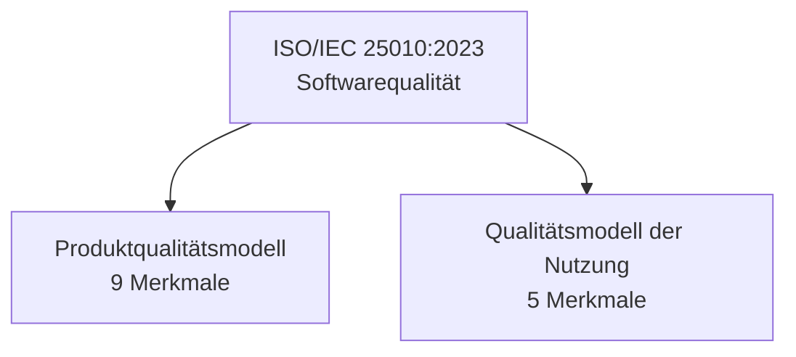

# ISO 25010 Produktqualität

> [!summary] Kurz & knapp
> Die Norm **ISO/IEC 25010:2023** definiert Softwarequalität international einheitlich. Sie besteht aus zwei Hauptkomponenten: dem **Produktqualitätsmodell** mit **9 Merkmalen** (Eigenschaften der Software selbst) und dem [[Qualitätsmodell der Nutzung]] mit 5 Merkmalen (Wirkung beim Anwender).

## Aufbau der Norm

## Die 9 Produktqualitätsmerkmale

| # | Merkmal (DE) | Englisch | Leitfrage |
| --- | --- | --- | --- |
| 1 | **Funktionale Eignung** | Functional Suitability | Erfüllt die Software die benötigten Funktionen (vollständig, korrekt, angemessen)? |
| 2 | **Leistungseffizienz** | Performance Efficiency | Wie gut nutzt sie Ressourcen und wie schnell arbeitet sie? |
| 3 | **Kompatibilität** | Compatibility | Kann sie mit anderen Systemen/Komponenten zusammenarbeiten und koexistieren? |
| 4 | **Benutzbarkeit / Interaktionsfähigkeit** | Interaction Capability | Wie einfach und verständlich ist die Nutzung? |
| 5 | **Zuverlässigkeit** | Reliability | Wie stabil, verfügbar und ausfallsicher ist sie? |
| 6 | **Sicherheit** | Security | Wie gut schützt sie Daten und Funktionen (Vertraulichkeit, Integrität, Authentizität)? |
| 7 | **Wartbarkeit** | Maintainability | Wie einfach lässt sie sich analysieren, ändern, testen und warten? |
| 8 | **Flexibilität** | Flexibility | Wie gut lässt sie sich an neue Umgebungen oder Anforderungen anpassen bzw. übertragen? |
| 9 | **Betriebssicherheit** | Safety | Wie gut vermeidet sie Gefahren für Menschen, Eigentum und Umwelt im Betrieb? |

> [!note] Security und Safety
> Im Deutschen heißen beide „Sicherheit“. **Security** (Informationssicherheit) schützt das System vor Angriffen und unberechtigtem Zugriff. **Safety** (Betriebssicherheit) schützt Menschen und Umwelt vor Gefahren, die vom System ausgehen, z. B. bei einer Steuerungssoftware.

> [!info] Alte und neue Version
> In der älteren ISO/IEC 25010:2011 gab es **8 Merkmale**, mit „Benutzbarkeit (Usability)“ und „Übertragbarkeit (Portability)“. Die Version **2023** nennt Usability jetzt *Interaction Capability*, ersetzt Portability durch *Flexibility* und ergänzt **Safety** als 9. Merkmal. Viele Lehrbücher nutzen noch die alten Begriffe.

## Anwendung
Ein ausführliches Beispiel für ein Grafana-Monitoring-Dashboard steht in [[Produktqualität am Beispiel Grafana]].

> [!tip] Merke
> Eselsbrücke für die 9 Merkmale: **F**unktion, **L**eistung, **K**ompatibilität, **B**enutzbarkeit, **Z**uverlässigkeit, **S**ecurity, **W**artbarkeit, **F**lexibilität, **S**afety.
> Produktqualität betrifft die **Software selbst**. Nutzungsqualität betrifft die **Wirkung beim Anwender**.

## Lernfragen
> [!question]- Aus welchen zwei Hauptkomponenten besteht die ISO/IEC 25010?
> Aus dem Produktqualitätsmodell (9 Merkmale) und dem Qualitätsmodell der Nutzung (5 Merkmale).

> [!question]- Nenne die 9 Produktqualitätsmerkmale nach ISO/IEC 25010:2023.
> Funktionale Eignung, Leistungseffizienz, Kompatibilität, Benutzbarkeit/Interaktionsfähigkeit, Zuverlässigkeit, Sicherheit (Security), Wartbarkeit, Flexibilität, Betriebssicherheit (Safety).

> [!question]- Was ist der Unterschied zwischen Security und Safety?
> Security schützt Daten und Funktionen vor unberechtigtem Zugriff und Angriffen. Safety (Betriebssicherheit) verhindert, dass vom System Gefahren für Menschen, Eigentum oder Umwelt ausgehen.

> [!question]- Ein Webshop lädt Produktseiten erst nach 8 Sekunden. Welches Merkmal ist verletzt?
> Leistungseffizienz (Performance Efficiency), genauer das Zeitverhalten.

> [!question]- Ein Programm lässt sich nur mit großem Aufwand ändern, weil der Code unübersichtlich ist. Welches Merkmal ist betroffen?
> Wartbarkeit (Maintainability).

## Siehe auch
- [[Qualitätsbegriff]]
- [[Qualitätsmodell der Nutzung]]
- [[Produktqualität am Beispiel Grafana]]
- [[LF8 - Übersicht]]
