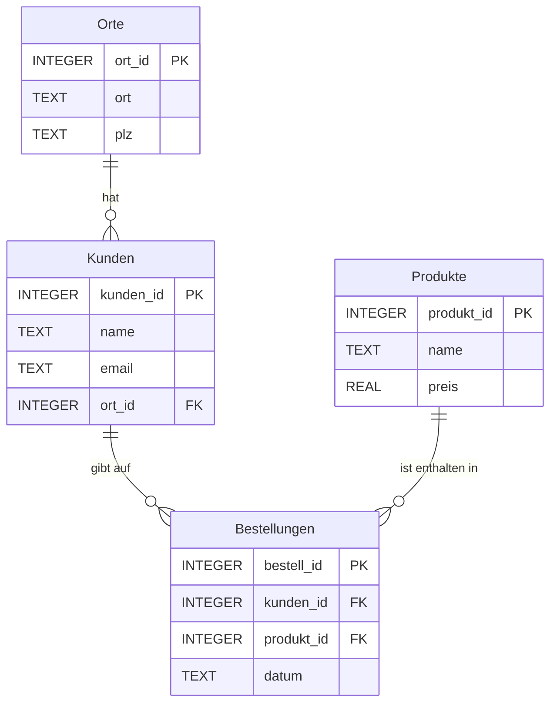

# Übung: Normalisierung Bestellungen in SQLite

> [!summary] Kurz & knapp
> Praktische Aufgabe aus Moodle: Die redundante Tabelle `BestellungenRoh` wird im **DB Browser for SQLite** untersucht, als relationales Modell dargestellt und bis zur **3NF** in die Tabellen `Kunden`, `Orte`, `Produkte` und `Bestellungen` zerlegt. Eine Sicht `Bestelluebersicht` setzt die Daten per JOIN wieder zusammen. Die eigenen Notizen zum Modell stehen in [[Datenbank Aufgaben]], die Theorie in [[Normalisierung]] und den SQL-Notizen.

## Aufgabenstellung
**Aufgabe 1 – Ausgangsmodell erstellen**
1. Tabelle `BestellungenRoh` und ihre Spalten untersuchen.
2. Relationales Modell der bestehenden Datenbank erstellen.
3. Attribute und vorhandene Schlüssel eintragen.

**Aufgabe 2 – Bis zur dritten Normalform normalisieren**
1. Ausgangsmodell schrittweise bis zur 3NF überarbeiten.
2. Änderungen dokumentieren und die Aufteilung begründen.
3. Primärschlüssel, Fremdschlüssel und Beziehungen kennzeichnen.

![[Pasted image 20261028104431.png]]
![[Pasted image 20261028105124.png]]

## Was in den Dateien steckt
| Datei | Inhalt |
|---|---|
| `normalisierung_redundant_angepasst.sqbpro` | DB-Browser-Projekt zur Datenbank `normalisierung_redundant_angepasst.db` (liegt nicht im Vault, nur im Download-Ordner). Geöffnet waren die Tabellen bzw. Sichten **BestellungenRoh** (8 Spalten), **Kunden** (4), **Orte** (3), **Produkte** (3) und **Bestelluebersicht** (7). Fremdschlüssel-Prüfung ist aktiv (`foreign_keys="1"`). Der SQL-Tab ist **leer**. |
| `new_try.db` | leere SQLite-Datenbank (Testversuch). Es gibt nur noch Reste einer gelöschten Testtabelle `CREATE TABLE notempty (id integer primary key)`. |
| `new_try.sqbpro` | leere Datei (0 Byte) |

> [!info] Kein eigenes SQL gespeichert
> Die Tabellen wurden offenbar über die grafische Oberfläche des DB Browsers angelegt oder das SQL wurde nicht gespeichert. Das SQL unten ist deshalb ein **Lösungsvorschlag**, passend zu den Tabellen im Projekt und zum Zielmodell aus Moodle.

## Aufgabe 1: Ausgangsmodell
**BestellungenRoh**

| Spalte | Beispielinhalt | Schlüssel |
|---|---|---|
| id | 1 | PK |
| kunde_name | Lena Meyer | |
| kunde_email | lena@example.de | |
| ort | Rendsburg | |
| plz | 24768 | |
| bestell_datum | 2026-10-28 | |
| produkt_name | Maus | |
| produkt_preis | 19.99 | |

Die Beispielwerte sind ausgedacht, die Original-Datenbank liegt nicht vor.

Relationales Modell: `BestellungenRoh(id, kunde_name, kunde_email, ort, plz, bestell_datum, produkt_name, produkt_preis)`. Einziger Schlüssel ist `id`, es gibt keine Fremdschlüssel.

**Probleme:** Name, E-Mail und Ort eines Kunden stehen in **jeder** seiner Bestellungen, Name und Preis eines Produkts in **jeder** Bestellung dieses Produkts. Das führt zu Änderungs-, Einfüge- und Löschanomalien (siehe [[Normalisierung]]).

## Aufgabe 2: Normalisierung
| Schritt | Befund | Maßnahme |
|---|---|---|
| **1NF** | Alle Werte sind atomar, es gibt keine Listen in einer Zelle. PK `id` vorhanden. | erfüllt |
| **2NF** | Einfacher PK `id`, also gibt es keine Teilabhängigkeiten. | automatisch erfüllt |
| **3NF** | **Transitive Abhängigkeiten:** `id → kunde_name → kunde_email, ort, plz`, `id → produkt_name → produkt_preis`, `plz → ort` | Kunden, Produkte und Orte in eigene Tabellen auslagern, über Fremdschlüssel verknüpfen |

### Eigener Entwurf (aus den Notizen)
| Bestellungen | Kunde | produkt |
|---|---|---|
| id | kunde_name | produkt_name |
| kunde_name | kunde_email | produkt_preis |
| bestell_datum | ort | |
| produkt_name | plz | |

> [!warning] Korrektur
> - **Keine künstlichen Schlüssel:** `kunde_name` und `produkt_name` dienen als Schlüssel. Namen sind **nicht eindeutig** (zwei Kunden „Max Müller“) und können sich ändern. Besser: `kunden_id` und `produkt_id` als PK.
> - **Schlüssel nicht gekennzeichnet:** PK und FK fehlen im Entwurf (Aufgabe 2.3). `Bestellungen.kunde_name` und `Bestellungen.produkt_name` wären die Fremdschlüssel.
> - **3NF noch nicht erreicht:** In `Kunde` hängt `ort` von `plz` ab (transitiv). Deshalb gehören `ort` und `plz` in eine eigene Tabelle `Orte`, `Kunden` bekommt den FK `ort_id`.
> - Tabellennamen einheitlich wählen (Plural, Großschreibung): `Kunden`, `Orte`, `Produkte`, `Bestellungen`.
>
> Laut DB-Browser-Projekt wurden `Kunden` (4 Spalten), `Orte` (3) und `Produkte` (3) in der Datenbank später genau so wie im Zielmodell umgesetzt. ✓

### Zielmodell (3NF)
| Tabelle | Attribute |
|---|---|
| **Orte** | <u>ort_id</u> (PK), ort, plz |
| **Kunden** | <u>kunden_id</u> (PK), name, email, ↑ort_id (FK → Orte) |
| **Produkte** | <u>produkt_id</u> (PK), name, preis |
| **Bestellungen** | <u>bestell_id</u> (PK), ↑kunden_id (FK → Kunden), ↑produkt_id (FK → Produkte), datum |



**Beziehungen:** Ein Ort hat viele Kunden (1:n), ein Kunde gibt viele Bestellungen auf (1:n), ein Produkt kommt in vielen Bestellungen vor (1:n). Der FK steht jeweils auf der n-Seite.

> [!note] Grenze des Modells
> Jede Bestellung enthält hier genau **ein** Produkt. Sollen mehrere Produkte in einer Bestellung möglich sein, ist Bestellung ↔ Produkt eine **m:n-Beziehung**. Dann braucht man eine Zwischentabelle `Bestellpositionen(↑bestell_id, ↑produkt_id, menge)` mit zusammengesetztem PK (siehe [[ER-Modell in Tabellen überführen]]).

## Lösungsvorschlag in SQL
> [!success]- 1. Tabellen anlegen (DDL)
> ```sql
> PRAGMA foreign_keys = ON;
>
> CREATE TABLE Orte (
>     ort_id INTEGER PRIMARY KEY,
>     ort    TEXT NOT NULL,
>     plz    TEXT NOT NULL
> );
>
> CREATE TABLE Kunden (
>     kunden_id INTEGER PRIMARY KEY,
>     name      TEXT NOT NULL,
>     email     TEXT UNIQUE,
>     ort_id    INTEGER NOT NULL REFERENCES Orte(ort_id)
> );
>
> CREATE TABLE Produkte (
>     produkt_id INTEGER PRIMARY KEY,
>     name       TEXT NOT NULL,
>     preis      REAL NOT NULL CHECK (preis >= 0)
> );
>
> CREATE TABLE Bestellungen (
>     bestell_id INTEGER PRIMARY KEY,
>     kunden_id  INTEGER NOT NULL REFERENCES Kunden(kunden_id),
>     produkt_id INTEGER NOT NULL REFERENCES Produkte(produkt_id),
>     datum      TEXT NOT NULL
> );
> ```

> [!success]- 2. Daten aus BestellungenRoh übernehmen (DML)
> ```sql
> INSERT INTO Orte (ort, plz)
> SELECT DISTINCT ort, plz FROM BestellungenRoh;
>
> INSERT INTO Kunden (name, email, ort_id)
> SELECT DISTINCT r.kunde_name, r.kunde_email, o.ort_id
> FROM BestellungenRoh r
> JOIN Orte o ON o.ort = r.ort AND o.plz = r.plz;
>
> INSERT INTO Produkte (name, preis)
> SELECT DISTINCT produkt_name, produkt_preis FROM BestellungenRoh;
>
> INSERT INTO Bestellungen (bestell_id, kunden_id, produkt_id, datum)
> SELECT r.id, k.kunden_id, p.produkt_id, r.bestell_datum
> FROM BestellungenRoh r
> JOIN Kunden   k ON k.email = r.kunde_email
> JOIN Produkte p ON p.name  = r.produkt_name;
> ```
> Die Reihenfolge ist wichtig: erst die Tabellen auf der 1-Seite, dann `Bestellungen`. Für die Zuordnung der Kunden wird die E-Mail genutzt, weil sie eindeutiger ist als der Name.

> [!success]- 3. Sicht Bestelluebersicht (SELECT mit JOIN)
> ```sql
> CREATE VIEW Bestelluebersicht AS
> SELECT k.name, k.email, o.ort, o.plz, p.name AS produkt, p.preis, b.datum
> FROM Bestellungen b
> JOIN Kunden   k ON b.kunden_id  = k.kunden_id
> JOIN Orte     o ON k.ort_id     = o.ort_id
> JOIN Produkte p ON b.produkt_id = p.produkt_id;
> ```
> Die 7 Spalten passen zur Sicht `Bestelluebersicht` im DB-Browser-Projekt.

> [!success]- 4. Prüfen
> ```sql
> -- gleiche Anzahl Zeilen wie vorher?
> SELECT (SELECT COUNT(*) FROM BestellungenRoh) AS roh,
>        (SELECT COUNT(*) FROM Bestelluebersicht) AS neu;
>
> -- Preisänderung jetzt an genau einer Stelle
> UPDATE Produkte SET preis = 21.99 WHERE name = 'Maus';
> ```
> Erst wenn beide Zahlen übereinstimmen, kann `BestellungenRoh` mit `DROP TABLE` entfernt werden.

## Lernfragen
> [!question]- Warum ist `kunde_name` als Primärschlüssel ungeeignet?
> Namen sind nicht eindeutig und können sich ändern. Ein künstlicher Schlüssel wie `kunden_id` ist eindeutig und bleibt stabil.

> [!question]- Welche transitive Abhängigkeit führt zur Tabelle `Orte`?
> `kunden_id → plz → ort`: Der Ort hängt von der PLZ ab, nicht direkt vom Kunden.

> [!question]- In welcher Reihenfolge müssen die Tabellen befüllt werden und warum?
> Orte, Kunden, Produkte, dann Bestellungen. Fremdschlüssel dürfen nur auf schon vorhandene Datensätze zeigen.

## Siehe auch
- [[Normalisierung]]
- [[Datenbank Aufgaben]]
- [[SQL - DDL Tabellen und Schlüssel anlegen]]
- [[SQL - DML INSERT UPDATE DELETE]]
- [[SQL - SELECT und JOIN]]
- [[ER-Modell in Tabellen überführen]]
