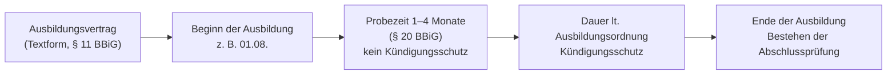

# Ausbildungsvertrag

> [!summary] Kurz & knapp
> Der Berufsausbildungsvertrag wird zwischen Ausbildendem (Betrieb) und Auszubildendem geschlossen und ist im **Berufsbildungsgesetz (BBiG)** geregelt. Sein wesentlicher Inhalt muss vor Beginn der Ausbildung schriftlich festgehalten werden (Mindestangaben nach **§ 11 BBiG**). Die Ausbildung beginnt mit der **Probezeit (1–4 Monate)** und endet mit dem **Bestehen der Abschlussprüfung**.

## Ablauf eines Ausbildungsverhältnisses

![[WIPO.pdf#page=5]]

## Formalien beim Vertragsabschluss

- **Form:** Niederschrift des wesentlichen Vertragsinhalts unverzüglich nach Vertragsschluss, spätestens vor Beginn der Ausbildung (§ 11 BBiG).
- **Inhalt:** Mindestangaben nach § 11 BBiG (siehe unten).
- **Eintragung** in das *Verzeichnis der Berufsausbildungsverhältnisse* bei der zuständigen Stelle (für IT-Berufe: IHK) – § 34 BBiG; der Ausbildende muss die Eintragung beantragen (§ 36 BBiG).
- **Unter 18 Jahren:** Bescheinigung über die ärztliche **Erstuntersuchung** muss vorliegen (§ 32 JArbSchG) → [[Jugendarbeitsschutzgesetz]]. Bei Minderjährigen unterschreiben zusätzlich die **gesetzlichen Vertreter** (Eltern).
- **Ausbildungsdauer:** laut Ausbildungsordnung; sie soll nicht mehr als drei und nicht weniger als zwei Jahre betragen (§ 5 BBiG).

> [!warning] Korrektur
> Auf dem älteren Arbeitsblatt (HOT 2/2008) steht „Form: Schriftform – elektronische Form ausgeschlossen“. Nach aktueller Fassung des § 11 BBiG (so auch auf der Folie aus dem Unterricht, [[WIPO.pdf#page=11]]) ist der Vertragsinhalt in **Textform** abzufassen und dem Azubi auszuhändigen – also z. B. auch als E-Mail/PDF möglich. Die **Kündigung** muss dagegen weiterhin **schriftlich** erfolgen (§ 22 Abs. 3 BBiG).

## Mindestangaben nach § 11 BBiG

| Nr. | Mindestangabe |
|---|---|
| 1 | Name und Anschrift von Ausbildendem und Auszubildendem (bei Minderjährigen auch der gesetzlichen Vertreter) |
| 2 | Art, sachliche und zeitliche Gliederung sowie Ziel der Berufsausbildung |
| 3 | Beginn und Dauer der Berufsausbildung |
| 4 | Ausbildungsmaßnahmen außerhalb der Ausbildungsstätte |
| 5 | Dauer der regelmäßigen täglichen Ausbildungszeit |
| 6 | Dauer der Probezeit |
| 7 | Zahlung und Höhe der Vergütung (inkl. Zusammensetzung) |
| 8 | Vergütung oder Ausgleich von Überstunden |
| 9 | Dauer des Urlaubs |
| 10 | Voraussetzungen, unter denen der Vertrag gekündigt werden kann |
| 11 | Hinweis auf anzuwendende Tarifverträge, Betriebs- oder Dienstvereinbarungen |
| 12 | Form des Ausbildungsnachweises (Berichtsheft) |

Im Unterricht wurden aus einem Beispielvertrag vor allem **Vergütung, Arbeitszeit, Urlaubstage und Anschrift** herausgesucht ([[WIPO.pdf#page=2]]).

## Probezeit und Kündigung

| Phase | Kündigung | Regel |
|---|---|---|
| **Probezeit** (mind. 1, max. 4 Monate, § 20 BBiG) | jederzeit, **ohne Grund**, **beidseitig**, **ohne Kündigungsfrist** | kein Kündigungsschutz |
| **Nach der Probezeit** – durch beide Seiten | nur aus **wichtigem Grund** | **fristlos** |
| **Nach der Probezeit** – nur durch den Azubi | bei **Aufgabe der Berufsausbildung** oder Wechsel in eine **andere Berufsausbildung** | Frist **4 Wochen** |

- Kündigung immer **schriftlich**, nach der Probezeit mit Angabe der Gründe (§ 22 BBiG).

## Ende der Ausbildung (§ 21 BBiG)

- Regulär mit **Ablauf der Ausbildungszeit**.
- Bei **vorzeitigem Bestehen** der Abschlussprüfung: mit Bekanntgabe des Ergebnisses durch den Prüfungsausschuss.
- **Nicht bestanden:** Verlängerung auf Verlangen des Azubis bis zur nächstmöglichen Wiederholungsprüfung, höchstens um ein Jahr.

> [!tip] Merke
> - Rechtsgrundlage: **BBiG**; Mindestinhalt: **§ 11 BBiG** (12 Punkte).
> - Probezeit **1–4 Monate** → jederzeit ohne Grund und ohne Frist kündbar.
> - Danach: Ausbildender nur noch aus **wichtigem Grund (fristlos)**; Azubi zusätzlich mit **4 Wochen Frist** bei Berufsaufgabe/-wechsel.
> - Ausbildung endet mit **Bestehen der Abschlussprüfung** (nicht erst am Vertragsende).

## Lernfragen
> [!question]- Welche Rechtsgrundlage regelt den Ausbildungsvertrag und wo stehen die Mindestangaben?
> Das Berufsbildungsgesetz (BBiG); die Mindestangaben stehen in § 11 BBiG.

> [!question]- Nenne fünf Mindestangaben eines Ausbildungsvertrags.
> Z. B. Art und Ziel der Ausbildung, Beginn und Dauer, tägliche Ausbildungszeit, Dauer der Probezeit, Höhe der Vergütung, Urlaubsdauer, Kündigungsvoraussetzungen, Hinweis auf Tarifverträge, Form des Ausbildungsnachweises.

> [!question]- Wie lange dauert die Probezeit und was gilt in dieser Zeit für die Kündigung?
> Mindestens 1, höchstens 4 Monate. Beide Seiten können jederzeit ohne Grund und ohne Kündigungsfrist kündigen (schriftlich).

> [!question]- Unter welchen Voraussetzungen kann ein Azubi nach der Probezeit kündigen?
> Fristlos aus wichtigem Grund oder mit einer Frist von 4 Wochen, wenn er die Berufsausbildung aufgibt oder eine andere Berufsausbildung beginnen will.

> [!question]- Ein Azubi besteht seine Abschlussprüfung im Juni, sein Vertrag läuft bis 31. Juli. Wann endet die Ausbildung?
> Mit der Bekanntgabe des Prüfungsergebnisses durch den Prüfungsausschuss (§ 21 Abs. 2 BBiG), also im Juni.

> [!question]- Was muss bei einem 17-jährigen Azubi zusätzlich vorliegen?
> Die Bescheinigung über die ärztliche Erstuntersuchung (JArbSchG) und die Unterschrift der gesetzlichen Vertreter.

## Siehe auch
- [[Rechte und Pflichten des Auszubildenden]]
- [[Jugendarbeitsschutzgesetz]]
- [[WiPo - Übersicht]]
